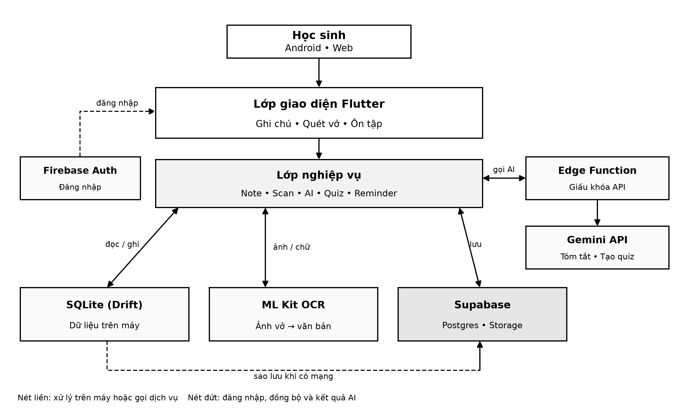
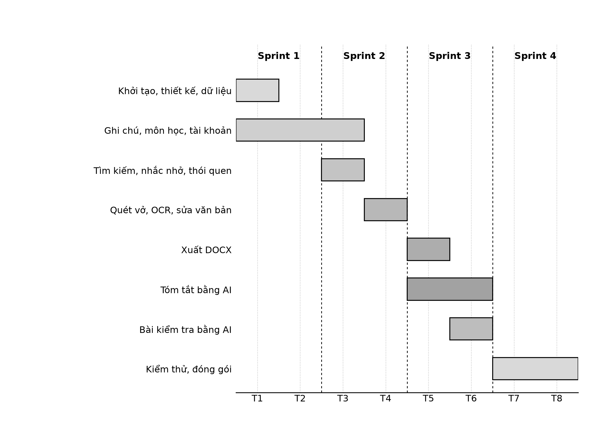

TRƯỜNG ĐẠI HỌC ....................................

KHOA CÔNG NGHỆ THÔNG TIN

ĐỀ CƯƠNG CHI TIẾT

DỰ ÁN CUỐI KỲ

Tên đề tài:

XÂY DỰNG ỨNG DỤNG
GHI CHÉP THÔNG MINH CHO HỌC SINH
TRÊN NỀN TẢNG DI ĐỘNG

| Học phần | Phát triển ứng dụng di động |
| --- | --- |
| Nhóm thực hiện | Nhóm 03 – Lớp 65KTPM |
| Giảng viên hướng dẫn | ............................................................ |
| Thời gian thực hiện | 16/11/2026 – 10/01/2027 |

THÀNH VIÊN THỰC HIỆN

| STT | Họ và tên | Vai trò |
| --- | --- | --- |
| 1 | Minh | Nhóm trưởng – Kiến trúc, dữ liệu, ghi chú |
| 2 | Đạt | Thành viên – Giao diện, xuất Word, bản Web |
| 3 | Hạnh | Thành viên – Môn học, tìm kiếm, nhắc nhở |
| 4 | Quân | Thành viên – Quét vở, OCR, AI |
| 5 | Đăng | Thành viên – Chia sẻ, kiểm thử, đóng gói |

Hà Nội, tháng 11 năm 2026

# 1. MỞ ĐẦU

## 1.1. Lý do chọn đề tài

Mỗi ngày đến lớp, học sinh phải ghi chép bài mới, làm bài tập và ghi lại việc cần học. Phần lớn các em vẫn dùng vở giấy. Vở giấy dễ viết nhưng khó tìm lại, khó sao lưu và không chia sẻ được cho bạn khi bạn nghỉ học. Khi gần đến kỳ thi, học sinh thường phải lật lại nhiều quyển vở, chụp ảnh hoặc gõ lại bài để ôn.

Trong học kỳ, nhóm đã phân tích và thiết kế ba ứng dụng: Daily You, SpeakWell và Ứng dụng Quản lý Tài liệu Học tập. Mỗi ứng dụng giải quyết một phần của việc học. Daily You giúp ghi nhật ký, nhắc việc và tạo thói quen. SpeakWell giúp luyện tập, làm bài kiểm tra và theo dõi tiến độ. Ứng dụng Quản lý Tài liệu giúp lưu tài liệu, tìm kiếm và chia sẻ.

Project cuối kỳ yêu cầu xây dựng một ứng dụng mới, có chức năng tương tự các ứng dụng đã làm. Nhóm chọn đề tài “Ghi Chép Thông Minh – ứng dụng ghi chú cho học sinh”. Ứng dụng cho phép ghi chú hằng ngày, quét vở giấy thành văn bản, xuất ra tệp Word (.docx), tóm tắt nội dung và tạo bài kiểm tra nhỏ bằng trí tuệ nhân tạo (AI). Như vậy, học sinh vừa giữ được thói quen ghi chép, vừa có thể tìm lại và ôn bài nhanh hơn.

Đề tài được thu hẹp để phù hợp với thời gian tám tuần của học phần. Ứng dụng tập trung vào bốn việc chính: ghi chú, quét vở, xuất Word và học lại bằng AI. Các chức năng khác chỉ làm ở mức cơ bản hoặc để dành cho phiên bản sau.

## 1.2. Mục đích của đề cương

Đề cương này trình bày kết quả đã làm trong học kỳ, lý do chọn ứng dụng ghi chú cho học sinh, và kế hoạch xây dựng ứng dụng trong tám tuần. Đề cương giúp cả nhóm hiểu thống nhất về mục tiêu, phạm vi, chức năng và cách làm việc trước khi bắt tay vào lập trình.

Đề cương gồm hai phần chính:

- Tổng hợp ba ứng dụng đã phân tích, thiết kế trong học kỳ và bài học rút ra.

- Xây dựng đề cương chi tiết cho ứng dụng Ghi Chép Thông Minh: mục tiêu, phạm vi, chức năng, kiến trúc, kế hoạch thực hiện và kiểm thử.

## 1.3. Cách thực hiện

Nhóm đọc lại báo cáo, đặc tả và mã nguồn của ba ứng dụng cũ. Sau đó, nhóm chọn những chức năng phù hợp với ứng dụng ghi chú, bỏ những chức năng quá khó hoặc không liên quan. Cuối cùng, nhóm viết đề cương và chia công việc theo tuần.

Quy trình gồm ba bước:

1. Bước 1 – Xem lại ba ứng dụng cũ, ghi ra chức năng nào có thể dùng lại.

2. Bước 2 – Chọn ứng dụng mới, xác định người dùng và các chức năng chính.

3. Bước 3 – Lập kế hoạch tám tuần, phân công và cách kiểm thử.

Phạm vi làm việc gồm năm thành viên, tám tuần, dùng các dịch vụ miễn phí. Thiết bị kiểm thử chính là điện thoại Android. Bản Web chỉ dùng để xem và sửa ghi chú ở mức cơ bản.

# 2. TỔNG HỢP CÁC ỨNG DỤNG ĐÃ LÀM TRONG HỌC KỲ

## 2.1. Ứng dụng Daily You

Daily You là ứng dụng nhật ký cá nhân, chạy trên điện thoại. Ứng dụng được viết bằng Flutter và lưu dữ liệu ngay trên máy. Người dùng có thể viết nhật ký mỗi ngày, thêm ảnh, đặt nhắc nhở và xem lại các ngày đã viết.

Ứng dụng có các chức năng đáng chú ý: ghi chú theo ngày, nhắc việc, thống kê số ngày đã viết, sao lưu và xuất dữ liệu. Điểm mạnh là dễ dùng, chạy được khi không có mạng và bảo vệ dữ liệu cá nhân. Điểm yếu là dữ liệu chỉ nằm trên một thiết bị, khó chia sẻ.

Ghi Chép Thông Minh học được từ Daily You cách tạo thói quen: mỗi ngày chỉ cần một ghi chú ngắn, có nhắc nhở và chuỗi ngày học liên tiếp. Cách làm này giúp học sinh duy trì việc ghi chép mà không thấy áp lực.

## 2.2. Ứng dụng SpeakWell

SpeakWell là ứng dụng luyện nói tiếng Anh. Người học nghe câu mẫu, thu âm và nhận phản hồi về cách phát âm. Ứng dụng có bài luyện theo chủ đề, mục tiêu mỗi ngày và trang tiến độ.

Điểm mạnh của SpeakWell là quy trình luyện tập rõ ràng: làm bài, nhận kết quả, xem lại chỗ sai và làm lại. Ứng dụng cũng có bộ kiểm thử lớn và giao diện tiến độ dễ hiểu. Hạn chế là phụ thuộc vào chất lượng nhận dạng giọng nói của điện thoại.

Ghi Chép Thông Minh dùng lại cách học này cho phần bài kiểm tra: AI tạo câu hỏi từ ghi chú, học sinh làm bài, nhận điểm và xem giải thích. Nhờ vậy, việc ôn bài có phản hồi ngay thay vì chỉ đọc lại.

## 2.3. Ứng dụng Quản lý Tài liệu Học tập

Đây là ứng dụng do nhóm thiết kế từ đầu. Ứng dụng cho phép đăng nhập, thêm tài liệu, đính kèm tệp, gắn tag, tìm kiếm, chia sẻ quyền xem hoặc chỉnh sửa và nhận thông báo. Dữ liệu được lưu trên Supabase, còn đăng nhập dùng Firebase.

Ứng dụng có mười lăm use case và mười hai bảng dữ liệu. Điểm mạnh là biết cách tổ chức tài liệu, phân quyền và bảo vệ dữ liệu bằng RLS (quy tắc bảo mật ở mức từng dòng dữ liệu). Điểm yếu là chưa đọc được nội dung bên trong ảnh hay tệp PDF.

Ghi Chép Thông Minh kế thừa cách quản lý tài liệu, tag, tìm kiếm và chia sẻ. Điểm mới là thêm bước quét vở giấy thành văn bản, rồi dùng AI để tóm tắt và tạo câu hỏi. Nhờ vậy, ứng dụng không chỉ lưu tài liệu mà còn giúp học sinh học lại từ tài liệu đó.

## 2.4. Bảng tổng hợp và bài học

Bảng 1 tóm tắt ba ứng dụng. Cột cuối ghi rõ bài học có thể dùng cho Ghi Chép Thông Minh.

Bảng 1. Tổng hợp ba ứng dụng đã làm trong học kỳ

| Ứng dụng | Chức năng chính | Điểm mạnh | Bài học cho Ghi Chép Thông Minh |
| --- | --- | --- | --- |
| Daily You | Nhật ký theo ngày, nhắc việc, thống kê, sao lưu | Dễ dùng, chạy offline, tạo thói quen | Ghi chú ngắn mỗi ngày, nhắc nhở, chuỗi ngày học |
| SpeakWell | Luyện nói, bài tập, chấm điểm, theo dõi tiến độ | Có phản hồi ngay, quy trình kiểm thử tốt | Bài kiểm tra, chấm điểm, xem giải thích, thống kê |
| Quản lý Tài liệu | Lưu tài liệu, tag, tìm kiếm, chia sẻ, thông báo | Quản lý dữ liệu tốt, phân quyền rõ ràng | Thư viện ghi chú, tag, tìm kiếm, chia sẻ |

Bài học chung là: ứng dụng học tập phải dễ dùng hằng ngày, phải chạy được khi mạng yếu, và phải giúp người học thấy tiến bộ. Ba ứng dụng cũ mỗi cái làm tốt một việc. Ghi Chép Thông Minh kết hợp các việc đó vào một quy trình nhỏ: ghi bài, quét vở, xuất Word, tóm tắt và làm bài kiểm tra.

# 3. ĐỀ CƯƠNG CHI TIẾT

## 3.1. Thông tin chung

Ghi Chép Thông Minh là ứng dụng mới, dùng lại một số chức năng của ba project trước và thêm bốn chức năng mới: quét vở, xuất Word, tóm tắt bằng AI và tạo bài kiểm tra bằng AI. Bảng 2 tóm tắt thông tin của dự án.

Bảng 2. Thông tin chung của dự án Ghi Chép Thông Minh

| Mục | Nội dung |
| --- | --- |
| Tên đề tài | Xây dựng ứng dụng Ghi Chép Thông Minh cho học sinh |
| Mã dự án | GC-03 |
| Loại dự án | Ứng dụng mới, dùng lại chức năng từ các project trước |
| Nhóm thực hiện | Nhóm 03 – Lớp 65KTPM, gồm 05 thành viên |
| Học phần | Phát triển ứng dụng di động |
| Công nghệ | Flutter; SQLite (Drift); Firebase Authentication; Supabase Postgres/Storage; ML Kit OCR; Gemini API; thư viện docx |
| Nền tảng | Android là chính; Web chỉ xem và sửa ghi chú ở mức cơ bản |
| Cách lưu dữ liệu | Lưu trên máy trước, sao lưu lên Supabase khi có mạng |
| Thời gian | 08 tuần, từ 16/11/2026 đến 10/01/2027 |
| Sản phẩm cuối | Mã nguồn, APK, tài liệu kỹ thuật, bộ kiểm thử, báo cáo và video demo |

## 3.2. Mục tiêu

### 3.2.1. Mục tiêu chung

Xây dựng một ứng dụng giúp học sinh ghi chú nhanh, chuyển vở giấy thành văn bản số, xuất ra tệp Word và dùng AI để tóm tắt, tạo bài kiểm tra. Ứng dụng phải dễ dùng, chạy được khi mạng yếu và không làm mất dữ liệu đã ghi.

### 3.2.2. Mục tiêu cụ thể

Bảng 3 trình bày sáu mục tiêu M1–M6. Mỗi mục tiêu đều có kết quả đo được để nhóm biết khi nào đã hoàn thành.

Bảng 3. Mục tiêu cụ thể của dự án

| Mã | Mục tiêu | Kết quả cần đạt |
| --- | --- | --- |
| M1 | Làm phần ghi chú: tạo, sửa, xóa, tự lưu; ghi nhật ký mỗi ngày; phân loại theo môn và tag; tìm kiếm. | Tạo và mở lại ghi chú đúng; không mất nội dung khi đóng ứng dụng; tìm thấy ghi chú theo tiêu đề hoặc nội dung. |
| M2 | Làm phần quét vở: chụp ảnh hoặc chọn ảnh, cắt ảnh, nhận dạng chữ, sửa văn bản và lưu. | Một trang vở rõ chữ được nhận dạng trong khoảng 5 giây; người dùng sửa được chữ sai; ảnh gốc được giữ lại. |
| M3 | Làm phần xuất Word: chọn một hoặc nhiều ghi chú, xuất ra tệp .docx có tiêu đề, môn và ngày. | Tệp mở được bằng Word hoặc Google Docs; nội dung tiếng Việt đúng; có thể chia sẻ tệp. |
| M4 | Làm phần tóm tắt bằng AI: tóm tắt ngắn, tóm tắt dài và gạch ý chính từ ghi chú. | Có kết quả trong khoảng 15 giây; lưu được kết quả; báo lỗi rõ khi mất mạng hoặc hết lượt gọi API. |
| M5 | Làm phần bài kiểm tra bằng AI: tạo 5–10 câu trắc nghiệm từ ghi chú, làm bài, chấm điểm và xem giải thích. | Câu hỏi bám nội dung; chấm đúng đáp án; lưu điểm; xem lại câu sai. |
| M6 | Làm phần nhắc nhở, thói quen và chia sẻ: nhắc học, chuỗi ngày học, thống kê tuần, chia sẻ ghi chú, sao lưu. | Nhắc đúng giờ; streak tăng đúng; biểu đồ khớp dữ liệu; người được chia sẻ chỉ xem được ghi chú đã chia sẻ. |

### 3.2.3. Mục tiêu học tập

Ngoài sản phẩm, nhóm đặt ra các mục tiêu học tập sau:

- Biết cách phân tích yêu cầu và viết đề cương trước khi làm ứng dụng.

- Biết tổ chức dữ liệu cục bộ, đồng bộ đám mây và bảo vệ dữ liệu bằng RLS.

- Biết dùng camera, thư viện ảnh và ML Kit để nhận dạng chữ.

- Biết gọi API AI qua máy chủ trung gian để giấu khóa bí mật.

- Biết kiểm thử, đóng gói APK và viết tài liệu bàn giao.

## 3.3. Phạm vi

### 3.3.1. Chức năng trong phạm vi

Phạm vi được chia thành ba mức. P0 là phần bắt buộc phải có. P1 là phần làm thêm nếu còn thời gian. P2 là phần để sau, không tính vào điểm nghiệm thu chính. Bảng 4 trình bày chi tiết.

Cách chia này giúp nhóm luôn có một bản chạy được. P0 phải xong trước mốc M3. P1 làm sau P0 và chỉ nhận khi P0 đã ổn định. P2 không đưa vào kế hoạch chính, tránh việc nhóm dàn trải rồi thiếu thời gian.

Bảng 4. Phạm vi chức năng của Ghi Chép Thông Minh

| Nhóm chức năng | Nội dung | Mức |
| --- | --- | --- |
| Ghi chú và nhật ký | Tạo, sửa, xóa, tự lưu; ghi chú theo môn; nhật ký mỗi ngày | P0 |
| Môn học, tag, tìm kiếm | Tạo môn, gắn tag, tìm theo tiêu đề và nội dung | P0 |
| Quét vở | Chụp ảnh, chọn ảnh, cắt ảnh, nhận dạng chữ, sửa văn bản, lưu ảnh gốc | P0 |
| Xuất Word | Xuất một hoặc nhiều ghi chú ra tệp .docx | P0 |
| Tóm tắt bằng AI | Tóm tắt ngắn, tóm tắt dài, gạch ý chính, lưu kết quả | P0 |
| Bài kiểm tra bằng AI | Tạo 5–10 câu trắc nghiệm, làm bài, chấm điểm, xem giải thích | P1 |
| Nhắc nhở và thói quen | Nhắc học, chuỗi ngày học, thống kê số ghi chú và số ngày học | P0 |
| Tài khoản, chia sẻ, sao lưu | Đăng nhập, chia sẻ ghi chú ở mức chỉ xem, sao lưu và khôi phục | P1 |
| Bản Web | Xem và sửa ghi chú trên trình duyệt | P2 |
| Thời khóa biểu và PDF | Nhập thời khóa biểu, xuất PDF | P2 |
| Nền tảng và kiểm thử | Android, kiểm thử, CI, đóng gói APK, tài liệu | P0 |

### 3.3.2. Không nằm trong phạm vi

Các phần sau không làm trong học kỳ này:

- Ứng dụng iOS và đưa lên App Store.

- Đọc chữ viết tay quá xấu, chữ bị nhòe hoặc công thức toán, hóa học phức tạp.

- Nhận dạng giọng nói, chấm phát âm hoặc gia sư trò chuyện bằng AI.

- Nhiều người cùng sửa một ghi chú trong thời gian thực.

- Thanh toán, quảng cáo, gói trả phí và quản lý trường học.

- Đồng bộ ngoại tuyến phức tạp có giải quyết xung đột nhiều thiết bị.

- Máy chủ quy mô lớn, cân bằng tải và cam kết chất lượng dịch vụ.

### 3.3.3. Giả định và điều kiện

- Nhóm có năm thành viên, mỗi người dành ít nhất 10–12 giờ mỗi tuần.

- Thời gian làm là tám tuần, có một tuần dự phòng cho sửa lỗi.

- Dùng gói miễn phí của Firebase, Supabase và Gemini API.

- Điện thoại kiểm thử chạy Android 8 trở lên, có camera từ 8 MP.

- Dữ liệu mẫu là vở học sinh, không chứa thông tin cá nhân nhạy cảm.

- Khóa API và mật khẩu không được đưa lên GitHub.

## 3.4. Người dùng và chức năng chính

### 3.4.1. Người dùng

Ứng dụng có ba nhóm người dùng và một nhóm hệ thống. Bảng 5 mô tả quyền của từng nhóm.

Bảng 5. Người dùng của ứng dụng

| Người dùng | Mô tả |
| --- | --- |
| Học sinh | Người dùng chính. Tạo ghi chú, quét vở, xuất Word, dùng AI, đặt nhắc nhở và chia sẻ. |
| Khách | Người mở ứng dụng lần đầu, có thể dùng thử ghi chú trên máy mà chưa cần đăng nhập. |
| Bạn học | Người được chia sẻ ghi chú. Chỉ xem, không sửa và không chia sẻ tiếp. |
| Hệ thống | Firebase Authentication, Supabase, ML Kit OCR và Gemini API. |

### 3.4.2. Chức năng chính

Bảng 6 trình bày chín nhóm chức năng F01–F09. Mỗi nhóm gắn với use case và mức ưu tiên để dễ theo dõi tiến độ.

Bảng 6. Các chức năng chính của Ghi Chép Thông Minh

| Mã | Chức năng | Mô tả | Use case | Mức |
| --- | --- | --- | --- | --- |
| F01 | Tài khoản | Đăng nhập, đăng ký, đăng xuất; dùng thử không cần tài khoản | UC-01 | P1 |
| F02 | Ghi chú và nhật ký | Tạo, sửa, xóa, tự lưu; ghi chú theo môn; nhật ký mỗi ngày | UC-02, 03 | P0 |
| F03 | Môn học, tag, tìm kiếm | Tạo môn, gắn tag, tìm theo tiêu đề và nội dung | UC-04, 05 | P0 |
| F04 | Quét vở | Chụp ảnh, cắt ảnh, nhận dạng chữ, sửa văn bản, lưu | UC-06, 07 | P0 |
| F05 | Xuất Word | Chọn ghi chú và xuất ra tệp .docx | UC-08 | P0 |
| F06 | Tóm tắt bằng AI | Tóm tắt ngắn, dài và gạch ý chính | UC-09 | P0 |
| F07 | Bài kiểm tra bằng AI | Tạo câu hỏi, làm bài, chấm điểm, xem giải thích | UC-10, 11 | P1 |
| F08 | Nhắc nhở và thống kê | Nhắc học, streak, số ghi chú, số ngày học | UC-12 | P0 |
| F09 | Chia sẻ và sao lưu | Chia sẻ ghi chú, sao lưu, khôi phục dữ liệu | UC-13, 14 | P1 |

Luồng dùng chính của ứng dụng: học sinh mở ứng dụng, tạo ghi chú hoặc chụp một trang vở. Nếu chụp ảnh, ứng dụng lấy chữ và cho sửa lại. Sau đó, học sinh có thể xuất ra Word, bấm tóm tắt hoặc tạo bài kiểm tra. Kết quả được lưu lại để xem sau. Luồng này được dùng làm kịch bản demo.

## 3.5. Kiến trúc và dữ liệu

### 3.5.1. Kiến trúc

Ứng dụng chia làm ba lớp: giao diện, nghiệp vụ và dữ liệu. Lớp giao diện là các màn hình Flutter. Lớp nghiệp vụ gồm các phần xử lý ghi chú, quét ảnh, gọi AI, tạo bài kiểm tra và nhắc nhở. Lớp dữ liệu gồm SQLite trên máy và Supabase trên đám mây.

Ứng dụng ưu tiên lưu trên máy để mở nhanh và dùng được khi mất mạng. Khi có tài khoản và có mạng, dữ liệu được sao lưu lên Supabase. Ảnh vở được ML Kit xử lý ngay trên điện thoại. Phần tóm tắt và tạo câu hỏi được gửi qua Edge Function đến Gemini API; khóa API nằm ở máy chủ, không nằm trong ứng dụng. Tệp Word được tạo trên máy bằng thư viện docx.

Hình 1. Kiến trúc tổng thể của ứng dụng Ghi Chép Thông Minh

Cách làm này có ba lợi ích. Thứ nhất, học sinh vẫn ghi chú được khi không có mạng. Thứ hai, ảnh vở không phải gửi lên máy chủ nếu chỉ cần lấy chữ. Thứ ba, khóa API AI được giấu an toàn và có thể đổi mà không phải cập nhật ứng dụng.

### 3.5.2. Dữ liệu

Cơ sở dữ liệu gồm mười ba bảng, chia làm bốn nhóm: người dùng và môn học; ghi chú và tag; quét vở và AI; nhắc nhở và chia sẻ. Bảng 7 mô tả từng bảng.

Bảng 7. Các bảng dữ liệu chính

| Bảng | Trường chính | Mục đích |
| --- | --- | --- |
| users | id, email, display_name, created_at | Tài khoản người dùng |
| subjects | id, user_id, name, color | Môn học |
| notes | id, user_id, subject_id, title, content, note_date, is_daily, updated_at | Ghi chú và nhật ký |
| tags | id, user_id, name | Nhãn ghi chú |
| note_tags | note_id, tag_id | Liên kết ghi chú với tag |
| scans | id, user_id, subject_id, title, note_id, created_at | Một lần quét vở |
| scan_pages | id, scan_id, page_no, image_path, ocr_text | Từng trang ảnh và chữ đã nhận dạng |
| summaries | id, user_id, note_id, scan_id, style, content, created_at | Kết quả tóm tắt của AI |
| quizzes | id, user_id, note_id, scan_id, title, created_at | Bài kiểm tra do AI tạo |
| quiz_questions | id, quiz_id, question, options, correct_index, explanation | Câu hỏi và đáp án |
| quiz_attempts | id, quiz_id, user_id, score, answers, completed_at | Kết quả làm bài |
| reminders | id, user_id, note_id, remind_at, repeat_rule, is_done | Nhắc nhở học tập |
| shares | id, resource_type, resource_id, shared_with, permission | Ghi chú được chia sẻ |

Mọi bảng đều bật RLS. Nguyên tắc là từ chối mặc định: mỗi người chỉ đọc và sửa dữ liệu của mình; ghi chú được chia sẻ chỉ cho phép người nhận xem; ảnh vở và kết quả AI không được công khai. Các bảng phụ như note_tags, scan_pages, summaries và quiz_questions lấy quyền từ bảng cha.

### 3.5.3. Quy định khi lập trình

- Màn hình không truy vấn cơ sở dữ liệu trực tiếp; phải gọi qua lớp nghiệp vụ.

- Mỗi chức năng nằm trong một thư mục riêng để dễ sửa và dễ kiểm thử.

- Không lưu khóa API, mật khẩu hay service key trong mã nguồn.

- Mọi bảng dữ liệu người dùng phải bật RLS.

- Thay đổi cấu trúc bảng phải có migration và được review.

- Ảnh vở và nội dung ghi chú chỉ được gửi lên AI khi người dùng bấm nút và đồng ý.

## 3.6. Yêu cầu phi chức năng

Bảng 8 trình bày các yêu cầu về tốc độ, bảo mật, độ ổn định và cách kiểm tra. Các yêu cầu này được viết ngắn để cả nhóm dễ theo dõi.

Bảng 8. Yêu cầu phi chức năng và cách kiểm tra

| Nhóm | Yêu cầu | Cách kiểm tra |
| --- | --- | --- |
| Nền tảng | Chạy tốt trên Android 8 trở lên; bản Web chỉ cần xem và sửa ghi chú. | Cài APK trên hai máy; mở Web trên Chrome. |
| Tốc độ | Danh sách 300 ghi chú mở dưới 1 giây; quét một trang dưới 5 giây; AI trả lời dưới 15 giây. | Đo bằng log và dữ liệu mẫu. |
| Hoạt động khi mất mạng | Vẫn tạo, sửa và đọc ghi chú; riêng AI cần mạng và phải báo rõ. | Tắt mạng, thử các thao tác chính. |
| Bảo mật | RLS cho mọi bảng; ảnh và ghi chú riêng tư; khóa API không lộ. | Kiểm thử nhiều tài khoản; rà soát mã nguồn. |
| Ổn định | Tự lưu ghi chú; không mất dữ liệu khi đóng ứng dụng; lỗi AI có nút thử lại. | Đóng ứng dụng khi đang viết; thử mất mạng. |
| Dễ dùng | Tạo ghi chú trong tối đa 3 bước; chữ tiếng Việt rõ ràng; có trạng thái chờ và lỗi. | Thử với 5 học sinh, quan sát thao tác. |
| Dễ bảo trì | Chia lớp rõ; flutter analyze không lỗi; có tài liệu kiến trúc và dữ liệu. | Review mã nguồn, chạy analyze. |
| Kiểm thử | Có kiểm thử đơn vị, giao diện và tích hợp; CI chạy tự động. | Xem báo cáo GitHub Actions. |

## 3.7. Sản phẩm bàn giao

Bảng 9 liệt kê sản phẩm phải nộp. Mỗi sản phẩm có người phụ trách và tiêu chí hoàn thành rõ ràng.

Bảng 9. Sản phẩm bàn giao

| Mã | Sản phẩm | Hình thức | Điều kiện hoàn thành |
| --- | --- | --- | --- |
| D1 | Mã nguồn | GitHub, có pull request | Chạy lại được; không có khóa bí mật |
| D2 | Bản cài Android | Tệp APK | Cài được; các luồng P0 chạy được |
| D3 | Tài liệu kỹ thuật | README, kiến trúc, bảng dữ liệu, cách cài | Khớp với mã nguồn |
| D4 | Bộ kiểm thử | Kế hoạch, test case, báo cáo, CI | Có kết quả chạy thật |
| D5 | Báo cáo và demo | DOCX/PDF, slide, video | Nộp đúng hạn; demo được luồng chính |
| D6 | Hướng dẫn cài đặt | README và SETUP_GUIDE | Người mới làm theo trong 30 phút |

Trước khi nộp, nhóm kiểm tra lại: build thành công, không lỗi analyze, không lộ khóa, tài liệu khớp mã nguồn và dữ liệu demo sạch.

Quy ước đóng gói bài nộp:

- Thư mục gốc gồm: mã nguồn, tệp APK, tài liệu, bộ kiểm thử và video demo.

- Tên tệp theo mẫu: Nhom03_GhiChepThongMinh_<ten-noi-dung>_v<so-phien-ban>.

- Mỗi tài liệu có trang bìa, mục lục và ghi rõ ngày cập nhật.

- Video demo dài 5–7 phút, quay liền mạch luồng chính từ ghi chú đến bài kiểm tra.

- Bản nộp cuối được lưu một bản dự phòng trên ổ cứng và một bản trên đám mây.

# 4. KẾ HOẠCH THỰC HIỆN

## 4.1. Cách làm việc

Nhóm làm theo bốn sprint, mỗi sprint hai tuần. Đầu sprint, nhóm chọn việc và chia người. Giữa sprint, nhóm kiểm tra tiến độ. Cuối sprint, nhóm demo phần đã làm và sửa lỗi.

Mỗi tuần, nhóm làm việc theo lịch sau:

- Thứ Hai: họp ngắn, chốt việc của tuần và người phụ trách.

- Thứ Tư: kiểm tra tiến độ, xử lý việc bị chậm.

- Thứ Sáu: demo, cập nhật tài liệu và bảng công việc.

Nhóm dùng GitHub để lưu mã nguồn, GitHub Actions để chạy kiểm thử, bảng công việc trực tuyến để theo dõi việc, Figma để vẽ giao diện. Mọi thay đổi vào nhánh chính phải qua pull request và có ít nhất một bạn review.

Một việc được coi là xong khi: chức năng chạy trên máy thật; có kiểm thử; flutter analyze không lỗi; không có khóa bí mật; tài liệu đã cập nhật; pull request đã được merge.

## 4.2. Phân công

Bảng 10 chia việc theo thế mạnh của từng bạn. Mỗi bạn phụ trách một phần từ thiết kế đến kiểm thử để hiểu rõ phần mình làm.

Bảng 10. Phân công công việc

| Thành viên | Vai trò | Việc chính | Sản phẩm |
| --- | --- | --- | --- |
| Minh | Nhóm trưởng | Kiến trúc, dữ liệu, tài khoản, phần ghi chú, review | Schema, auth, ghi chú, review PR |
| Đạt | Thành viên | Giao diện, trình soạn ghi chú, xuất Word, bản Web | Màn hình ghi chú, nút xuất DOCX, bản Web |
| Hạnh | Thành viên | Môn học, tag, tìm kiếm, nhắc nhở, streak, thống kê | Màn hình môn học, nhắc nhở, biểu đồ |
| Quân | Thành viên | Quét ảnh, OCR, sửa văn bản, tóm tắt và bài kiểm tra AI | Màn hình quét, OCR, tóm tắt, quiz |
| Đăng | Thành viên | Chia sẻ, sao lưu, kiểm thử, CI, đóng gói, báo cáo | Chia sẻ, test, APK, báo cáo |

Ngoài việc chính, cả nhóm cùng thử ứng dụng, viết tài liệu, chuẩn bị dữ liệu demo và review bài của nhau. Nếu một bạn quá tải, nhóm chuyển bớt việc nhỏ cho bạn khác.

## 4.3. Tiến độ 8 tuần

Bảng 11 trình bày việc chính của từng tuần. Thứ tự ưu tiên là P0 trước, P1 sau. Nếu chậm, nhóm cắt P2 và giữ P0. Hình 2 tóm tắt tiến độ bằng biểu đồ Gantt.

Hình 2. Tiến độ tám tuần của dự án

Bảng 11. Tiến độ thực hiện theo tuần

| Tuần | Thời gian | Sprint | Việc chính | Sản phẩm |
| --- | --- | --- | --- | --- |
| 1 | 16–22/11 | S1 | Khởi động, chốt phạm vi, vẽ giao diện, thiết kế bảng dữ liệu, tạo khung dự án | Kế hoạch, wireframe, schema v1 |
| 2 | 23–29/11 | S1 | Làm ghi chú, môn học, tag; lưu trên máy; tự lưu; đăng nhập cơ bản | Ghi chú CRUD, môn học, đăng nhập |
| 3 | 30/11–06/12 | S2 | Làm nhật ký, tìm kiếm, nhắc nhở, streak; kiểm thử giao diện | Nhật ký, tìm kiếm, nhắc nhở |
| 4 | 07–13/12 | S2 | Làm camera, chọn ảnh, cắt ảnh, OCR, màn hình sửa văn bản | Quét vở và lưu bản quét |
| 5 | 14–20/12 | S3 | Làm xuất DOCX; gọi AI tóm tắt qua Edge Function; xử lý lỗi mạng | Xuất Word, tóm tắt AI |
| 6 | 21–27/12 | S3 | Làm bài kiểm tra AI, chấm điểm, xem giải thích; chia sẻ, sao lưu, thống kê | Quiz, chia sẻ, sao lưu, thống kê |
| 7 | 28/12–03/01 | S4 | Kiểm thử tổng thể, thử với học sinh, đo tốc độ, sửa lỗi | Bản RC1, báo cáo kiểm thử |
| 8 | 04–10/01 | S4 | Đóng gói APK, hoàn thiện tài liệu, slide, video demo, tổng duyệt | Bản phát hành, báo cáo, demo |

## 4.4. Cột mốc

Cột mốc giúp nhóm biết đã đến đâu. Bảng 12 nêu sản phẩm phải có và điều kiện đạt ở mỗi mốc.

Bảng 12. Cột mốc và điều kiện đạt

| Mốc | Thời điểm | Sản phẩm | Điều kiện đạt |
| --- | --- | --- | --- |
| M0 | 16/11/2026 | Kế hoạch, backlog, môi trường | Cả nhóm chạy được khung ứng dụng |
| M1 | 29/11/2026 | Ghi chú, môn học, tag, đăng nhập | Tạo và mở lại ghi chú đúng; build APK được |
| M2 | 13/12/2026 | Quét vở, OCR, sửa văn bản, nhắc nhở | Quét được một trang; nhắc đúng giờ |
| M3 | 27/12/2026 | Xuất DOCX, tóm tắt AI, quiz, chia sẻ | Xuất mở được bằng Word; AI trả kết quả; chia sẻ đúng quyền |
| M4 | 03/01/2027 | Bản RC1, báo cáo kiểm thử | P0 đạt 100%; P1 đạt tối thiểu 90%; không còn lỗi chặn |
| M5 | 10/01/2027 | APK, tài liệu, slide, video | Bộ sản phẩm đủ; demo trơn tru |

## 4.5. Kiểm thử

Nhóm kiểm thử ngay khi làm, không để đến cuối. Dữ liệu thử gồm 5 tài khoản, 100 ghi chú, 30 ảnh vở, 10 bài kiểm tra và các tệp ảnh có độ sáng khác nhau. Bảng 13 trình bày kế hoạch kiểm thử.

Bảng 13. Kế hoạch kiểm thử

| Loại kiểm thử | Nội dung | Cách làm | Điều kiện đạt |
| --- | --- | --- | --- |
| Đơn vị | Ghi chú, streak, chấm điểm quiz, tạo nội dung DOCX | flutter test | Tất cả test đạt |
| Giao diện | Màn hình ghi chú, danh sách, sửa OCR, làm bài | flutter test | Không tràn layout; nút bấm đúng |
| Tích hợp | Tạo ghi chú → quét → xuất Word; ghi chú → tóm tắt → quiz | integration_test và thử tay | Luồng chính chạy đúng |
| Chất lượng OCR | 30 ảnh vở: chữ in, chữ viết rõ, ảnh hơi mờ | So sánh chữ nhận được với chữ gốc | Chữ in đạt từ 90%; chữ viết rõ đạt từ 70%; sửa được |
| Chất lượng AI | 10 ghi chú mẫu | Đọc kết quả tóm tắt và câu hỏi | Tóm tắt đúng ý; câu hỏi có đáp án đúng; dưới 15 giây |
| Bảo mật | Chủ sở hữu, bạn được chia sẻ, người lạ | Thử bằng 3 tài khoản | Người lạ không đọc được; bạn chỉ xem |
| UAT | 05 học sinh, 08 kịch bản | Quan sát và hỏi | Ít nhất 4/5 làm được không cần trợ giúp |
| Build | APK, Web | flutter analyze, build | 0 lỗi analyze; build thành công |

Với OCR, nhóm không đặt mục tiêu đọc đúng 100%. Chữ viết tay rất khó đọc, nên ứng dụng luôn cho người dùng sửa lại. Điều quan trọng là ứng dụng giúp giảm thời gian gõ lại, không thay thế hoàn toàn việc kiểm tra của học sinh.

## 4.6. Rủi ro

Bảng 14 liệt kê các rủi ro chính. Nhóm xem lại bảng này mỗi tuần và ghi cách xử lý.

Bảng 14. Rủi ro và cách xử lý

| Mã | Rủi ro | Mức | Cách xử lý |
| --- | --- | --- | --- |
| R1 | OCR đọc chữ viết tay kém | Cao / Cao | Cho sửa tay; hướng dẫn chụp rõ; thử nhiều loại ảnh; ghi rõ giới hạn |
| R2 | AI chậm, hết lượt gọi hoặc trả kết quả sai | Cao / Trung bình | Giới hạn nội dung gửi; hiện thời gian chờ; có nút thử lại; lưu kết quả đã dùng |
| R3 | Ảnh vở mờ, thiếu sáng, bị nghiêng | Trung bình / Cao | Có bước cắt và xoay ảnh; cảnh báo chất lượng; cho chụp lại |
| R4 | Ôm quá nhiều chức năng | Cao / Trung bình | Khóa phạm vi sau tuần 4; P0 trước; cắt P2 khi chậm |
| R5 | Lỗi camera hoặc quyền truy cập trên một số máy | Trung bình / Trung bình | Thử trên 2–3 máy; xin quyền rõ ràng; có cách chọn ảnh từ thư viện |
| R6 | Mất mạng khi đang gọi AI | Trung bình / Trung bình | Báo lỗi rõ; cho thử lại; ghi chú vẫn dùng bình thường |
| R7 | Mất dữ liệu hoặc lỗi khi xuất Word | Thấp / Cao | Tự lưu; sao lưu; kiểm tra tệp DOCX trước khi nộp |
| R8 | Tiến độ chậm do thi và ngày lễ | Trung bình / Trung bình | Đặt mốc sớm; giữ tuần 7 dự phòng; ưu tiên P0 |

## 4.7. Tiêu chí hoàn thành

Bảng 15 là cách nhóm tự đánh giá và cũng là cơ sở để giảng viên nghiệm thu. Trọng số có thể thay đổi theo hướng dẫn, nhưng nội dung tiêu chí giữ nguyên.

Bảng 15. Tiêu chí hoàn thành và trọng số

| Mục | Tiêu chí | Trọng số |
| --- | --- | --- |
| Chức năng | 100% P0 chạy được; tối thiểu 90% P1 | 30% |
| Mã nguồn và kiến trúc | Chia lớp rõ; không truy vấn DB trong màn hình; analyze 0 lỗi | 20% |
| Giao diện | Dễ dùng; có trạng thái chờ, trống, lỗi; chữ tiếng Việt rõ | 15% |
| Bảo mật | RLS đúng; ảnh và ghi chú riêng tư; không lộ khóa | 10% |
| Kiểm thử | Test đơn vị, giao diện, tích hợp đạt; UAT từ 4/5 | 10% |
| Tài liệu | README, kiến trúc, dữ liệu, báo cáo test đầy đủ | 10% |
| Làm nhóm | Đúng mốc; có review; báo cáo tuần | 5% |

Ngoài ra, sản phẩm không được còn lỗi chặn luồng chính. Lỗi nhỏ phải ghi trong báo cáo. Phần chưa làm được phải nói rõ, không che giấu.

# 5. KẾT LUẬN

Đề cương đã tổng hợp ba ứng dụng đã làm trong học kỳ và chọn hướng mới: Ghi Chép Thông Minh – ứng dụng ghi chú cho học sinh. Ứng dụng dùng lại cách ghi nhật ký, nhắc việc, làm bài kiểm tra và quản lý tài liệu của các project trước. Điểm mới là quét vở giấy thành văn bản, xuất Word, tóm tắt và tạo bài kiểm tra bằng AI.

Phạm vi được thu hẹp để làm kịp trong tám tuần. Phần bắt buộc gồm ghi chú, quét vở, xuất DOCX, tóm tắt AI và nhắc nhở. Phần làm thêm gồm bài kiểm tra AI, chia sẻ và sao lưu. Cách chia này giúp nhóm luôn có sản phẩm chạy được, kể cả khi thời gian bị rút ngắn.

Kế hoạch gồm bốn sprint, phân công theo thế mạnh, kiểm thử song song và xử lý rủi ro hằng tuần. Với cách làm này, nhóm tin có thể hoàn thành một ứng dụng nhỏ nhưng hữu ích, có tài liệu, có kiểm thử và có thể demo trước lớp.

# TÀI LIỆU THAM KHẢO

[1] Nhóm 03. (2026). Báo cáo phân tích ứng dụng Daily You. Kho mã nguồn nhóm 03 – 65KTPM.

[2] Nhóm 03. (2026). Báo cáo ứng dụng SpeakWell. Kho mã nguồn nhóm 03 – 65KTPM.

[3] Nhóm 03. (2026). Đặc tả yêu cầu và use case – Ứng dụng Quản lý Tài liệu Học tập. Kho mã nguồn nhóm 03 – 65KTPM.

[4] Nhóm 03. (2026). Báo cáo kiến trúc và triển khai ứng dụng Quản lý Tài liệu Học tập. Kho mã nguồn nhóm 03 – 65KTPM.

[5] Demizo. (2026). Daily You, phiên bản 3.7.0 [mã nguồn]. GitHub. https://github.com/Demizo/Daily_You.

[6] Flutter Team. (2026). Flutter documentation. https://docs.flutter.dev.

[7] Google. (2026). ML Kit Text Recognition. https://developers.google.com/ml-kit/vision/text-recognition.

[8] Supabase. (2026). Row Level Security. https://supabase.com/docs/guides/database/postgres/row-level-security.

[9] Firebase. (2026). Firebase Authentication. https://firebase.google.com/docs/auth.

[10] Google. (2026). Gemini API documentation. https://ai.google.dev/gemini-api/docs.

[11] Sommerville, I. (2016). Software Engineering (10th ed.). Pearson.

[12] Pressman, R. S., & Maxim, B. R. (2020). Software Engineering: A Practitioner's Approach (9th ed.). McGraw-Hill.

# PHỤ LỤC A. CHECKLIST ĐỐI CHIẾU YÊU CẦU

Bảng dưới đây kiểm tra xem đề cương đã trả lời đủ các yêu cầu chính của đề bài chưa.

Bảng 16. Checklist đối chiếu yêu cầu

| Yêu cầu | Nội dung trong đề cương | Vị trí | Đạt |
| --- | --- | --- | --- |
| Tổng hợp các ứng dụng đã phân tích, thiết kế trong học kỳ | Daily You, SpeakWell, Quản lý Tài liệu; chức năng, điểm mạnh, bài học | Mục 2, Bảng 1 | Đạt |
| Mục tiêu của ứng dụng | Mục tiêu chung và 06 mục tiêu cụ thể | Mục 3.2, Bảng 3 | Đạt |
| Phạm vi của ứng dụng | P0–P2, phần không làm, giả định | Mục 3.3, Bảng 4 | Đạt |
| Chức năng chính | 09 nhóm chức năng F01–F09 và 14 use case | Mục 3.4, Bảng 6 | Đạt |
| Kiến trúc và dữ liệu | Kiến trúc 3 lớp, 13 bảng, RLS | Mục 3.5, Bảng 7 | Đạt |
| Kế hoạch thực hiện | 04 sprint, 08 tuần, phân công, mốc, kiểm thử, rủi ro | Mục 4, Bảng 10–15 | Đạt |
| Sản phẩm bàn giao | Mã nguồn, APK, tài liệu, test, báo cáo, demo | Mục 3.7, Bảng 9 | Đạt |
| Tiêu chí hoàn thành | Tiêu chí và trọng số | Mục 4.7, Bảng 15 | Đạt |
| Hình thức | A4, Times New Roman 13, giãn dòng 1,5, có mục lục, bảng, hình | Toàn bộ | Đạt |

# PHỤ LỤC B. BẢNG CHỨC NĂNG – USE CASE – PHÂN CÔNG

Bảng dưới đây nối use case với chức năng, sprint và người phụ trách. Bảng giúp nhóm kiểm tra không bỏ sót việc.

Bảng 17. Bảng use case – chức năng – sprint – người phụ trách

| Use case | Tên use case | Chức năng | Sprint | Phụ trách |
| --- | --- | --- | --- | --- |
| UC-01 | Đăng nhập, đăng ký, đăng xuất | F01 | S1 | Minh |
| UC-02 | Tạo, sửa, xóa ghi chú | F02 | S1 | Minh |
| UC-03 | Ghi nhật ký hằng ngày | F02 | S2 | Đạt |
| UC-04 | Quản lý môn học và tag | F03 | S2 | Hạnh |
| UC-05 | Tìm kiếm ghi chú | F03 | S2 | Hạnh |
| UC-06 | Quét vở và nhận dạng chữ | F04 | S2 | Quân |
| UC-07 | Sửa văn bản sau khi quét | F04 | S2 | Quân |
| UC-08 | Xuất ghi chú ra DOCX | F05 | S3 | Đạt |
| UC-09 | Tóm tắt bằng AI | F06 | S3 | Quân |
| UC-10 | Tạo bài kiểm tra bằng AI | F07 | S3 | Quân |
| UC-11 | Làm bài và xem kết quả | F07 | S3 | Quân |
| UC-12 | Nhắc nhở và xem thống kê | F08 | S2–S3 | Hạnh |
| UC-13 | Chia sẻ ghi chú | F09 | S3 | Đăng |
| UC-14 | Sao lưu và khôi phục | F09 | S3–S4 | Đăng |

Ghi chú: S1–S4 là bốn sprint trong Mục 4.3. Các use case P0 phải xong trước mốc M2 hoặc M3. Các use case P1 xong trước M3. P2 không tính vào nghiệm thu chính.
