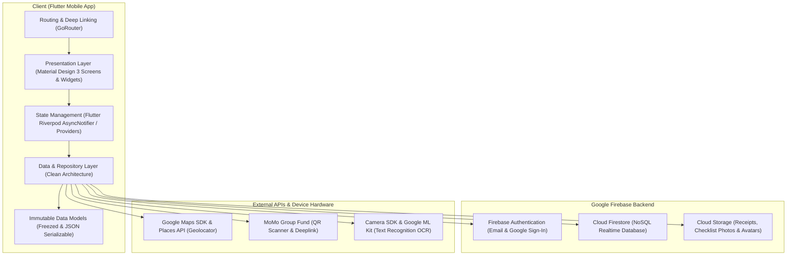
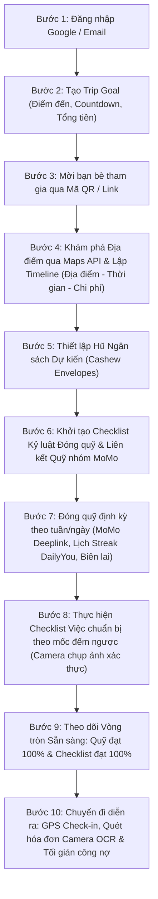

# 📱 Travel Buddy - Ứng Dụng Lập Kế Hoạch, Checklist Chuẩn Bị & Kỷ Luật Tích Lũy Quỹ Du Lịch

[](https://flutter.dev/)
[](https://dart.dev/)
[](https://firebase.google.com/)
[](https://riverpod.dev/)
[](https://pub.dev/packages/go_router)
[]()

> **Học phần:** Phát Triển Ứng Dụng Di Động (PTUDDD)  
> **Khoa:** Công nghệ Thông tin - Trường Đại học Thủy Lợi (TLU)  
> **Lớp học phần / Lớp sinh hoạt:** 65KTPM  
> **Giảng viên hướng dẫn:** ThS. Đỗ Oanh Cường  
> **Nhóm thực hiện:** Nhóm 08  

---

## 📑 Mục Lục
1. [Giới Thiệu Đề Tài](#1-giới-thiệu-đề-tài)
2. [Mục Tiêu & Phạm Vi Đề Tài](#2-mục-tiêu--phạm-vi-đề-tài)
3. [Kiến Trúc Tổng Thể & Công Nghệ](#3-kiến-trúc-tổng-thể--công-nghệ)
4. [4 Trụ Cột Chức Năng Cốt Lõi (Vertical Slices)](#4-4-trụ-cột-chức-năng-cốt-lõi-vertical-slices)
5. [Luồng Nghiệp Vụ Xuyên Suốt (End-to-End Workflow)](#5-luồng-nghiệp-vụ-xuyên-suốt-end-to-end-workflow)
6. [Phân Quyền Người Dùng](#6-phân-quyền-người-dùng)
7. [Phân Công Nhiệm Vụ Thành Viên](#7-phân-công-nhiệm-vụ-thành-viên)
8. [Hướng Dẫn Thiết Lập & Khởi Chạy Ứng Dụng](#8-hướng-dẫn-thiết-lập--khởi-chạy-ứng-dụng)
9. [Quy Chuẩn Quản Trị Mã Nguồn & Git](#9-quy-chuẩn-quản-trị-mã-nguồn--git)

---

## 1. Giới Thiệu Đề Tài

Nhu cầu tự lập kế hoạch du lịch theo nhóm bạn bè hoặc cá nhân ngày càng trở nên phổ biến trong giới trẻ và sinh viên. Tuy nhiên, để một chuyến đi thực sự diễn ra suôn sẻ, khâu quan trọng và mang tính quyết định nhất lại nằm ở **giai đoạn chuẩn bị trước chuyến đi hàng tuần, hàng tháng**:
- Xác định địa điểm và cân đối thời gian di chuyển.
- Dự toán tổng kinh phí cần thiết và duy trì kỷ luật tích góp đủ tiền đúng hạn.
- Hoàn thành hàng loạt đầu việc chuẩn bị (săn vé, đặt phòng, mua sắm đồ dùng, xếp hành lý).

Trên thực tế, rất nhiều kế hoạch du lịch của sinh viên bị trì hoãn hoặc hủy bỏ vào phút chót do:
- **Thiếu kỷ luật tài chính:** Các thành viên không tích góp đủ tiền đúng hạn, quên đóng quỹ hoặc phân bổ chi tiêu vượt khả năng.
- **Thiếu sự chuẩn bị bài bản:** Quên các mốc thời gian quan trọng để săn vé/đặt phòng giá tốt, bỏ sót vật dụng thiết yếu.
- **Kế hoạch rời rạc:** Lên danh sách các điểm đến nhưng không gắn với thời gian di chuyển và ngân sách thực tế; theo dõi qua ghi chú rời rạc, bảng Excel và chuyển khoản tự phát.

**Travel Buddy** ra đời nhằm giải quyết triệt để bài toán chuẩn bị du lịch, biến những dự định trên lời nói thành **kế hoạch hành động cụ thể** có kỷ luật tài chính, lộ trình công việc rõ ràng và gắn kết trọn vẹn giữa **Thời gian - Địa điểm - Tiền bạc**.

---

## 2. Mục Tiêu & Phạm Vi Đề Tài

### 2.1. Mục tiêu tổng quát
Xây dựng hoàn chỉnh ứng dụng di động đa nền tảng **Travel Buddy** bằng Flutter & Dart, áp dụng kiến trúc **Feature-First** kết hợp **Riverpod**, **GoRouter** và **Firebase**. Ứng dụng giúp người dùng thiết lập mục tiêu chuyến đi, quản lý toàn diện Checklist việc cần làm theo mốc thời gian, rèn luyện kỷ luật tích lũy quỹ liên kết ví MoMo, lập kế hoạch lịch trình điểm đến và kiểm soát ngân sách minh bạch.

### 2.2. Phạm vi đề tài (Project Scope)
- **Trong phạm vi (In-Scope):**
  - Đóng gói và kiểm thử ứng dụng di động trên Android (APK) và iOS.
  - Quản lý mục tiêu chuyến đi & đếm ngược thời gian (Countdown).
  - Hệ thống Checklist chuẩn bị đa tầng theo mốc thời gian kèm bộ mẫu và chụp ảnh xác thực bằng Camera.
  - Checklist kỷ luật tích góp quỹ du lịch định kỳ liên kết Quỹ nhóm MoMo (QR/Deeplink) và lịch chuỗi kỷ luật (Streak Calendar).
  - Đề xuất địa điểm qua Places API, lập lịch trình gắn liền Địa điểm - Thời gian - Chi phí, vẽ lộ trình Polyline và GPS Check-in.
  - Hoạch định hũ ngân sách kiểu Cashew, quét hóa đơn bằng Camera OCR (Google ML Kit) và thuật toán tối giản hóa công nợ.
- **Ngoài phạm vi (Out-of-Scope):**
  - Không can thiệp vào API lõi ngân hàng của MoMo (sử dụng Deeplink/QR chính thức của tính năng Quỹ nhóm MoMo kết hợp tải biên lai xác nhận).
  - Không thực hiện đặt vé máy bay/đặt phòng khách sạn trực tuyến thương mại (B2B booking engine).
  - Chưa xây dựng trang Web Admin quản trị tập trung ở giai đoạn hiện tại.

---

## 3. Kiến Trúc Tổng Thể & Công Nghệ

Hệ thống được thiết kế theo mô hình kiến trúc phân tầng kết hợp **Feature-First Architecture**, đảm bảo tính độc lập và khả năng mở rộng cao giữa các module:



### 3.1. Công nghệ sử dụng
- **Ngôn ngữ & Framework:** Dart (`>= 3.0.0`), Flutter SDK (`>= 3.10.0`).
- **Quản lý trạng thái:** `flutter_riverpod` (`^3.5.0`) – Đảm bảo compile-safe, độc lập với BuildContext.
- **Điều hướng:** `go_router` (`^18.1.4`) – Declarative Routing, hỗ trợ Deep Link và Auth Guard.
- **Backend-as-a-Service:**
  - `firebase_core` (`^5.1.0`), `firebase_auth` (`^7.0.1`): Xác thực người dùng.
  - `cloud_firestore` (`^7.1.0`): Lưu trữ NoSQL và đồng bộ thời gian thực.
  - `firebase_storage` (`^14.0.1`): Lưu trữ ảnh hóa đơn, ảnh xác thực checklist.
- **Bản đồ & Định vị:** `google_maps_flutter` (`^2.18.1`), `geolocator` (`^14.1.2`), `permission_handler` (`^13.0.2`).
- **Thanh toán & Mã QR:** `qr_flutter` (`^4.1.0`), `mobile_scanner` (`^7.5.0`), `url_launcher`.
- **Thị giác máy tính (AI/OCR) & Biểu đồ:** `google_mlkit_text_recognition`, `fl_chart` (`^1.3.1`).
- **Code Generation:** `freezed` (`^3.2.5`), `json_serializable` (`^6.15.2`), `build_runner` (`^2.15.1`).

### 3.2. Cấu trúc thư mục mã nguồn (`nhom08-65ktpm/src/lib/`)
```text
lib/
├── core/                                  # Thành phần dùng chung toàn hệ thống
│   ├── theme/                             # Cấu hình Material Design 3 (Light/Dark mode)
│   ├── utils/                             # Tiện ích format tiền tệ, ngày giờ, validation
│   └── widgets/                           # Reusable widgets (CustomButton, Loading, ErrorView...)
├── features/                              # Các module tính năng (Feature-First)
│   ├── goal_and_checklist/                # Module 1: Mục tiêu chuyến đi & Checklist chuẩn bị
│   │   ├── presentation/                  # Giao diện màn hình Countdown, Checklist theo mốc thời gian
│   │   ├── providers/                     # Riverpod Notifiers quản lý trạng thái Checklist
│   │   └── repository/                    # Giao tiếp Firestore & Camera Image Picker
│   ├── saving_discipline_and_momo/        # Module 2: Kỷ luật tích lũy quỹ & Liên kết MoMo (DailyYou)
│   │   ├── presentation/                  # Lịch Streak Calendar, màn hình nạp quỹ MoMo, biên lai
│   │   ├── providers/                     # Quản lý tiến độ đóng quỹ, tính chuỗi Streak liên tiếp
│   │   └── repository/                    # Xử lý QR Scanner, MoMo Deeplink & Firestore
│   ├── place_and_itinerary_planner/       # Module 3: Đề xuất điểm đến & Hoạch định bản đồ
│   │   ├── presentation/                  # Bản đồ Google Maps, Timeline lịch trình, Polyline
│   │   ├── providers/                     # Quản lý danh sách điểm đến, tính toán chi phí dự kiến
│   │   └── repository/                    # Tích hợp Places API, Geolocator GPS Check-in
│   └── budget_and_expense_cashew/         # Module 4: Hũ ngân sách Cashew & Camera OCR hóa đơn
│       ├── presentation/                  # Hũ ngân sách, bàn phím máy tính nhập tiền, quét hóa đơn
│       ├── providers/                     # Quản lý thực chi, đối chiếu kế hoạch vs thực tế, FL Chart
│       └── repository/                    # Google ML Kit Text Recognition, thuật toán tối giản công nợ
├── models/                                # Bộ Data Models Freezed & JSON Serializable
├── router/                                # Khai báo hệ thống định tuyến GoRouter
└── main.dart                              # Điểm khởi chạy ứng dụng
```

---

## 4. 4 Trụ Cột Chức Năng Cốt Lõi (Vertical Slices)

Dự án được phân chia thành 4 module độc lập theo chiều dọc (Vertical Slices), mỗi module liên kết qua `tripId`:

### 🎯 Module 1: Khởi Tạo Mục Tiêu Chuyến Đi & Checklist Chuẩn Bị Đa Tầng (`goal_and_checklist`)
- **Trip Goal & Countdown:** Tạo kế hoạch chuyến đi (Điểm đến, ngày khởi hành, tổng kinh phí mục tiêu). Bật đồng hồ đếm ngược số ngày còn lại đến giờ khởi hành. Mời thành viên tham gia qua mã QR.
- **Checklist theo mốc thời gian (Timeline To-Do Checklist):** Phân chia đầu việc theo các giai đoạn:
  - *Giai đoạn 1 (Trước 30 ngày):* Săn vé máy bay/xe, đặt cọc phòng khách sạn.
  - *Giai đoạn 2 (Trước 14 - 7 ngày):* Mua sắm vật dụng cá nhân, chuẩn bị giấy tờ/thuốc men.
  - *Giai đoạn 3 (Trước 1 - 2 ngày):* Đóng gói hành lý, sạc thiết bị, kiểm tra đồ đạc.
- **Bộ mẫu Checklist thông minh (Smart Templates):** Mẫu có sẵn theo loại hình: Du lịch biển, Leo núi/Cắm trại, Phượt xe máy, Du lịch tự túc dài ngày.
- **Phân công nhiệm vụ & Vòng tròn sẵn sàng (Readiness Progress %):** Gán người phụ trách cho từng việc chung của nhóm; hiển thị vòng tròn tiến độ sẵn sàng khởi hành.
- **Camera xác thực hoàn thành:** Chụp ảnh đồ đạc/vé đã chuẩn bị đính kèm vào mục checklist để nhóm cùng kiểm tra. Thông báo nhắc việc sắp đến hạn.

---

### 💳 Module 2: Checklist Kỷ Luật Tích Lũy Quỹ & Liên Kết Quỹ Nhóm MoMo (`saving_discipline_and_momo` - Kế thừa DailyYou)
- **Kế hoạch tích góp quỹ định kỳ (Saving Plan Generator):** Tự động chia tổng kinh phí chuyến đi thành các kỳ đóng quỹ kỷ luật (theo ngày, tuần hoặc tháng) cho từng thành viên dựa trên thời gian đếm ngược.
- **Liên kết Quỹ nhóm MoMo (MoMo Group Fund Integration):** Cấu hình liên kết và mã QR Quỹ nhóm MoMo vào chuyến đi. Tích hợp quét mã QR (`mobile_scanner`) và nút mở thẳng ứng dụng MoMo (Deeplink) để nạp tiền vào quỹ chung chỉ với 1 chạm.
- **Lịch theo dõi chuỗi kỷ luật (Saving Streak Calendar kiểu DailyYou):** Đánh dấu các ngày/tuần nạp quỹ đúng hạn, ghi nhận chuỗi kỷ luật liên tiếp (Streak), gắn biểu tượng cảm xúc và nhật ký tích góp.
- **Xác nhận biên lai & Thanh tiến độ quỹ:** Thành viên tải ảnh chụp màn hình giao dịch chuyển tiền MoMo; hệ thống cập nhật thanh tiến độ quỹ chung hướng tới mốc 100%.

---

### 🗺 Module 3: Đề Xuất Điểm Đến, Lập Kế Hoạch Lịch Trình & Ước Tính Thời Gian (`place_and_itinerary_planner`)
- **Khám phá điểm đến qua Maps/Places API:** Tìm kiếm và gợi ý các danh lam thắng cảnh, quán ăn đặc sản, khách sạn tại địa phương muốn đến.
- **Hoạch định đa yếu tố (Địa điểm - Thời gian - Tiền bạc):** Khi thêm một địa điểm vào lịch trình, người dùng thiết lập:
  - Khung giờ tham quan dự kiến và thời lượng lưu trú.
  - Chi phí ước tính tại điểm đó (vé tham quan, tiền ăn dự kiến) để tự động cộng dồn vào ngân sách cần chuẩn bị.
- **Timeline lịch trình theo ngày & Cảnh báo xung đột:** Sắp xếp lịch trình trực quan theo từng ngày (Ngày 1, Ngày 2...), hỗ trợ kéo thả sắp xếp lại thứ tự và cảnh báo nếu khung giờ giữa các điểm bị trùng lặp.
- **Bản đồ lộ trình & GPS Check-in:** Vẽ đường nối lộ trình (Polyline) giữa các điểm trong ngày, tính khoảng cách di chuyển và dùng GPS/Camera để đánh dấu Check-in khi thực sự đặt chân đến nơi.

---

### 💰 Module 4: Hoạch Định Ngân Sách Dự Kiến, Quản Lý Chi Tiêu & Camera OCR (`budget_and_expense_cashew` - Kế thừa Cashew)
- **Hũ ngân sách dự kiến (Cashew Budget Envelopes):** Chia tổng kinh phí mục tiêu thành các hũ ngân sách: *Di chuyển, Lưu trú, Ăn uống, Vé tham quan, Mua sắm, Dự phòng*. Đối chiếu liên tục giữa chi phí lịch trình dự kiến và số tiền quỹ đã tích góp.
- **Bàn phím máy tính nhập tiền nhanh:** Tích hợp bộ phím tính toán cộng/trừ kiểu Cashew giúp nhập chi phí chuẩn bị trước chuyến đi và chi phí phát sinh nhanh chóng.
- **Camera quét hóa đơn tự động (Receipt OCR):** Sử dụng Camera và Google ML Kit Text Recognition để chụp hóa đơn/vé, tự động trích xuất tổng tiền và trừ trực tiếp vào Quỹ chung hoặc ghi nhận khoản chi ứng trước.
- **Biểu đồ đối chiếu Kế hoạch vs. Thực tế:** Biểu đồ `fl_chart` so sánh trực quan ngân sách dự toán ban đầu với số tiền đã tích góp và chi tiêu thực tế.
- **Tối giản hóa công nợ (Debt Simplification):** Tự động cấn trừ các khoản chi riêng và số dư Quỹ nhóm MoMo để đưa ra phương án chuyển tiền trả nợ tối ưu nhất sau chuyến đi.

---

## 5. Luồng Nghiệp Vụ Xuyên Suốt (End-to-End Workflow)

Quy trình sử dụng ứng dụng trải qua 10 bước tuần tự từ lúc nhen nhóm ý tưởng đến khi kết thúc chuyến đi:



---

## 6. Phân Quyền Người Dùng

Trong mỗi kế hoạch chuyến đi, hệ thống phân định rõ 2 vai trò:

| Tính năng / Quyền hạn | Trưởng nhóm / Người lập kế hoạch (Trip Planner & Fund Host) | Thành viên đồng hành (Trip Member) |
| :--- | :---: | :---: |
| Tạo mục tiêu chuyến đi, đặt ngày khởi hành & tổng kinh phí | ✅ Toàn quyền | ❌ |
| Mời thành viên qua mã QR / Xóa thành viên | ✅ Toàn quyền | ❌ |
| Cấu hình lộ trình đóng quỹ kỷ luật & Liên kết Quỹ nhóm MoMo | ✅ Toàn quyền | ❌ |
| Xác nhận các giao dịch nạp quỹ của thành viên | ✅ Toàn quyền | ❌ |
| Phê duyệt lịch trình chính thức & Phân bổ Hũ ngân sách | ✅ Toàn quyền | ❌ |
| Nhận nhiệm vụ, đánh dấu Checklist & chụp ảnh xác thực bằng Camera | ✅ Có quyền | ✅ Có quyền |
| Nạp quỹ định kỳ qua MoMo, tải biên lai, duy trì Streak | ✅ Có quyền | ✅ Có quyền |
| Đề xuất điểm đến trên bản đồ vào lịch trình chung | ✅ Có quyền | ✅ Có quyền |
| Dùng Camera OCR quét hóa đơn & GPS Check-in điểm đến | ✅ Có quyền | ✅ Có quyền |

---

## 7. Phân Công Nhiệm Vụ Thành Viên

Dự án được phân chia theo mô hình **Vertical Slices** (mỗi thành viên phụ trách trọn vẹn từ giao diện UI, State Management Riverpod đến Database Firebase của một module độc lập):

| STT | Họ và Tên | Mã Sinh Viên | Lớp Sinh Hoạt | Vai Trò | Module Phụ Trách (Full-stack) | Công Nghệ & Dịch Vụ Chính |
| :-: | :--- | :---: | :---: | :---: | :--- | :--- |
| 1 | **Đỗ Đình An** | 2351170568 | 65KTPM | **Trưởng nhóm** | **Module 1: Mục Tiêu Chuyến Đi & Checklist Chuẩn Bị** (`goal_and_checklist`) | Firebase Auth, Firestore, Storage, GoRouter, Riverpod, Camera SDK, Local Notifications |
| 2 | **Nguyễn Xuân Bình** | 2251172252 | 64KTPM5 | Thành viên | **Module 2: Kỷ Luật Tích Lũy Quỹ MoMo & Lịch Streak** (`saving_discipline_and_momo`) | MoMo Deeplink, QR Scanner (`mobile_scanner`), Firestore, Storage, Riverpod |
| 3 | **Hồ Thế Dũng** | 2251243286 | 64ĐTVT3 | Thành viên | **Module 3: Đề Xuất Điểm Đến & Hoạch Định Bản Đồ** (`place_and_itinerary_planner`) | Google Maps SDK, Places API, Geolocator, Firestore, Riverpod, Freezed |
| 4 | **Đỗ Tùng Khánh** | 2251243356 | 64ĐTVT3 | Thành viên | **Module 4: Hoạch Định Ngân Sách Cashew & OCR Chi Tiêu** (`budget_and_expense_cashew`) | Google ML Kit (Camera OCR), FL Chart, Firestore, Storage, Riverpod |

---

## 8. Hướng Dẫn Thiết Lập & Khởi Chạy Ứng Dụng

### 8.1. Yêu cầu môi trường (Prerequisites)
1. **Flutter SDK:** Phiên bản `>= 3.10.0` (Khuyến nghị Flutter 3.24 trở lên). Kiểm tra bằng:
   ```bash
   flutter --version
   ```
2. **Dart SDK:** Đi kèm với Flutter SDK (`>= 3.0.0`).
3. **IDE / Editor:** [Visual Studio Code](https://code.visualstudio.com/) hoặc [Android Studio](https://developer.android.com/studio) (đã cài Flutter & Dart plugins).
4. **Thiết bị chạy:**
   - Android Emulator (API level 28+) hoặc iOS Simulator.
   - Thiết bị thật đã bật chế độ *Developer Options* và *USB Debugging*.
5. **Firebase CLI & FlutterFire:** Đã cài đặt [Firebase CLI](https://firebase.google.com/docs/cli) để liên kết dự án.

### 8.2. Các bước cài đặt và chạy ứng dụng

#### Bước 1: Clone kho lưu trữ và chuyển đến nhánh nhóm
```bash
git clone https://github.com/dinhan125/project-ptuddd.git
cd project-ptuddd
git checkout nhom08-65ktpm
```

#### Bước 2: Di chuyển vào thư mục mã nguồn
```bash
cd nhom08-65ktpm/src
```

#### Bước 3: Cài đặt các gói thư viện phụ thuộc
```bash
flutter pub get
```

#### Bước 4: (Tùy chọn) Chạy sinh mã nguồn tự động cho Freezed / JSON
```bash
dart run build_runner build --delete-conflicting-outputs
```

#### Bước 5: Khởi chạy ứng dụng ở chế độ Debug
```bash
flutter run
```

---

## 9. Quy Chuẩn Quản Trị Mã Nguồn & Git

Nhóm tuân thủ nghiêm ngặt quy chế nộp bài và quản lý mã nguồn của học phần:
- **Kho Fork cá nhân của nhóm trưởng:** `https://github.com/dinhan125/project-ptuddd`
- **Kho Upstream gốc của giảng viên:** `https://github.com/oanhcuongdo/project-ptuddd.git`
- **Nhánh làm việc chính thức:** `nhom08-65ktpm`
- **Quy tắc an toàn tệp tin:**
  - 100% tệp tin phát triển phải nằm trong thư mục `nhom08-65ktpm/`.
  - Tuyệt đối không chỉnh sửa tệp gốc ngoài nhóm (`.gitignore`, `README.md` tại thư mục root).
  - Không sử dụng lệnh `git add .` tại thư mục gốc, luôn dùng:
    ```bash
    git add nhom08-65ktpm/
    ```
  - Định dạng commit chuẩn:
    ```bash
    git commit -m "<loại-thay-đổi>(nhom08-65ktpm): <mô-tả-ngắn-gọn>"
    ```
    *Ví dụ:* `feat(nhom08-65ktpm): tich hop camera ocr quet hoa don`
  - Đẩy mã nguồn lên kho Fork:
    ```bash
    git push origin nhom08-65ktpm
    ```
  - Mở Pull Request về kho gốc `upstream/main` với tiêu đề chuẩn:
    ```text
    [Nộp bài] nhom08-65ktpm - Travel Buddy - Ứng dụng Lập Kế hoạch, Checklist Chuẩn bị & Kỷ luật Tích lũy Quỹ Du lịch
    ```
