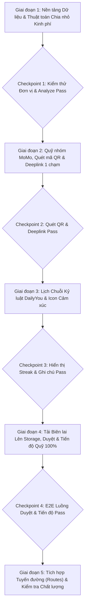

# 🗓️ Kế hoạch Triển khai (PLAN.md)
## Phân hệ 2: Kỷ luật Tích góp & Quỹ nhóm MoMo (`saving_discipline_and_momo`)
### Kỹ sư phụ trách: Nguyễn Xuân Bình (MSV: 2251172252 - Lớp: 64KTPM5 - Thành viên #2)
**Dự án:** Travel Buddy (PTUDDD - Nhóm 08)  
**Phạm vi:** `nhom08-65ktpm/src/lib/features/saving_discipline_and_momo/`

---

## 1. Chiến lược Triển khai: Lát cắt Dọc (Vertical Slices)

Kế hoạch được tổ chức thành 5 giai đoạn (Phase) độc lập, mỗi giai đoạn giải quyết trọn vẹn các yêu cầu nghiệp vụ từ Model ➔ Repository ➔ Provider ➔ Giao diện (UI):

---

## 2. Chi tiết các Giai đoạn Triển khai

### 🟢 Giai đoạn 1: Nền tảng Dữ liệu & Thuật toán Chia nhỏ Kinh phí (ĐÃ HOÀN THÀNH)
- [x] **Task 1.1: Định nghĩa Data Models & Thực thể**
  - Tạo `MoMoFundConfig`, `SavingPlan`, `DepositRecord`, `MemberStreak`.
  - Hỗ trợ chuyển đổi với Cloud Firestore `Timestamp` và JSON.
  - *Files:* `models/momo_fund_config.dart`, `models/saving_plan.dart`, `models/deposit_record.dart`, `models/member_streak.dart`.
- [x] **Task 1.2: Cài đặt Thuật toán Chia nhỏ Kinh phí (`SavingCalculator`)**
  - Phân bổ tổng tiền theo ngày/tuần/tháng dựa trên ngày đếm ngược đến chuyến đi.
  - Làm tròn đến 1.000 VNĐ, bù trừ phần dư vào kỳ cuối cùng.
  - Viết bộ unit test kiểm thử toàn diện các trường hợp biên (`saving_calculator_test.dart`).
  - *Files:* `utils/saving_calculator.dart`.
- [x] **Task 1.3: Xây dựng Lớp Lưu trữ Repository (`SavingRepository`)**
  - Giao diện `SavingRepository` và cài đặt `SavingRepositoryImpl`.
  - CRUD Firestore và xử lý giao dịch an toàn (Firestore Transaction).
  - *Files:* `repository/saving_repository.dart`, `repository/saving_repository_impl.dart`.

---

### 🟡 Giai đoạn 2: Quỹ nhóm MoMo, Quét mã QR & Deeplink 1 chạm
- **Yêu cầu đáp ứng:**
  - Tích hợp Quét mã QR (`mobile_scanner`) để quét mã Quỹ nhóm MoMo.
  - Tích hợp nút Deeplink mở trực tiếp ứng dụng MoMo (`url_launcher`) để nộp quỹ 1 chạm kèm fallback sao chép thông tin.
- **Chi tiết các tác vụ:**
  - **Task 2.1: Màn hình Cấu hình Quỹ MoMo (Trưởng quỹ):** Nhập số điện thoại MoMo, tên quỹ, link quỹ, tự động hiển thị mã QR qua `qr_flutter`.
    - *Files:* `presentation/screens/momo_fund_config_screen.dart`, `providers/momo_fund_provider.dart`.
  - **Task 2.2: Màn hình Quét mã QR Camera (`mobile_scanner`):** Quét mã QR chuyển khoản MoMo bằng camera, kiểm tra quyền camera (`permission_handler`), hỗ trợ bật flash/đổi camera.
    - *Files:* `presentation/screens/qr_scanner_screen.dart`.
  - **Task 2.3: Bộ điều hướng Deeplink MoMo & Màn hình Nộp quỹ 1 chạm:** Mở scheme `momo://` kèm số tiền, số điện thoại và nội dung; hỗ trợ hộp thoại fallback 1-tap copy khi máy chưa cài MoMo.
    - *Files:* `utils/momo_deeplink_helper.dart`, `presentation/screens/momo_deposit_screen.dart`.

---

### 🟠 Giai đoạn 3: Lịch Chuỗi Kỷ luật Tích góp (DailyYou-style) & Icon Cảm xúc
- **Yêu cầu đáp ứng:**
  - Xây dựng Lịch theo dõi chuỗi kỷ luật tích góp (Saving Streak Calendar kiểu DailyYou).
  - Tính toán chuỗi ngày kỷ luật (Streak), cho phép chọn icon cảm xúc / ghi chú mỗi lần đóng quỹ.
- **Chi tiết các tác vụ:**
  - **Task 3.1: Bộ tính toán chuỗi kỷ luật (Streak Provider):** Tính `currentStreak`, `longestStreak`, kiểm tra tính kỷ luật theo ngày/tuần.
    - *Files:* `providers/streak_calendar_provider.dart`.
  - **Task 3.2: Giao diện Lịch Kỷ luật DailyYou:** Lưới lịch tháng hiển thị màu sắc trạng thái các ngày đóng tiền (`CalendarDayCell`) và ngọn lửa kỷ luật rực sáng (`StreakFireBadge`).
    - *Files:* `presentation/screens/streak_calendar_screen.dart`, `presentation/widgets/calendar_day_cell.dart`, `presentation/widgets/streak_fire_badge.dart`.
  - **Task 3.3: Hộp thoại Chọn Icon Cảm xúc & Ghi chú Nhật ký:** Cho phép thành viên chọn cảm xúc (😄, 😎, 😤, ☕) và nhập lời nhắn khi hoàn thành kỳ đóng.
    - *Files:* `presentation/widgets/emotion_selector_dialog.dart`.

---

### 🔵 Giai đoạn 4: Tải Biên lai Lên Storage, Duyệt Giao dịch & Tiến độ Quỹ 100%
- **Yêu cầu đáp ứng:**
  - Màn hình tải ảnh chụp biên lai chuyển tiền MoMo lên Cloud Storage.
  - Cập nhật thanh tiến độ tích lũy quỹ chung của nhóm đạt mốc 100%.
- **Chi tiết các tác vụ:**
  - **Task 4.1: Tải ảnh chụp biên lai chuyển tiền:** Tải ảnh biên lai lên Firebase Storage (`trips/{tripId}/receipts/`), lưu bản ghi nộp tiền ở trạng thái `PENDING`.
    - *Files:* `presentation/screens/momo_deposit_screen.dart`.
  - **Task 4.2: Màn hình Xem & Duyệt Biên lai (Trưởng quỹ):** Xem ảnh chụp biên lai full-screen, duyệt hoặc từ chối giao dịch.
    - *Files:* `presentation/screens/pending_receipts_screen.dart`, `providers/receipt_approval_provider.dart`.
  - **Task 4.3: Thẻ Tiến độ Quỹ nhóm Đạt mốc 100%:** Hiển thị trực quan thanh tiến độ tích lũy, tự động chuyển trạng thái chúc mừng khi hoàn thành 100% mục tiêu.
    - *Files:* `presentation/widgets/fund_progress_card.dart`.

---

### 🟣 Giai đoạn 5: Tích hợp Tuyến đường & Kiểm tra Toàn diện
- **Task 5.1: Định nghĩa Tuyến đường (Routes):** Đóng gói routes cho phân hệ (`/saving-plan`, `/momo-deposit`, `/streak-calendar`, `/momo-config`, `/pending-receipts`).
  - *Files:* `presentation/routes.dart`.
- **Task 5.2: Kiểm tra Chất lượng & Phân tích Tĩnh:** Chạy `flutter analyze` bảo đảm 0 lỗi, 0 cảnh báo; định dạng code theo chuẩn Dart.

---

## 3. Tiêu chí Nghiệm thu & Cam kết
- Toàn bộ mã nguồn nằm gọn trong thư mục được phân công: `lib/features/saving_discipline_and_momo/`.
- Thực hiện kiểm thử và cập nhật tiến độ đầy đủ vào `PROGRESS.md`.
