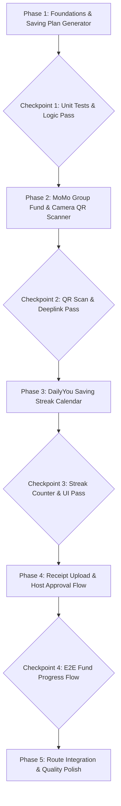

# 🗓️ Implementation Plan (PLAN.md)
## Module 2: Saving Discipline & MoMo Group Fund (`saving_discipline_and_momo`)
### Lead Engineer: Nguyen Xuan Binh (Member #2 - 64KTPM5)
**Project:** Travel Buddy (PTUDDD - Group 08)  
**Execution Boundary:** Strictly limited to `nhom08-65ktpm/src/lib/features/saving_discipline_and_momo/`

---

## 1. Implementation Strategy: Vertical Slices
This plan uses a **Vertical Slices** approach. Instead of building horizontal layers (all models, then all UI), each phase delivers a fully verifiable, end-to-end slice of functionality (Model ➔ Repository ➔ Notifier ➔ UI Widget) that can be verified and demonstrated independently.

---

## 2. Detailed Task Breakdown

### 🟢 Phase 1: Data Foundations & Saving Plan Generator

#### Task 1.1: Define Data Models & Entities
- **Description:** Implement immutable data structures for Fund Configuration, Saving Plans, Deposit Records, and Streaks.
- **Acceptance Criteria:**
  - Define `MoMoFundConfig`, `SavingPlan`, `DepositRecord`, and `MemberStreak`.
  - Provide serialization/deserialization for Firestore `Timestamp` and JSON maps.
- **Files Touched:**
  - `nhom08-65ktpm/src/lib/features/saving_discipline_and_momo/models/momo_fund_config.dart`
  - `nhom08-65ktpm/src/lib/features/saving_discipline_and_momo/models/saving_plan.dart`
  - `nhom08-65ktpm/src/lib/features/saving_discipline_and_momo/models/deposit_record.dart`
  - `nhom08-65ktpm/src/lib/features/saving_discipline_and_momo/models/member_streak.dart`
- **Scope:** Medium (M)

#### Task 1.2: Implement Saving Plan Calculator (`SavingCalculator`)
- **Description:** Implement pure domain functions to partition target amounts into periodic installments based on the countdown duration and frequency (Daily, Weekly, Monthly).
- **Acceptance Criteria:**
  - Correctly calculates installment amounts and due dates.
  - Automatically adjusts for short countdowns (< 7 days defaults to Daily).
  - Rounds values to the nearest 1,000 VND and handles rounding remainders in the final installment.
- **Files Touched:**
  - `nhom08-65ktpm/src/lib/features/saving_discipline_and_momo/utils/saving_calculator.dart`
- **Scope:** Small (S)

#### Task 1.3: Build Saving Repository Layer
- **Description:** Implement `SavingRepository` and `SavingRepositoryImpl` to handle Firestore reads/writes for fund configurations, plans, and deposit logs.
- **Acceptance Criteria:**
  - Clean CRUD operations for `momo_fund_config` and `saving_plans`.
  - Realtime streams for fund progress and member deposits.
- **Files Touched:**
  - `nhom08-65ktpm/src/lib/features/saving_discipline_and_momo/repository/saving_repository.dart`
  - `nhom08-65ktpm/src/lib/features/saving_discipline_and_momo/repository/saving_repository_impl.dart`
- **Scope:** Medium (M)

#### 🎯 Checkpoint 1: Foundation Verification
- [ ] Data models compile with null safety.
- [ ] Unit tests for `SavingCalculator` pass with 100% boundary test coverage.
- [ ] Firestore repository mock tests execute without exceptions.

---

### 🟡 Phase 2: MoMo Group Fund & Camera QR Scanner

#### Task 2.1: Host MoMo Fund Setup Screen
- **Description:** Create the screen allowing the Fund Host to configure their MoMo phone number, fund title, target goal, and optional fund link.
- **Acceptance Criteria:**
  - Validates 10-digit Vietnamese phone numbers.
  - Renders a dynamic QR code using `qr_flutter` if no external QR image is provided.
- **Files Touched:**
  - `nhom08-65ktpm/src/lib/features/saving_discipline_and_momo/presentation/screens/momo_fund_config_screen.dart`
  - `nhom08-65ktpm/src/lib/features/saving_discipline_and_momo/providers/momo_fund_provider.dart`
- **Scope:** Medium (M)

#### Task 2.2: Live Camera QR Scanner via `mobile_scanner`
- **Description:** Implement a camera scanning view to scan MoMo payment/fund QR codes.
- **Acceptance Criteria:**
  - Handles runtime camera permission requests via `permission_handler`.
  - Parses scanned QR payloads (extracting MoMo deep link or phone number) and navigates back with the result.
  - Includes camera toggle (front/rear) and flash toggle buttons.
- **Files Touched:**
  - `nhom08-65ktpm/src/lib/features/saving_discipline_and_momo/presentation/screens/qr_scanner_screen.dart`
- **Scope:** Medium (M)

#### Task 2.3: 1-Tap MoMo Deeplink & Payment View
- **Description:** Implement the member deposit view with a 1-tap "Open MoMo" action and manual transfer details.
- **Acceptance Criteria:**
  - Executes `momo://` deep link via `url_launcher`.
  - Provides a safe fallback when MoMo is not installed, featuring 1-tap copy buttons for phone number and transfer remarks.
- **Files Touched:**
  - `nhom08-65ktpm/src/lib/features/saving_discipline_and_momo/utils/momo_deeplink_helper.dart`
  - `nhom08-65ktpm/src/lib/features/saving_discipline_and_momo/presentation/screens/momo_deposit_screen.dart`
- **Scope:** Small (S)

#### 🎯 Checkpoint 2: MoMo Integration Verification
- [ ] Fund configuration successfully persists to Firestore.
- [ ] QR scanner accurately decodes barcode values without crashing.
- [ ] Deeplink launcher triggers MoMo or displays the graceful fallback dialog.

---

### 🟠 Phase 3: DailyYou-Style Saving Streak Calendar

#### Task 3.1: Saving Streak Calculation Logic
- **Description:** Implement domain logic for streak progression: incrementing `currentStreak` upon on-time deposits, maintaining `longestStreak`, and resetting `currentStreak` on missed deadlines.
- **Acceptance Criteria:**
  - Handles daily and weekly installment schedules accurately.
  - Distinguishes between on-time, early, and delinquent payment states.
- **Files Touched:**
  - `nhom08-65ktpm/src/lib/features/saving_discipline_and_momo/providers/streak_calendar_provider.dart`
- **Scope:** Small (S)

#### Task 3.2: DailyYou Streak Calendar UI Widget
- **Description:** Build a Material Design 3 monthly calendar grid displaying deposit statuses per day.
- **Acceptance Criteria:**
  - `CalendarDayCell` reflects status: Paid (Green), Due Today (Amber/Pulse), Overdue (Red/Grey).
  - `StreakFireBadge` displays an animated flame icon 🔥 with the active streak count.
- **Files Touched:**
  - `nhom08-65ktpm/src/lib/features/saving_discipline_and_momo/presentation/screens/streak_calendar_screen.dart`
  - `nhom08-65ktpm/src/lib/features/saving_discipline_and_momo/presentation/widgets/calendar_day_cell.dart`
  - `nhom08-65ktpm/src/lib/features/saving_discipline_and_momo/presentation/widgets/streak_fire_badge.dart`
- **Scope:** Medium (M)

#### Task 3.3: Emotion Tags & Saving Journal Dialog
- **Description:** Allow members to attach an emotion badge and a short personal diary note to every deposit.
- **Acceptance Criteria:**
  - Dialog presents emoji choices: 😄 Excited, 😎 Confident, 😤 Determined, ☕ Skipped Coffee.
  - Attaches emotion tag to `DepositRecord` and renders a mini-journal timeline below the calendar.
- **Files Touched:**
  - `nhom08-65ktpm/src/lib/features/saving_discipline_and_momo/presentation/widgets/emotion_selector_dialog.dart`
- **Scope:** Small (S)

#### 🎯 Checkpoint 3: Streak & Gamification Verification
- [ ] Streak counter increments reactively upon deposit logging.
- [ ] Calendar grid renders correctly across multiple screen densities without pixel overflow.

---

### 🔵 Phase 4: Receipt Upload, Host Approval & Fund Progress

#### Task 4.1: Transfer Receipt Upload to Firebase Storage
- **Description:** Enable members to select or capture a payment confirmation screenshot, compress it, and upload it to Firebase Storage.
- **Acceptance Criteria:**
  - Uploads images to `trips/{tripId}/receipts/` and stores the download URL.
  - Creates a `DepositRecord` with initial status `PENDING`.
- **Files Touched:**
  - `nhom08-65ktpm/src/lib/features/saving_discipline_and_momo/repository/saving_repository_impl.dart`
  - `nhom08-65ktpm/src/lib/features/saving_discipline_and_momo/presentation/screens/momo_deposit_screen.dart`
- **Scope:** Medium (M)

#### Task 4.2: Host Receipt Review & Verification Screen
- **Description:** Provide the Fund Host with a list of pending transactions to inspect receipt photos and approve/reject them.
- **Acceptance Criteria:**
  - Full-screen photo inspection dialog with zoom support.
  - Tapping `Approve` transitions status to `APPROVED`, increments group fund balance, and triggers streak updates.
- **Files Touched:**
  - `nhom08-65ktpm/src/lib/features/saving_discipline_and_momo/presentation/screens/pending_receipts_screen.dart`
  - `nhom08-65ktpm/src/lib/features/saving_discipline_and_momo/providers/receipt_approval_provider.dart`
- **Scope:** Medium (M)

#### Task 4.3: Realtime Fund Progress Bar & Leaderboard Card
- **Description:** Display an overarching progress card showing total fund completion percentage and individual contributions.
- **Acceptance Criteria:**
  - Animated progress indicator showing percentage toward 100%.
  - Celebratory visual state when the total fund reaches 100%.
- **Files Touched:**
  - `nhom08-65ktpm/src/lib/features/saving_discipline_and_momo/presentation/widgets/fund_progress_card.dart`
- **Scope:** Small (S)

#### 🎯 Checkpoint 4: End-to-End Workflow Verification
- [ ] Member submits receipt -> Host receives pending item -> Host approves -> Fund progress increments in realtime.
- [ ] Memory leaks avoided during repeated photo uploads.

---

### 🟣 Phase 5: Routing Integration & Quality Polish

#### Task 5.1: Encapsulate Module Routing Contract
- **Description:** Expose standard route builder helpers/definitions for Module 2 to allow clean registration into the host router.
- **Acceptance Criteria:**
  - Provides clear route constants: `/saving-plan`, `/momo-deposit`, `/streak-calendar`, `/momo-config`.
- **Files Touched:**
  - `nhom08-65ktpm/src/lib/features/saving_discipline_and_momo/presentation/routes.dart`
- **Scope:** Small (S)

#### Task 5.2: Static Analysis & Code Quality Verification
- **Description:** Run full static analysis and formatting on all created files.
- **Acceptance Criteria:**
  - `flutter analyze` reports 0 errors and 0 warnings inside Module 2.
  - All Dart files formatted according to official conventions (`dart format`).
- **Scope:** Small (S)

#### 🎯 Final Checkpoint: Ready for Git Review & Commit
- [ ] All code strictly confined within `nhom08-65ktpm/src/lib/features/saving_discipline_and_momo/`.
- [ ] Commit message follows academic requirements: `feat(nhom08-65ktpm): implement saving discipline and momo group fund`.
