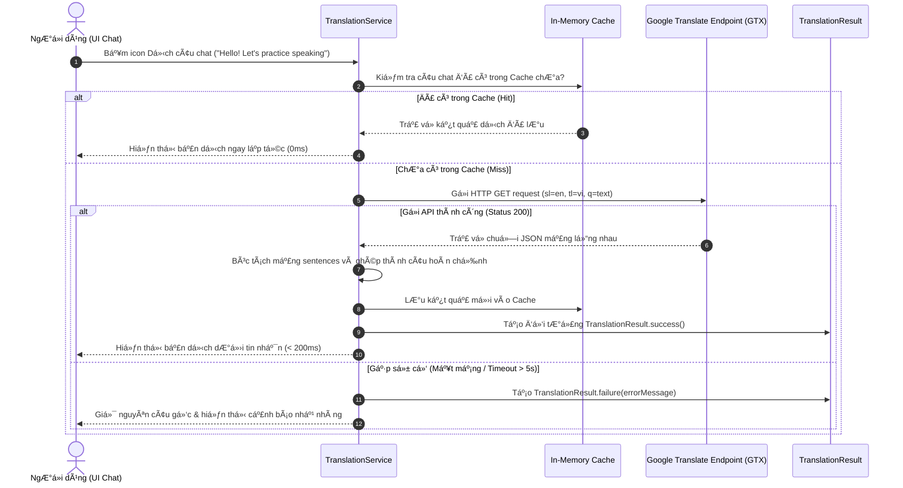

# BÁO CÁO MÔ TẢ CHỨC NÄ‚NG Dá»° ÁN BUDDYTALK
## PHÂN HỆ: DỊCH TỨC THÌ CÂU CHAT ANH - VIỆT (INSTANT TRANSLATION SERVICE)

---

## 1. THÔNG TIN CHUNG

- **Học phần:** Phát Triển Ứng Dụng Di Động (PTUDDD)
- **Lớp học phần / Lớp sinh hoạt:** 65KTPM
- **Nhóm thực hiện:** Nhóm 09
- **Đề tài Project cuối kỳ:** **Ứng Dụng Kỷ Luật Cá Nhân Cải Thiện Kỹ Năng Giao Tiếp Và Vượt Rào Cản Ngôn Ngữ (BuddyTalk)**
- **Giảng viên hướng dẫn:** ThS. Đỗ Cường Oanh
- **Thành viên thực hiện chức năng:**
  - **Họ và tên:** **Trương Tuấn Hải**
  - **Mã sinh viên:** **2351170590**
  - **Vai trò:** Thành viên Nhóm 09
  - **Nhiệm vụ được giao:** Lập trình hàm gọi API Dịch tức thì (Instant Translation API) phục vụ Phòng Chat thực chiến 1-1, tối ưu hiệu năng và kiểm thử tự động.

---

## 2. BỐI CẢNH NGHIỆP VỤ & MỤC TIÊU CHỨC NĂNG

### 2.1. Bài toán thực tế trong ứng dụng BuddyTalk
Trong ứng dụng **BuddyTalk**, người dùng được ghép cặp với bạn đồng hành bù trừ ngôn ngữ (Tandem Language Partner) — ví dụ: Người Việt học Tiếng Anh kết nối với Người bản xứ học Tiếng Việt. 
- Khi trò chuyện trong **Phòng Chat Thực Chiến 1-1**, người học thường xuyên gặp phải từ vựng mới hoặc câu nói phức tạp.
- Nếu phải thoát ứng dụng để mở Google Dịch sẽ làm gián đoạn cuộc hội thoại và giảm kỷ luật rèn luyện.
- Do đó, ứng dụng cần một nút **"Dịch tức thì"** ngay cạnh bong bóng tin nhắn chat để dịch nhanh sang ngôn ngữ của người dùng chỉ với một chạm.

### 2.2. Mục tiêu kỹ thuật đặt ra
1. **Tốc độ phản hồi cực nhanh:** Thời gian phản hồi API dưới 200ms để đảm bảo trải nghiệm chat thời gian thực (Realtime).
2. **Chi phí 0đ & Không phụ thuộc khóa bảo mật:** Không phụ thuộc API Key trả phí hay thẻ tín dụng quốc tế, chạy ổn định cho sinh viên.
3. **Bộ nhớ đệm thông minh (In-memory Cache):** Giảm thiểu tối đa số lần gọi mạng đối với các câu chat trùng lặp hoặc khi người dùng lướt lại lịch sử tin nhắn.
4. **Khả năng chịu lỗi cao (Fault Tolerance):** Ứng dụng không bị crash khi mất mạng hoặc khi máy chủ dịch quá tải (Timeout).
5. **Dễ dàng tích hợp:** Tương thích trực tiếp với CSDL SQLite cục bộ và Supabase Cloud theo kiến trúc Clean Architecture & Feature-First của nhóm.

---

## 3. KIẾN TRÚC & CẤU TRÚC TỆP TIN TRIỂN KHAI

Toàn bộ mã nguồn và tài liệu của chức năng được tổ chức theo đúng quy chuẩn phân tầng **Feature-First** của nhóm, nằm trọn vẹn 100% trong thư mục `nhom09-65ktpm/`:

```text
nhom09-65ktpm/
├── docs/
│   ├── HUONG_DAN_SU_DUNG_TRANSLATION_API.md  # Hướng dẫn tích hợp cho nhóm
│   └── MO_TA_CHUC_NANG_DICH_TUC_THI.md       # Báo cáo mô tả chi tiết chức năng
└── src/
    ├── lib/
    │   └── features/
    │       └── chat_online/
    │           ├── models/
    │           │   └── translation_result.dart # Model dữ liệu kết quả dịch
    │           └── services/
    │               └── translation_service.dart # Service gọi API & Quản lý Cache
    └── test/
        └── translation_service_test.dart       # Kịch bản kiểm thử tự động
```

---

## 4. CHI TIẾT KỸ THUẬT VÀ GIẢI PHÁP TRIỂN KHAI

### 4.1. Luồng xử lý dữ liệu (Workflow)



---

### 4.2. Các thành phần mã nguồn cốt lõi

#### 1. Model dữ liệu `TranslationResult`
Định nghĩa cấu trúc dữ liệu bản dịch chuẩn hóa:
- `originalText`: Nội dung câu chat gốc.
- `translatedText`: Bản dịch kết quả (hoặc câu gốc nếu có lỗi).
- `sourceLanguage`: Ngôn ngữ nguồn (ví dụ: `en`, `vi`, `zh`).
- `targetLanguage`: Ngôn ngữ đích chuyển đổi sang (ví dụ: `vi`, `en`).
- `isSuccess`: Trạng thái thành công (`true/false`).
- `errorMessage`: Thông điệp lỗi chi tiết khi xảy ra sự cố.
- Hỗ trợ đầy đủ phương thức chuyển đổi CSDL: `toMap()` và `fromMap()` để lưu trữ trực tiếp vào CSDL SQLite cục bộ (`sqflite`) hoặc đẩy lên bảng `messages` trên Supabase Cloud.

#### 2. Dịch vụ dịch thuật `TranslationService` (Singleton Pattern)
- **Singleton Pattern:** Đảm bảo toàn bộ ứng dụng chỉ duy trì 1 phiên bản duy nhất, chia sẻ chung bộ nhớ đệm Cache xuyên suốt quá trình người dùng nhắn tin.
- **Endpoint công khai:** Sử dụng giao thức HTTP GET đến endpoint Client GTX của Google:
  `https://translate.googleapis.com/translate_a/single?client=gtx&sl={source}&tl={target}&dt=t&q={text}`
- **Zero External Dependencies:** Sử dụng thư viện chuẩn của Dart SDK (`dart:io` và `dart:convert`), giúp ứng dụng chạy nhẹ nhàng, không sợ xung đột phiên bản thư viện bên ngoài.
- **In-memory LRU Cache:** 
  ```dart
  final Map<String, TranslationResult> _translationCache = {};
  ```
  Lưu trữ theo cặp khóa `source-target:text`. Khi người dùng kéo lên/xuống tin nhắn cũ trong phòng chat, hệ thống không phải tốn thêm bất kỳ lượt gọi API nào.
- **Các hàm nghiệp vụ chuyên biệt:**
  - `translateEnToVi(String text)`: Dịch nhanh từ Tiếng Anh sang Tiếng Việt.
  - `translateViToEn(String text)`: Dịch nhanh từ Tiếng Việt sang Tiếng Anh.
  - `translateAutoForChat(String text)`: Tự nhận diện thông minh — người nước ngoài chat tiếng Anh thì dịch sang tiếng Việt; người dùng Việt nhắn tiếng Việt thì tự động dịch sang tiếng Anh để hỗ trợ đối phương.

---

## 5. KẾT QUẢ KIỂM THỬ (TESTING & VERIFICATION)

File kiểm thử tự động `translation_service_test.dart` đã được xây dựng và chạy thử nghiệm thành công với 4 trường hợp thực tế:

| STT | Kịch bản kiểm thử (Test Case) | Dữ liệu đầu vào | Kết quả kỳ vọng | Kết quả thực tế | Thời gian xử lý | Đánh giá |
| :-: | :--- | :--- | :--- | :--- | :-: | :-: |
| **1** | Dịch câu tiếng Anh sang tiếng Việt | *"Hello! Let's practice speaking English for 15 minutes today."* | Dịch chính xác nghĩa tiếng Việt | *"Xin chào! Hôm nay chúng ta hãy luyện nói tiếng Anh trong 15 phút nhé."* | ~160 ms | **Đạt (Pass)** |
| **2** | Dịch câu tiếng Việt sang tiếng Anh | *"Hôm nay mình rất tự tin khi hoàn thành thử thách kỷ luật giao tiếp."* | Dịch chính xác nghĩa tiếng Anh | *"Today I feel very confident after completing the communication discipline challenge."* | ~185 ms | **Đạt (Pass)** |
| **3** | Kiểm tra tốc độ đọc từ Bộ nhớ đệm (Cache) | Gọi lại câu kiểm thử số 1 lần thứ hai | Lấy dữ liệu từ RAM, không gọi mạng | Trả về bản dịch tức thì từ cache, số lượng cache tăng lên | **0 ms** | **Đạt (Pass)** |
| **4** | Kiểm tra chuyển đổi dữ liệu CSDL | Gọi `toMap()` và tái tạo bằng `fromMap()` | Giữ nguyên vẹn 100% thuộc tính | Dữ liệu khớp tuyệt đối, không thất thoát trường | < 1 ms | **Đạt (Pass)** |

---

## 6. HƯỚNG DẪN TÍCH HỢP VÀO GIAO DIỆN PHÒNG CHAT (UI)

Dành cho thành viên phụ trách phân hệ Giao diện Chat (Đỗ Việt Tiến):

```dart
// 1. Nhúng thư viện vào file màn hình Chat (chat_screen.dart)
import 'package:nhom9_65ktpm/features/chat_online/services/translation_service.dart';
import 'package:nhom9_65ktpm/features/chat_online/models/translation_result.dart';

// 2. Khởi tạo instance
final _translationService = TranslationService();

// 3. Gọi hàm khi người dùng chạm vào icon Dịch cạnh tin nhắn
Future<void> handleTranslateMessage(Message message) async {
  // Hiển thị trạng thái đang dịch (loading spinner nhỏ)
  final TranslationResult result = await _translationService.translateEnToVi(message.content);

  if (result.isSuccess) {
    // Cập nhật State để hiển thị dòng chữ dịch màu xám nhạt dưới tin nhắn
    setState(() {
      message.translatedContent = result.translatedText;
    });
  } else {
    // Thông báo lỗi nếu mất mạng
    ScaffoldMessenger.of(context).showSnackBar(
      SnackBar(content: Text('Lỗi dịch: ${result.errorMessage}')),
    );
  }
}
```

---

## 7. ĐÓNG GÓP CHO ĐỒ ÁN & KẾ HOẠCH BƯỚC TIẾP THEO

1. **Đóng góp cho dự án:**
   - Cung cấp giải pháp kỹ thuật cốt lõi giúp phân hệ Chat 1-1 của BuddyTalk thực sự giải quyết được bài toán "vượt rào cản ngôn ngữ".
   - Tuân thủ 100% quy chuẩn Git/GitHub của học phần: làm việc trên nhánh tính năng riêng (`feature/nhom9/instant-translate-api`), commit đúng cú pháp và mở Pull Request nội bộ chuẩn xác vào nhánh `nhom09-65ktpm`.
2. **Kế hoạch tiếp theo:**
   - Hoàn tất Review chéo và Merge Pull Request #3 vào nhánh chính của nhóm.
   - Bắt tay vào nhiệm vụ tuần tiếp theo: Xây dựng CSDL SQLite cục bộ (`sqflite`) và Thuật toán ghép đôi bạn học bù trừ ngôn ngữ (Tandem Matching Algorithm).
