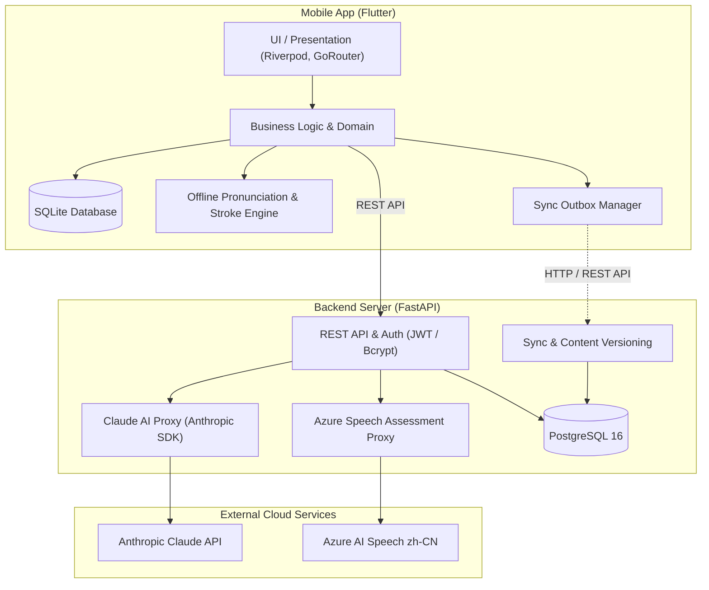

<p align="center">
  
</p>

# ChaiLish - Ứng Dụng Học Tiếng Trung Tích Hợp AI

> **Học phần:** Phát Triển Ứng Dụng Di Động (PTUDDD)  
> **Lớp học phần:** 65KTPM - Trường Đại học Thủy Lợi  
> **Giảng viên hướng dẫn:** Thầy Đỗ Oanh Cường  
> **Nhóm thực hiện:** Nhóm 11  
> **Kho lưu trữ nội bộ:** [LoudlyDawn2108/project-ptuddd](https://github.com/LoudlyDawn2108/project-ptuddd)  
> **Nhánh phát triển chính:** `nhom/nhom11-65ktpm`

---

## 📌 1. Giới Thiệu Đề Tài

**ChaiLish** là ứng dụng di động hỗ trợ người Việt tự học tiếng Trung toàn diện từ con số 0 đến HSK 2. Ứng dụng giải quyết ba trở ngại lớn nhất của người Việt khi tiếp cận tiếng Trung: **ngữ âm - thanh điệu phức tạp**, **chữ Hán nhiều nét khó nhớ**, và **thiếu môi trường giao tiếp thực tế**.

Hệ thống được thiết kế theo kiến trúc hiện đại **Client - Server (Offline-First)**:
- **Phía ứng dụng (Mobile Client):** Viết bằng Flutter, cung cấp trải nghiệm học tập mượt mà, hỗ trợ học offline không cần mạng, tự động đồng bộ kết quả khi có kết nối Internet.
- **Phía máy chủ (Backend Server):** Viết bằng Python FastAPI, quản lý tài khoản người dùng, đồng bộ dữ liệu học tập, phân phối nội dung bài học theo phiên bản và làm cổng trung gian kết nối các dịch vụ AI chuyên sâu.

---

## ✨ 2. Tính Năng Nổi Bật

### 🎯 2.1. Lộ trình học bài bản HSK 1 - HSK 2
- Lộ trình phân cấp trực quan theo từng chặng (Stages) và bài học (Nodes).
- Cơ chế mở khóa thông minh: Đạt tối thiểu **70 điểm** ở bài học trước để mở khóa bài tiếp theo.
- Tích hợp bài kiểm tra đầu vào (**Placement Test**) cho phép người đã có kiến thức bỏ qua các bài căn bản.
- Kế hoạch học tập hằng ngày (**Daily Plan**) tự động cân đối: bài mới, thẻ từ vựng cần ôn, chữ Hán cần viết lại.

### 🎙️ 2.2. Chấm phát âm kép thông minh (Hybrid Pronunciation Engine)
- **Engine Offline (chạy cục bộ trên máy):**
  - Tách âm tiết thành 3 thành phần: *Thanh mẫu (Initial)*, *Vận mẫu (Final)*, *Thanh điệu (Tone)*.
  - Căn chỉnh chuỗi âm thanh bằng thuật toán **Weighted Levenshtein**.
  - Thiết kế ma trận phạt điểm riêng biệt, tối ưu cho các cặp âm người Việt hay phát âm sai: `zh/z`, `ch/c`, `sh/s`, `j/q/x`, `ü/u`, thanh 2 và thanh 3.
  - Phân tích 4 chỉ số: Độ chính xác, Thanh điệu, Độ đầy đủ, Độ trôi chảy.
- **Engine Online (Azure AI Speech Assessment):**
  - Gửi bản ghi âm WAV lên máy chủ để phân tích ngữ âm nâng cao từ Azure AI Speech zh-CN.
- **Cơ chế chuyển đổi tự động (Auto-Fallback):** Luôn ưu tiên chấm online khi có mạng, tự động chuyển về offline khi mất kết nối mạng, đảm bảo việc học không bị gián đoạn.

### ✍️ 2.3. Luyện viết Hán tự tương tác thời gian thực
- Dựng khung lưới ô chữ mễ tự (米) và điền tự (田) chuẩn thư pháp bằng `CustomPainter`.
- Tích hợp dữ liệu vector nét chữ từ bộ dữ liệu mở **Make Me a Hanzi**.
- **3 chế độ luyện viết:**
  1. *Xem nét mẫu:* Hoạt ảnh mô phỏng thứ tự từng nét (Stroke Order Animation).
  2. *Tô theo nét mờ:* Hướng dẫn cầm bút, kiểm tra độ chính xác từng nét viết.
  3. *Viết tự do:* Người học tự viết từ trí nhớ trên khung ô vuông.
- Thuật toán kiểm tra nét theo thời gian thực: So sánh tọa độ bắt đầu, kết thúc, hướng vẽ và khoảng cách trung bình Fréchet / Euclidean; cảnh báo ngay khi viết sai thứ tự hoặc ngược nét.

### 🤖 2.4. Trợ lý AI ôn bài & Chấm ngữ pháp câu trả lời
- Tích hợp **Claude API (Anthropic)** đóng vai trợ lý đối thoại theo chủ đề vừa học.
- Áp dụng kỹ thuật **Prompt Caching** giúp tối ưu chi phí và tăng tốc độ phản hồi.
- Cơ chế phản hồi luồng (**Streaming Response**) tạo hiệu ứng trò chuyện thời gian thực.
- **Phân tích ngữ pháp chuyên sâu (Structured Output JSON):**
  - Phân tách cấu trúc câu: Chủ ngữ, Vị ngữ, Tân ngữ, Trạng ngữ, Lượng từ.
  - Chỉ rõ lỗi ngữ pháp điển hình: sai trật tự từ, thiếu trợ từ ngữ khí `le` (了), nhầm lẫn giữa `bù` (不) và `méi` (没).
  - So sánh trực quan câu của người học với câu trả lời mẫu của AI.

### 🗂️ 2.5. Flashcard ôn tập Spaced Repetition (Thuật toán SM-2)
- Tự động bổ sung từ vựng đã học vào bộ thẻ ôn tập cá nhân.
- Ứng dụng thuật toán lặp lại ngắt quãng **SuperMemo-2 (SM-2)** tính toán ngày ôn tập tối ưu dựa trên mức độ ghi nhớ.
- Hiệu ứng lật thẻ 3D trực quan, hỗ trợ học đa giác quan: nhìn chữ đoán nghĩa, nghe âm chọn chữ, nhìn Pinyin viết Hán tự.

### 🔄 2.6. Đồng bộ dữ liệu Offline-First
- Kiến trúc **Sync Outbox**: Mọi kết quả học tập được lưu tức thời vào SQLite cục bộ.
- Dịch vụ nền tự động gửi thay đổi lên máy chủ qua API `POST /api/sync/push` khi có Internet.
- Hỗ trợ tải toàn bộ tiến độ khi chuyển sang thiết bị mới qua API `GET /api/sync/pull`.

### 🏆 2.7. Gamification & Động lực học tập
- Hệ thống chuỗi ngày học (**Streak**), điểm kinh nghiệm (**XP**).
- Thông báo cục bộ nhắc học hằng ngày và cảnh báo nguy cơ đứt Streak lúc 20:00.
- Bảng xếp hạng tuần (**Weekly Leaderboard**) thi đua cùng các học viên khác.
- Bộ sưu tập 15+ danh hiệu và huy hiệu thành tích độc đáo.

---

## 🏛️ 3. Kiến Trúc Hệ Thống & Công Nghệ Sử Dụng



### Bảng công nghệ chi tiết

| Thành phần | Công nghệ / Thư viện chính | Vai trò trong hệ thống |
| :--- | :--- | :--- |
| **Mobile App** | Flutter 3.47, Dart 3.13 | Phát triển ứng dụng đa nền tảng (Android/iOS) |
| **State Management** | `flutter_riverpod` | Quản lý trạng thái ứng dụng phản ứng (reactive state) |
| **Routing** | `go_router` | Điều hướng màn hình khai báo tập trung |
| **Local Database** | `sqflite` | Lưu trữ dữ liệu cục bộ phục vụ Offline-First |
| **Secure Storage** | `flutter_secure_storage` | Lưu trữ an toàn JWT Token và thông tin phiên |
| **Audio & Speech** | `record`, `speech_to_text`, `flutter_tts` | Thu âm WAV, nhận dạng giọng nói zh-CN và Text-to-Speech |
| **Canvas Graphics** | `CustomPainter` | Vẽ lưới Hán tự và hiển thị vector Make Me a Hanzi |
| **Charts** | `fl_chart` | Biểu đồ phút học và thống kê ngữ âm trực quan |
| **Backend Server** | Python 3.11+, FastAPI, Pydantic v2 | Máy chủ API hiệu năng cao, tự sinh OpenAPI Swagger |
| **ORM & Migration** | SQLAlchemy 2.0, Alembic | Quản trị mô hình dữ liệu và lược đồ migration CSDL |
| **Database Server** | PostgreSQL 16 | Cơ sở dữ liệu quan hệ lưu trữ dữ liệu trung tâm |
| **AI / NLP** | Anthropic Claude API (Opus / Haiku) | Trợ lý đối thoại và phân tích ngữ pháp tiếng Trung |
| **Speech Assessment** | Azure AI Speech Service (zh-CN) | Dịch vụ chấm phát âm online chuyên sâu |
| **DevOps & Container** | Docker, Docker Compose, Nginx | Đóng gói máy chủ và cấu hình reverse proxy |

---

## 👥 4. Danh Sách Thành Viên & Phân Công Nhiệm Vụ

Chi tiết mã công việc và phân chia 31 Issues được quản lý tại tệp [danhsachnhom.md](file:///mnt/windows_data/Code/project-ptuddd/nhom11-65ktpm/danhsachnhom.md):

| STT | Họ và Tên | Mã Sinh Viên | GitHub Username | Vai Trò | Phạm Vi Phụ Trách Chính |
| :---: | :--- | :---: | :---: | :---: | :--- |
| 1 | **Nguyễn Hồng Phúc** | 2351170611 | `@LoudlyDawn2108` | **Trưởng nhóm** | Thiết kế kiến trúc Flutter, FastAPI Core, Auth JWT, Docker, Module Claude AI & UI Chat |
| 2 | **Lê Tuấn Khanh** | 2351170601 | `@khanhx419` | Thành viên | Thu âm WAV, STT zh-CN, TTS, Engine chấm phát âm Offline, API Azure Speech Online & UI chấm âm |
| 3 | **Đinh Thị Hoa** | 2351170593 | `@dinhhoa65ktpm` | Thành viên | Bộ dữ liệu từ vựng HSK 1-2 (~300 từ), Script nạp CSDL, UI Bài học, Module Flashcard SM-2 & Huy hiệu |
| 4 | **Chu Hữu Đệ** | 2251172273 | `@chuhuude` | Thành viên | CSDL SQLite, luồng Auth/Profile, Sync Offline-First, Canvas Luyện viết Hán tự & Kiểm tra nét vẽ |
| 5 | **Phạm Vũ Ngọc Bảo** | 2251172249 | `@ngxcbao` | Thành viên | Bản đồ Lộ trình học, Placement Test, Dashboard Trang chủ, Bài kiểm tra HSK, Thống kê fl_chart & E2E Test |

---

## 📂 5. Cấu Trúc Thư Mục Dự Án

Cấu trúc mã nguồn và tài liệu tuân thủ nghiêm ngặt quy định nộp bài của học phần:

```text
nhom11-65ktpm/
├── danhsachnhom.md              # Bảng phân công chi tiết và quy trình Git PR
├── README.md                    # Tài liệu tổng quan dự án và hướng dẫn chạy (tệp này)
├── De_cuong_cuoi_ky_ChaiLish.md # Đề cương chi tiết bài tập lớn (Markdown)
├── De_cuong_cuoi_ky_ChaiLish.docx # Đề cương chi tiết bài tập lớn (Word)
├── assets/                      # Hình ảnh, tài nguyên đồ họa của dự án
│   └── media/
│       └── image1.png
├── docs/                        # Tài liệu báo cáo, slide thuyết trình, kịch bản demo
└── src/                         # Toàn bộ mã nguồn dự án
    ├── app/                     # Mã nguồn ứng dụng di động Flutter
    │   ├── lib/
    │   │   ├── core/            # Theme, routing, network client, utilities
    │   │   └── features/        # Các module chức năng theo từng thành viên
    │   │       ├── auth/
    │   │       ├── roadmap/
    │   │       ├── lessons/
    │   │       ├── pronunciation/
    │   │       ├── writing/
    │   │       ├── flashcard/
    │   │       ├── ai_chat/
    │   │       └── statistics/
    │   └── test/                # Unit test và Widget test Flutter
    └── server/                  # Mã nguồn máy chủ API FastAPI
        ├── app/
        │   ├── api/             # Routers và controllers
        │   ├── core/            # Config, security, database session
        │   ├── models/          # SQLAlchemy ORM models
        │   ├── schemas/         # Pydantic schemas validation
        │   └── services/        # Dịch vụ AI Claude, Azure Speech, Sync
        ├── alembic/             # Cấu hình migration database
        ├── docker-compose.yml   # Khởi chạy FastAPI, PostgreSQL, Nginx
        ├── Dockerfile           # Đóng gói backend container
        └── tests/               # Pytest tự động
```

---

## 🚀 6. Hướng Dẫn Cài Đặt & Khởi Chạy

> 📘 Hướng dẫn chi tiết từng bước (chạy trên điện thoại thật, tài khoản demo, lỗi hay gặp): **[docs/huong-dan-setup.md](docs/huong-dan-setup.md)**

### 6.1. Yêu cầu môi trường tiền đề
- **Flutter SDK:** Phiên bản `3.47.x` (Dart 3.13, kèm Android SDK Platform 37 / Android Studio)
- **Python:** Phiên bản `3.12`
- **PostgreSQL:** Phiên bản `>= 16` (hoặc cài qua Docker)
- **Docker & Docker Compose:** Đã cài đặt và đang chạy dịch vụ

---

### 6.2. Khởi chạy Máy chủ API (FastAPI Backend)

#### Cách 1: Chạy trực tiếp bằng Python venv
1. Di chuyển vào thư mục backend:
   ```bash
   cd nhom11-65ktpm/src/server
   ```
2. Khởi tạo và kích hoạt môi trường ảo:
   ```bash
   python -m venv .venv
   source .venv/bin/activate       # Trên Linux / macOS
   # .venv\Scripts\activate        # Trên Windows PowerShell
   ```
3. Cài đặt các thư viện phụ thuộc:
   ```bash
   pip install -r requirements.txt
   ```
4. Thiết lập tệp cấu hình môi trường `.env`:
   ```bash
   cp .env.example .env
   # Điền thông tin kết nối DATABASE_URL, ANTHROPIC_API_KEY, AZURE_SPEECH_KEY
   ```
5. Chạy migration cơ sở dữ liệu và nạp dữ liệu mẫu:
   ```bash
   docker compose up -d db          # PostgreSQL 16 bằng Docker
   alembic upgrade head
   python -m scripts.seed_dev       # dữ liệu mẫu + tài khoản demo@chailish.dev / Demo12345
   ```
6. Khởi động server với chế độ hot-reload:
   ```bash
   uvicorn app.main:app --reload --host 0.0.0.0 --port 8000
   ```
   > Tài liệu Swagger API tương tác: **http://localhost:8000/docs**

#### Cách 2: Khởi chạy nhanh bằng Docker Compose
```bash
cd nhom11-65ktpm/src/server
docker compose up -d --build
```

---

### 6.3. Khởi chạy Ứng dụng Di động (Flutter App)

1. Di chuyển vào thư mục ứng dụng:
   ```bash
   cd nhom11-65ktpm/src/app
   ```
2. Cài đặt các packages phụ thuộc:
   ```bash
   flutter pub get
   ```
3. Kiểm tra thiết bị kết nối (máy thật bật USB Debugging hoặc Android Emulator):
   ```bash
   flutter devices
   ```
4. Khởi chạy ứng dụng:
   ```bash
   flutter run                       # Android Emulator (API mặc định http://10.0.2.2:8000/api)
   # Điện thoại thật qua USB:
   adb reverse tcp:8000 tcp:8000
   flutter run --dart-define=API_BASE_URL=http://localhost:8000/api
   ```

---

## 🧪 7. Kiểm Thử Tự Động (Testing)

Dự án áp dụng kiểm thử tự động đa tầng:

```bash
# 1. Chạy Unit Test & Widget Test ứng dụng Flutter
cd nhom11-65ktpm/src/app
flutter test

# 2. Chạy Kiểm thử API Backend với Pytest
cd nhom11-65ktpm/src/server
pytest -v
```

---

## 🌿 8. Quy Định Phối Hợp Làm Việc Trên Git (Git Workflow)

1. **Kho Fork quản lý công việc:** [https://github.com/LoudlyDawn2108/project-ptuddd](https://github.com/LoudlyDawn2108/project-ptuddd)
2. **Nhánh gốc nội bộ:** Toàn bộ công việc bắt đầu từ nhánh `nhom/nhom11-65ktpm` và mở Pull Request về nhánh này.
3. **Quy tắc đặt tên nhánh tính năng:**
   ```bash
   git checkout nhom/nhom11-65ktpm
   git pull origin nhom/nhom11-65ktpm
   git checkout -b <loại-thay-đổi>/<tên-thành-viên>/<tên-tính-năng>
   # Ví dụ:
   # git checkout -b feat/khanh/voice-recording-stt
   # git checkout -b feat/de/ui-hanzi-canvas
   ```
4. **Quy tắc Commit:** Chỉ stage và commit tệp nằm trong thư mục của nhóm:
   ```bash
   git add nhom11-65ktpm/
   git commit -m "<loại>(nhom11-65ktpm): <nội dung tóm tắt> (#<mã-issue>)"
   git push origin <tên-nhánh-tính-năng>
   ```
5. **Mở Pull Request & Phản hồi chéo:**
   - Mở PR trên GitHub gán reviewer theo bảng ma trận phân công.
   - Thảo luận, comment mã nguồn trực tiếp trên PR.
   - Khi có ít nhất 1 phê duyệt (Approve), trưởng nhóm thực hiện Merge vào nhánh `nhom/nhom11-65ktpm`.

---

<p align="center">
  <b>© 2026 Nhóm 11 - 65KTPM - Đại Học Thủy Lợi. All rights reserved.</b>
</p>
