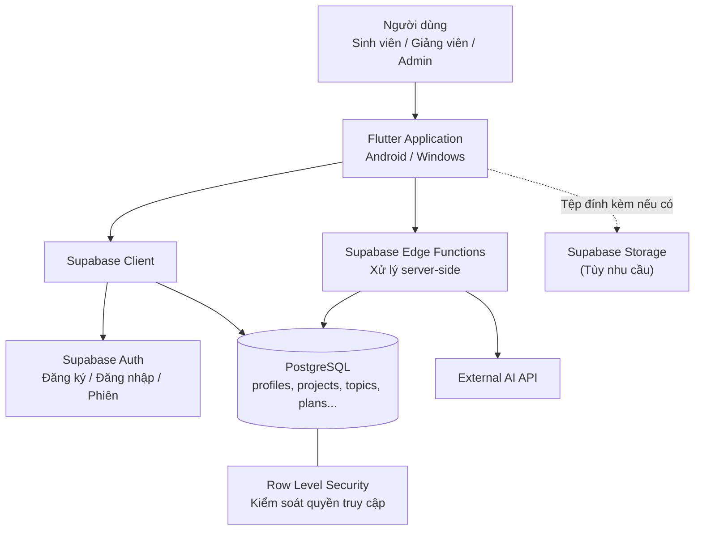
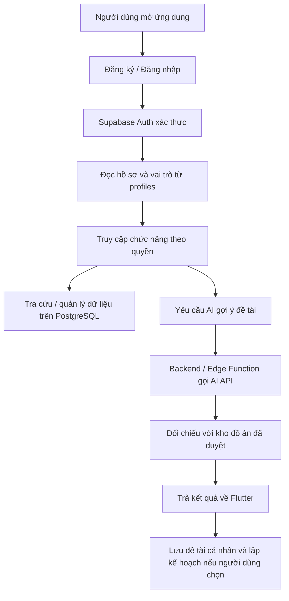
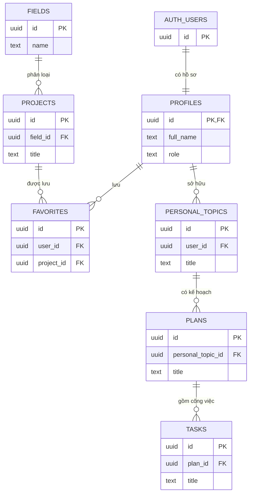

# Nhóm 14 – 65KTPM
## TÊN ĐỀ TÀI: Hệ thống hỗ trợ định hướng và chuẩn bị đồ án tốt nghiệp cho sinh viên

> Tài liệu tổng quan dành cho thành viên Nhóm 14 khi tham gia phát triển bài tập học phần **Phát triển Ứng dụng Di động (PTUDDD)**.

## 1. Thông tin dự án

| Nội dung | Thông tin |
|---|---|
| Nhóm | Nhóm 14 – 65KTPM |
| Học phần | Phát triển Ứng dụng Di động (PTUDDD) |
| Giảng viên hướng dẫn | ThS. Đỗ Oanh Cường |
| Repository làm việc của nhóm | [`Maya0612/project-ptuddd`](https://github.com/Maya0612/project-ptuddd) |
| Nhánh tích hợp nội bộ | `nhom14-65ktpm` |
| Project Supabase | `n14-mobile-graduation-support` |
| Frontend | Flutter |
| Backend Cloud và Database | Supabase và PostgreSQL |
| AI | AI API bên ngoài, được gọi qua backend/Edge Function phù hợp |

**Mục tiêu:** Xây dựng ứng dụng đa nền tảng hỗ trợ sinh viên tra cứu đồ án các khóa trước, tham khảo và đối chiếu hướng đề tài bằng AI, quản lý đề tài cá nhân và lập kế hoạch chuẩn bị đồ án tốt nghiệp.

## 2. Tài liệu cần đọc

Thành viên cần đọc theo thứ tự:

1. [`danhsachnhom.md`](./danhsachnhom.md) – Danh sách thành viên, phân công nhiệm vụ và hướng dẫn môi trường.
2. [`docs/GIT_WORKFLOW.md`](./docs/GIT_WORKFLOW.md) – Quy trình Git/GitHub, branch, Issue, Project Board, Pull Request, review, merge và quy ước database.
3. README và hướng dẫn ở thư mục gốc repository do giảng viên cung cấp – Tuân thủ cấu trúc, quy định và cách nộp bài của học phần. **Không tự ý sửa tài liệu gốc của giảng viên.**

## 3. Phân công thành viên và branch

Mỗi thành viên làm việc trên branch cá nhân cố định được phân công. Branch cá nhân được đồng bộ từ `nhom14-65ktpm`; Pull Request nội bộ luôn có base branch là `nhom14-65ktpm`.

| Mã TV | Thành viên | Branch cá nhân | Phạm vi chính |
|---|---|---|---|
| TV1 | Đào Hà Thu – Trưởng nhóm | `feature/nhom14/foundation-auth` | Kiến trúc, cấu trúc Flutter, kết nối Supabase, Auth, `profiles`, RLS nền tảng, tổng hợp schema và tích hợp |
| TV2 | Phạm Kim Anh | `feature/nhom14/project-repository` | Kho đồ án, `projects`, `fields`, `favorites`, tìm kiếm/lọc, đề xuất bổ sung và quy trình duyệt |
| TV3 | Trần Đức Trung | `feature/nhom14/ai-suggestions` | AI gợi ý 3–5 hướng đề tài, đối chiếu với kho đồ án đã duyệt, tích hợp AI API qua backend/Edge Function |
| TV4 | Trịnh Mạnh Đức | `feature/nhom14/personal-topics` | Quản lý đề tài cá nhân, `personal_topics`, lưu ý tưởng tự tạo hoặc từ AI |
| TV5 | Vương Tiến Dũng | `feature/nhom14/planning-progress` | Lập kế hoạch, `plans`, `tasks`, thời hạn, trạng thái và tiến độ |

Chi tiết đầu việc và tiêu chí hoàn thành xem trong GitHub Issues được giao cho từng thành viên.

## 4. Phạm vi chức năng

Hệ thống dự kiến gồm 5 nhóm chức năng:

1. **Nền tảng và xác thực:** tài khoản, hồ sơ, vai trò và quyền truy cập.
2. **Kho đồ án:** quản lý dữ liệu đồ án, lĩnh vực, tìm kiếm, yêu thích và đề xuất bổ sung đồ án.
3. **AI định hướng:** nhận thông tin sở thích/kỹ năng, gợi ý 3–5 hướng đề tài và đối chiếu với dữ liệu đồ án đã được duyệt.
4. **Đề tài cá nhân:** tạo, chỉnh sửa, theo dõi các đề tài sinh viên đang cân nhắc.
5. **Kế hoạch và tiến độ:** lập kế hoạch, công việc, thời hạn và trạng thái thực hiện gắn với đề tài cá nhân.

**Giới hạn phạm vi:** AI chỉ có vai trò tham khảo, không phê duyệt đề tài. “Lưu/đăng ký đề tài cá nhân” trong ứng dụng không đồng nghĩa với đăng ký đề tài chính thức tại nhà trường. Phiên bản đầu không mặc định bao gồm quản lý giảng viên hướng dẫn, lịch bảo vệ, chấm điểm, chat nội bộ hoặc huấn luyện mô hình AI riêng.

## 5. Công nghệ và kiến trúc tổng quan

### 5.1. Công nghệ

| Thành phần | Công nghệ | Trách nhiệm |
|---|---|---|
| Ứng dụng | Flutter | Giao diện và logic phía client; định hướng Android và Windows |
| Backend Cloud | Supabase | Cung cấp Auth, PostgreSQL, RLS và Edge Functions |
| Cơ sở dữ liệu | PostgreSQL trên Supabase | Lưu dữ liệu quan hệ của hệ thống |
| Xác thực | Supabase Auth | Đăng ký, đăng nhập, đăng xuất và quản lý phiên |
| Phân quyền dữ liệu | PostgreSQL RLS | Kiểm soát quyền đọc/ghi theo người dùng và vai trò |
| Xử lý server-side | Supabase Edge Functions khi cần | Xử lý nghiệp vụ cần bảo vệ khóa bí mật và gọi AI API |
| AI | AI API bên ngoài | Sinh gợi ý và hỗ trợ đối chiếu đề tài |
| Lưu tệp | Supabase Storage nếu cần | Lưu tài liệu được phép chia sẻ, nếu chức năng này nằm trong phạm vi |

### 5.2. Sơ đồ kiến trúc



**Diễn giải:**

- Flutter là lớp giao diện, nhận thao tác và hiển thị kết quả.
- Supabase Auth quản lý xác thực; PostgreSQL lưu dữ liệu nghiệp vụ.
- RLS được bật và cấu hình phù hợp trên các bảng cần bảo vệ. Không chỉ dựa vào việc ẩn/hiện nút trên giao diện để phân quyền.
- Khi cần gọi AI API có khóa bí mật, Flutter gửi yêu cầu tới Edge Function hoặc backend phù hợp; khóa bí mật chỉ được lưu ở môi trường server-side.
- Không cần xây dựng một backend độc lập bằng Node.js/Java/Python trong phiên bản đầu nếu Supabase đáp ứng yêu cầu.

### 5.3. Luồng xử lý tổng quát



## 6. Cấu trúc cơ sở dữ liệu đã triển khai

Cơ sở dữ liệu đã được triển khai trên Supabase Cloud dùng chung của Nhóm 14, gồm 7 bảng nghiệp vụ và 2 view. Các thành viên phát triển chức năng dựa trên schema này.

### 6.1. Danh sách bảng và view

| Bảng/View | Mục đích | Phụ trách |
|---|---|---|
| `profiles` | Hồ sơ và vai trò người dùng | TV1 |
| `fields` | Danh mục lĩnh vực đồ án | TV2 |
| `projects` | Kho đồ án tốt nghiệp | TV2 |
| `favorites` | Danh sách đồ án yêu thích | TV2 |
| `personal_topics` | Đề tài cá nhân của sinh viên | TV4 |
| `plans` | Kế hoạch thực hiện đề tài | TV5 |
| `tasks` | Công việc thuộc kế hoạch | TV5 |
| `ai_published_projects` | View cung cấp dữ liệu đồ án đã duyệt cho AI | TV3 |
| `plan_progress` | View tính tiến độ hoàn thành kế hoạch | TV5 |

`auth.users` do Supabase Auth quản lý, không phải bảng nghiệp vụ do nhóm tự tạo.

Không tạo bảng `ai_suggestions` trong phiên bản hiện tại. AI trả về 3–5 gợi ý; chỉ đề tài được sinh viên lựa chọn mới được lưu vào `personal_topics`.

### 6.2. Quan hệ dữ liệu

- `profiles.id` tham chiếu `auth.users.id`.
- `projects.field_id` tham chiếu `fields.id`.
- `projects.submitted_by` và `projects.reviewed_by` tham chiếu `auth.users.id`.
- `favorites.user_id` tham chiếu `auth.users.id`.
- `favorites.project_id` tham chiếu `projects.id`.
- `personal_topics.user_id` tham chiếu `auth.users.id`.
- `personal_topics.field_id` tham chiếu `fields.id`.
- `plans.personal_topic_id` tham chiếu `personal_topics.id`.
- `tasks.plan_id` tham chiếu `plans.id`.

Bảng `favorites` sử dụng khóa chính kép `(user_id, project_id)` để ngăn lưu trùng đồ án.

### 6.3. Danh sách trường dữ liệu

| Bảng | Các trường |
|---|---|
| `profiles` | id, full_name, student_code, class_name, role, created_at, updated_at |
| `fields` | id, name |
| `projects` | id, student_code, student_name, class_name, title, supervisor_name, department_name, field_id, year, description, approach, technologies, status, submitted_by, reviewed_by, reviewed_at, created_at, updated_at |
| `favorites` | user_id, project_id, created_at |
| `personal_topics` | id, user_id, title, field_id, objective, approach, technologies, source, status, archived_at, created_at, updated_at |
| `plans` | id, personal_topic_id, title, description, start_date, end_date, status, created_at, updated_at |
| `tasks` | id, plan_id, phase, title, description, due_date, status, order_index, completed_at, created_at, updated_at |

Kiểu dữ liệu, giá trị mặc định, constraints, grants, triggers và RLS được quy định chính thức trong các file migration SQL.

### 6.4. Giá trị trạng thái

| Trường | Giá trị hợp lệ |
|---|---|
| profiles.role | student, lecturer, admin |
| projects.status | pending, published, rejected |
| personal_topics.source | manual, ai |
| personal_topics.status | exploring, preparing, in_progress, completed |
| plans.status | active, completed, archived |
| tasks.status | todo, in_progress, done |

### 6.5. Phân quyền người dùng

| Chức năng | Student | Lecturer | Admin |
|---|---|---|---|
| Xem và chỉnh sửa hồ sơ của mình | Có | Có | Có |
| Tra cứu kho đồ án | Có | Có | Có |
| Đề xuất bổ sung đồ án | Có | — | — |
| Quản lý và duyệt kho đồ án | — | Có | Có |
| Quản lý lĩnh vực | — | Có | Có |
| Lưu đồ án yêu thích | Có | — | — |
| AI gợi ý đề tài | Có | — | — |
| Quản lý đề tài cá nhân | Có | — | — |
| Quản lý kế hoạch và công việc cá nhân | Có | — | — |

Vai trò được lấy từ bảng `profiles`. Việc phân quyền phải được thực thi tại database và backend, không chỉ dựa vào giao diện Flutter.

### 6.6. Quy ước tích hợp theo thành viên

**TV1 – Foundation Auth**

- Sử dụng Supabase Auth để xác thực.
- Trigger tự động tạo profile khi đăng ký.
- Tài khoản đăng ký mới mặc định có role `student`.
- Client chỉ được cập nhật `full_name`, `student_code`, `class_name` trên hồ sơ của mình.
- Không cập nhật trực tiếp role hoặc updated_at từ Flutter.

**TV2 – Project Repository**

- Sử dụng `fields`, `projects`, `favorites`.
- Đề xuất của sinh viên có trạng thái mặc định `pending`.
- Sử dụng RPC `get_repository_projects`, `save_repository_project` và `review_project` cho nghiệp vụ quản lý kho của lecturer/admin.
- Không sử dụng `select('*')` trực tiếp trên bảng projects bằng client authenticated.
- Không hiển thị trái phép thông tin cá nhân của sinh viên các khóa trước.
- Khi nhập dữ liệu đồ án cũ, hỗ trợ mã sinh viên, họ tên, lớp, tên đề tài, giáo viên hướng dẫn và bộ môn.
- Không tạo thêm cột số thứ tự; số thứ tự được hiển thị tại giao diện.

**TV3 – AI Suggestions**

- Sử dụng view `ai_published_projects` để đối chiếu với kho đồ án đã duyệt.
- Không sử dụng dữ liệu cá nhân của sinh viên khóa trước làm đầu vào AI.
- Gọi AI API thông qua Edge Function hoặc backend bảo mật.
- Không lưu API secret trong Flutter hoặc GitHub.
- Chỉ chuyển đề tài được người dùng lựa chọn sang module TV4.

**TV4 – Personal Topics**

- Sử dụng bảng `personal_topics`.
- Chỉ quản lý đề tài thuộc tài khoản sinh viên hiện tại.
- Phân biệt nguồn đề tài `manual` và `ai`.
- Sử dụng `archived_at` khi lưu trữ đề tài.
- Không xóa đề tài đang có kế hoạch liên kết.

**TV5 – Planning Progress**

- Sử dụng bảng `plans`, `tasks` và view `plan_progress`.
- Mỗi kế hoạch phải liên kết với một đề tài cá nhân.
- Mỗi công việc phải liên kết với một kế hoạch.
- Tiến độ được tính từ số công việc hoàn thành trên tổng số công việc.
- Kế hoạch chưa có công việc có tiến độ 0%.
- `completed_at` được đồng bộ bằng trigger.
- Khi xóa kế hoạch, các công việc thuộc kế hoạch bị xóa theo.

### 6.7. Migration SQL

Các migration chính thức được lưu tại `nhom14-65ktpm/supabase/migrations/`.

| Thứ tự | File | Nội dung |
|---|---|---|
| 1 | `20261128000001_foundation_auth.sql` | Profiles, Auth trigger, role và RLS nền tảng |
| 2 | `20261128000002_project_repository.sql` | Fields, projects, favorites, RPC và AI view |
| 3 | `20261128000003_personal_topics.sql` | Personal topics và RLS |
| 4 | `20261128000004_planning_progress.sql` | Plans, tasks, triggers và progress view |

**Lưu ý quan trọng:**

- Bốn migration trên đã được thực thi thủ công bằng SQL Editor trên Supabase Cloud dùng chung.
- Thành viên clone repository về không cần chạy lại migration.
- Lịch sử migration của Supabase CLI chưa được thiết lập.
- Không tự ý chạy `supabase db push`, `supabase db reset` hoặc migration repair trên project dùng chung.
- Không chạy lại các migration cũ.
- Mọi thay đổi schema phải được TV1 và thành viên phụ trách module thống nhất trước khi triển khai.
- Các migration mới phát sinh phải được lưu trong Git và cập nhật tài liệu liên quan.

Các bảng dưới đây là **danh sách định hướng**, chưa phải schema cuối cùng. Chỉ tạo hoặc thay đổi bảng trên Supabase dùng chung sau khi schema đã được đề xuất, rà soát và thống nhất theo `docs/GIT_WORKFLOW.md`.

| Bảng | Mục đích | Phụ trách |
|---|---|---|
| `profiles` | Hồ sơ bổ sung và vai trò người dùng; liên kết `auth.users` | TV1 |
| `projects` | Thông tin đồ án trong kho | TV2 |
| `fields` | Danh mục lĩnh vực đồ án | TV2 |
| `favorites` | Đồ án được người dùng lưu yêu thích | TV2 |
| `personal_topics` | Đề tài cá nhân của sinh viên | TV4 |
| `plans` | Kế hoạch chuẩn bị gắn với đề tài cá nhân | TV5 |
| `tasks` | Công việc thuộc một kế hoạch | TV5 |
| `ai_suggestions` | Chỉ tạo nếu nhóm thống nhất cần lưu lịch sử gợi ý AI | TV3 phối hợp TV1 |

`auth.users` là bảng do Supabase Auth quản lý, không phải bảng nghiệp vụ do nhóm tự tạo.

### 6.1. Quan hệ dữ liệu dự kiến



Sơ đồ chỉ thể hiện quan hệ dự kiến ở mức khái niệm. Kiểu dữ liệu, tên cột chính thức, cardinality, unique constraints, delete behavior và chính sách RLS phải được xác nhận trong ERD/schema chi tiết trước khi tạo migration.

## 7. Cấu trúc thư mục nhóm

```text
project-ptuddd/
├── README.md
├── .gitignore
└── nhom14-65ktpm/
    ├── README.md
    ├── danhsachnhom.md
    ├── docs/
    │   └── GIT_WORKFLOW.md
    ├── supabase/
    │   └── migrations/
    │       ├── 20261128000001_foundation_auth.sql
    │       ├── 20261128000002_project_repository.sql
    │       ├── 20261128000003_personal_topics.sql
    │       └── 20261128000004_planning_progress.sql
    └── src/
        ├── android/
        ├── ios/
        ├── windows/
        ├── lib/
        │   ├── core/
        │   │   ├── supabase_config.dart
        │   │   └── theme/
        │   ├── models/
        │   ├── screens/
        │   ├── services/
        │   └── main.dart
        ├── test/
        ├── env.json
        └── pubspec.yaml
```

Đây là cấu trúc các thư mục chính, không liệt kê toàn bộ file mã nguồn.

Thư mục `migrations_backup/` chỉ lưu migration cũ trên máy trưởng nhóm và không được đưa lên GitHub.

Không tự ý thay đổi cấu trúc nộp bài hoặc tài liệu gốc do giảng viên quy định.
## 8. Cấu hình môi trường và khởi chạy ứng dụng

### 8.1. Yêu cầu môi trường

- Flutter SDK và Dart SDK.
- Git.
- VS Code hoặc Android Studio.
- Chrome để kiểm thử nhanh trên Web.
- Android SDK nếu phát triển trên Android.
- Visual Studio với bộ công cụ Desktop development with C++ nếu chạy Windows Desktop.

Kiểm tra môi trường:

```bash
flutter doctor
git --version
```

### 8.2. Clone repository

Áp dụng cho thành viên chưa có repository trên máy:

```bash
git clone https://github.com/Maya0612/project-ptuddd.git
cd project-ptuddd
git switch nhom14-65ktpm
```

Thành viên đã có repository thực hiện đồng bộ theo `docs/GIT_WORKFLOW.md`, không cần clone lại.

Sau khi đồng bộ, chuyển sang branch cá nhân được phân công để phát triển chức năng.

### 8.3. Cài đặt dependencies

```bash
cd nhom14-65ktpm/src
flutter pub get
```

### 8.4. Cấu hình Supabase

File `env.json` đã được cung cấp trong repository tại `nhom14-65ktpm/src/env.json`.

File chỉ chứa:

- `SUPABASE_URL`: URL project Supabase dùng chung.
- `SUPABASE_ANON_KEY`: Publishable Key dành cho client.

Không cần tạo project Supabase mới hoặc tự thay đổi thông tin kết nối.

Publishable Key được phép sử dụng trong ứng dụng client. Không thêm service_role key, secret key, database password hoặc AI API secret vào file này.

### 8.5. Khởi chạy ứng dụng

Kiểm tra thiết bị:

```bash
flutter devices
```

Chạy trên Chrome:

```bash
flutter run -d chrome --dart-define-from-file=env.json
```

Chạy trên Windows:

```bash
flutter run -d windows --dart-define-from-file=env.json
```

Chạy trên thiết bị Android đang kết nối:

```bash
flutter run --dart-define-from-file=env.json
```

### 8.6. Kiểm tra chất lượng code

Trước khi commit:

```bash
flutter analyze
flutter test --dart-define-from-file=env.json
```

Kiểm thử thêm các chức năng thực tế thuộc module được phân công.

### 8.7. Tài khoản kiểm thử

Hệ thống hỗ trợ ba vai trò:

- Student.
- Lecturer.
- Admin.

Thành viên sử dụng tài khoản đã đăng ký hoặc tài khoản kiểm thử do TV1 cung cấp nội bộ.

Không lưu mật khẩu tài khoản kiểm thử trong README, mã nguồn, migration hoặc GitHub.

Tài khoản đăng ký mới phải được tạo profile tự động với vai trò student. Việc cấp vai trò lecturer/admin do người quản trị có thẩm quyền thực hiện.

### 8.8. Trạng thái Foundation Auth

Foundation Auth đã được đồng bộ với schema database mới và kiểm thử thủ công các chức năng đăng ký, đăng nhập, đăng xuất, hồ sơ cá nhân và điều hướng theo vai trò.

Các module nghiệp vụ còn lại tiếp tục được phát triển bởi TV2–TV5 theo phân công.

Database dùng chung đã được triển khai. Thành viên không cần Docker, Supabase CLI hoặc chạy lại migration để khởi chạy Flutter với Supabase Cloud.

## 9. Bảo mật

- Chỉ sử dụng Supabase publishable/anon key trong Flutter.
- File `env.json` hiện tại được phép lưu trong Git vì chỉ chứa URL và Publishable Key dành cho client.
- Không commit `.env`, mật khẩu, Database Password, Supabase `service_role` key, secret key hoặc AI API secret.
- Không nhúng khóa bí mật vào mã Flutter hoặc truyền khóa bí mật qua dart-define.
- Bật RLS và duy trì chính sách phân quyền trên các bảng nghiệp vụ.
- Không cấp quyền UPDATE toàn bộ bảng profiles cho authenticated.
- Không cho người dùng tự thay đổi role.
- Không vô hiệu hóa RLS để khắc phục lỗi permission denied.
- Không sử dụng service_role key để vượt qua RLS từ Flutter.
- Không cấp quyền quản trị Supabase không cần thiết cho thành viên.
- Không đưa dữ liệu cá nhân hoặc tài liệu đồ án không được phép chia sẻ lên GitHub.
- Chỉ sử dụng dữ liệu đồ án đã duyệt và không chứa thông tin cá nhân trong quá trình đối chiếu bằng AI.
- Không tự ý sửa hoặc xóa dữ liệu dùng chung của thành viên khác.
- Mọi thay đổi schema, grants, RPC, triggers và RLS phải được rà soát trước khi triển khai.

Chi tiết quy trình bảo mật và database xem tại [docs/GIT_WORKFLOW.md](./docs/GIT_WORKFLOW.md).
## 10. Quy trình đóng góp

1. Đọc tài liệu nhóm và nhận GitHub Issue được giao.
2. Làm việc trên branch cá nhân cố định.
3. Đồng bộ branch cá nhân với `nhom14-65ktpm` trước khi bắt đầu phiên làm việc.
4. Commit và push thay đổi lên branch cá nhân.
5. Tạo Pull Request về `nhom14-65ktpm`, gắn Issue bằng `Refs #<issue_number>`.
6. Thành viên khác review; sửa theo góp ý nếu có.
7. Chỉ merge sau khi được approve và kiểm tra không còn conflict; sau merge mới chuyển Issue sang Done.
8. Tiếp tục đồng bộ branch cá nhân theo hướng dẫn trong `docs/GIT_WORKFLOW.md`.

---

**Lưu ý:** README này mô tả định hướng hiện tại của nhóm. Các thành viên phát triển chức năng dựa trên schema và phân công hiện tại. Khi có thay đổi về database, kiến trúc hoặc phạm vi chức năng, TV1 có trách nhiệm cập nhật tài liệu và thông báo cho nhóm.