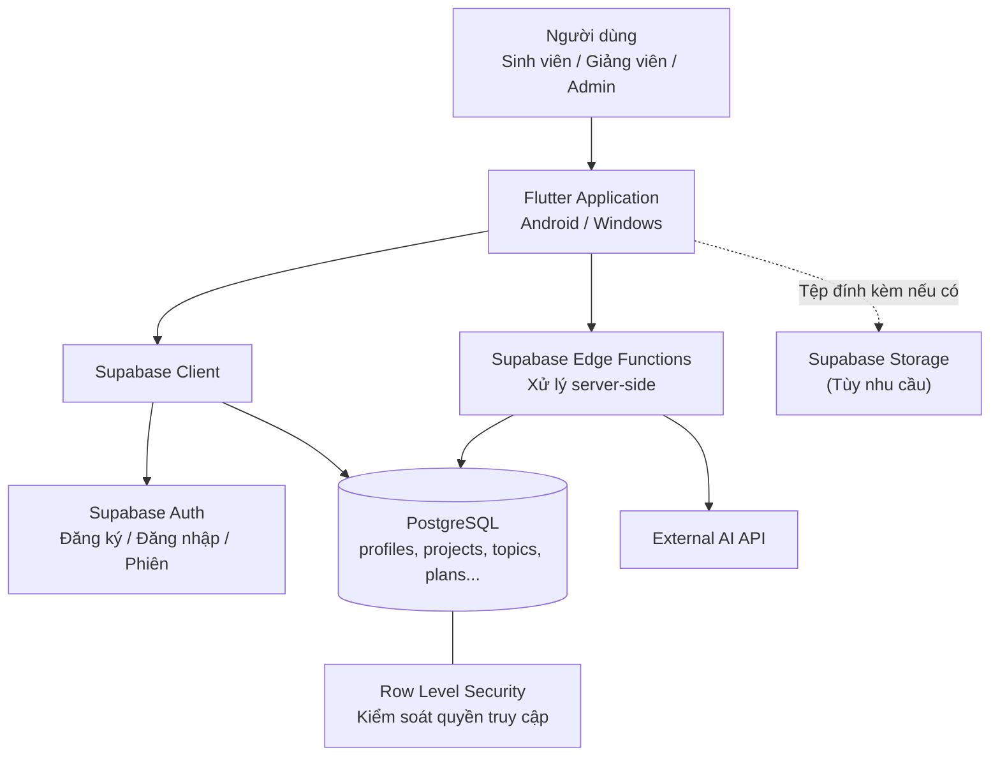
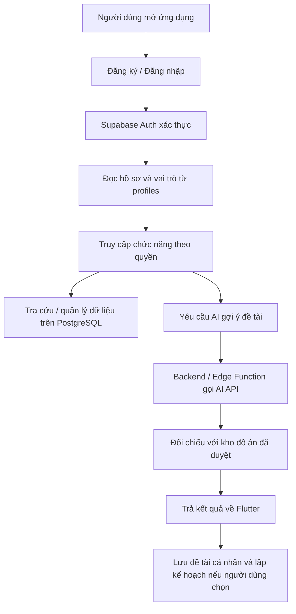
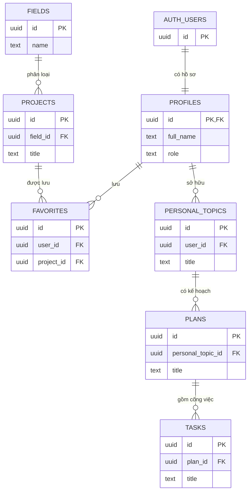

# Nhóm 14 – 65KTPM
## Hệ thống hỗ trợ định hướng và chuẩn bị đồ án tốt nghiệp cho sinh viên

> Tài liệu tổng quan dành cho thành viên Nhóm 14 khi tham gia phát triển bài tập học phần **Phát triển Ứng dụng Di động (PTUDDD)**.

## 1. Thông tin dự án

| Nội dung | Thông tin |
|---|---|
| Nhóm | Nhóm 14 – 65KTPM |
| Học phần | Phát triển Ứng dụng Di động (PTUDDD) |
| Giảng viên hướng dẫn | ThS. Đỗ Oanh Cường |
| Repository làm việc của nhóm | [`Maya0612/project-ptuddd`](https://github.com/Maya0612/project-ptuddd) |
| Nhánh tích hợp nội bộ | `nhom14-65ktpm` |
| Project Supabase | `n14-mobile-graduation-support` |
| Frontend | Flutter |
| Backend Cloud và Database | Supabase và PostgreSQL |
| AI | AI API bên ngoài, được gọi qua backend/Edge Function phù hợp |

**Mục tiêu:** Xây dựng ứng dụng đa nền tảng hỗ trợ sinh viên tra cứu đồ án các khóa trước, tham khảo và đối chiếu hướng đề tài bằng AI, quản lý đề tài cá nhân và lập kế hoạch chuẩn bị đồ án tốt nghiệp.

## 2. Tài liệu cần đọc

Thành viên cần đọc theo thứ tự:

1. [`danhsachnhom.md`](./danhsachnhom.md) – Danh sách thành viên, phân công nhiệm vụ và hướng dẫn môi trường.
2. [`docs/GIT_WORKFLOW.md`](./docs/GIT_WORKFLOW.md) – Quy trình Git/GitHub, branch, Issue, Project Board, Pull Request, review, merge và quy ước database.
3. README và hướng dẫn ở thư mục gốc repository do giảng viên cung cấp – Tuân thủ cấu trúc, quy định và cách nộp bài của học phần. **Không tự ý sửa tài liệu gốc của giảng viên.**

## 3. Phân công thành viên và branch

Mỗi thành viên làm việc trên branch cá nhân cố định được phân công. Branch cá nhân được đồng bộ từ `nhom14-65ktpm`; Pull Request nội bộ luôn có base branch là `nhom14-65ktpm`.

| Mã TV | Thành viên | Branch cá nhân | Phạm vi chính |
|---|---|---|---|
| TV1 | Đào Hà Thu – Trưởng nhóm | `feature/tv1-foundation-auth` | Kiến trúc, cấu trúc Flutter, kết nối Supabase, Auth, `profiles`, RLS nền tảng, tổng hợp schema và tích hợp |
| TV2 | Phạm Kim Anh | `feature/tv2-project-repository` | Kho đồ án, `projects`, `fields`, `favorites`, tìm kiếm/lọc, đề xuất bổ sung và quy trình duyệt |
| TV3 | Trần Đức Trung | `feature/tv3-ai-suggestions` | AI gợi ý 3–5 hướng đề tài, đối chiếu với kho đồ án đã duyệt, tích hợp AI API qua backend/Edge Function |
| TV4 | Trịnh Mạnh Đức | `feature/tv4-personal-topics` | Quản lý đề tài cá nhân, `personal_topics`, lưu ý tưởng tự tạo hoặc từ AI |
| TV5 | Vương Tiến Dũng | `feature/tv5-planning-progress` | Lập kế hoạch, `plans`, `tasks`, thời hạn, trạng thái và tiến độ |

Chi tiết đầu việc và tiêu chí hoàn thành xem trong GitHub Issues được giao cho từng thành viên.

## 4. Phạm vi chức năng

Hệ thống dự kiến gồm 5 nhóm chức năng:

1. **Nền tảng và xác thực:** tài khoản, hồ sơ, vai trò và quyền truy cập.
2. **Kho đồ án:** quản lý dữ liệu đồ án, lĩnh vực, tìm kiếm, yêu thích và đề xuất bổ sung đồ án.
3. **AI định hướng:** nhận thông tin sở thích/kỹ năng, gợi ý 3–5 hướng đề tài và đối chiếu với dữ liệu đồ án đã được duyệt.
4. **Đề tài cá nhân:** tạo, chỉnh sửa, theo dõi các đề tài sinh viên đang cân nhắc.
5. **Kế hoạch và tiến độ:** lập kế hoạch, công việc, thời hạn và trạng thái thực hiện gắn với đề tài cá nhân.

**Giới hạn phạm vi:** AI chỉ có vai trò tham khảo, không phê duyệt đề tài. “Lưu/đăng ký đề tài cá nhân” trong ứng dụng không đồng nghĩa với đăng ký đề tài chính thức tại nhà trường. Phiên bản đầu không mặc định bao gồm quản lý giảng viên hướng dẫn, lịch bảo vệ, chấm điểm, chat nội bộ hoặc huấn luyện mô hình AI riêng.

## 5. Công nghệ và kiến trúc tổng quan

### 5.1. Công nghệ

| Thành phần | Công nghệ | Trách nhiệm |
|---|---|---|
| Ứng dụng | Flutter | Giao diện và logic phía client; định hướng Android và Windows |
| Backend Cloud | Supabase | Cung cấp Auth, PostgreSQL, RLS và Edge Functions |
| Cơ sở dữ liệu | PostgreSQL trên Supabase | Lưu dữ liệu quan hệ của hệ thống |
| Xác thực | Supabase Auth | Đăng ký, đăng nhập, đăng xuất và quản lý phiên |
| Phân quyền dữ liệu | PostgreSQL RLS | Kiểm soát quyền đọc/ghi theo người dùng và vai trò |
| Xử lý server-side | Supabase Edge Functions khi cần | Xử lý nghiệp vụ cần bảo vệ khóa bí mật và gọi AI API |
| AI | AI API bên ngoài | Sinh gợi ý và hỗ trợ đối chiếu đề tài |
| Lưu tệp | Supabase Storage nếu cần | Lưu tài liệu được phép chia sẻ, nếu chức năng này nằm trong phạm vi |

### 5.2. Sơ đồ kiến trúc



**Diễn giải:**

- Flutter là lớp giao diện, nhận thao tác và hiển thị kết quả.
- Supabase Auth quản lý xác thực; PostgreSQL lưu dữ liệu nghiệp vụ.
- RLS được bật và cấu hình phù hợp trên các bảng cần bảo vệ. Không chỉ dựa vào việc ẩn/hiện nút trên giao diện để phân quyền.
- Khi cần gọi AI API có khóa bí mật, Flutter gửi yêu cầu tới Edge Function hoặc backend phù hợp; khóa bí mật chỉ được lưu ở môi trường server-side.
- Không cần xây dựng một backend độc lập bằng Node.js/Java/Python trong phiên bản đầu nếu Supabase đáp ứng yêu cầu.

### 5.3. Luồng xử lý tổng quát



## 6. Cấu trúc dữ liệu dự kiến

Các bảng dưới đây là **danh sách định hướng**, chưa phải schema cuối cùng. Chỉ tạo hoặc thay đổi bảng trên Supabase dùng chung sau khi schema đã được đề xuất, rà soát và thống nhất theo `docs/GIT_WORKFLOW.md`.

| Bảng | Mục đích | Phụ trách |
|---|---|---|
| `profiles` | Hồ sơ bổ sung và vai trò người dùng; liên kết `auth.users` | TV1 |
| `projects` | Thông tin đồ án trong kho | TV2 |
| `fields` | Danh mục lĩnh vực đồ án | TV2 |
| `favorites` | Đồ án được người dùng lưu yêu thích | TV2 |
| `personal_topics` | Đề tài cá nhân của sinh viên | TV4 |
| `plans` | Kế hoạch chuẩn bị gắn với đề tài cá nhân | TV5 |
| `tasks` | Công việc thuộc một kế hoạch | TV5 |
| `ai_suggestions` | Chỉ tạo nếu nhóm thống nhất cần lưu lịch sử gợi ý AI | TV3 phối hợp TV1 |

`auth.users` là bảng do Supabase Auth quản lý, không phải bảng nghiệp vụ do nhóm tự tạo.

### 6.1. Quan hệ dữ liệu dự kiến



Sơ đồ chỉ thể hiện quan hệ dự kiến ở mức khái niệm. Kiểu dữ liệu, tên cột chính thức, cardinality, unique constraints, delete behavior và chính sách RLS phải được xác nhận trong ERD/schema chi tiết trước khi tạo migration.

## 7. Cấu trúc thư mục nhóm

Cấu trúc mục tiêu trong repository:

```text
project-ptuddd/
├── README.md                         # README gốc do giảng viên cung cấp
└── nhom14-65ktpm/
    ├── README.md                     # README tổng quan của nhóm
    ├── danhsachnhom.md               # Thành viên, phân công, hướng dẫn môi trường
    ├── docs/
    │   ├── GIT_WORKFLOW.md           # Quy trình Git/GitHub và quy ước database
    │   └── ...                       # Báo cáo và tài liệu thiết kế khác
    ├── supabase/
    │   ├── config.toml               # Cấu hình Supabase CLI (khi được khởi tạo)
    │   └── migrations/               # SQL migration được quản lý bằng Git
    └── src/
        ├── android/
        ├── ios/
        ├── lib/
        ├── test/
        └── pubspec.yaml
```

Nếu cấu trúc thực tế trong repository khác sơ đồ này, cần đối chiếu với README gốc của giảng viên trước khi di chuyển hoặc tạo thư mục. Không tự ý thay đổi cấu trúc nộp bài do giảng viên quy định.

## 8. Khởi chạy ứng dụng Flutter

Mở terminal tại thư mục nhóm rồi chạy:

```bash
cd nhom14-65ktpm/src
flutter pub get
flutter run
```

Nếu đang ở thư mục `nhom14-65ktpm` thì chỉ cần:

```bash
cd src
flutter pub get
flutter run
```

Yêu cầu: đã cài Flutter SDK, Android Studio hoặc thiết bị/giả lập phù hợp. Phiên bản Flutter/Dart và cấu hình môi trường cụ thể cần được ghi nhận trong `danhsachnhom.md` khi nhóm chốt môi trường dùng chung.

## 9. Bảo mật

- Không commit `.env`, mật khẩu, Database Password, Supabase `service_role` key hoặc AI API secret.
- Không nhúng khóa bí mật vào mã Flutter.
- Chỉ dùng publishable/anon key ở client theo cấu hình Supabase phù hợp và phải bảo vệ dữ liệu bằng RLS.
- Không cấp quyền quản trị Supabase không cần thiết cho thành viên.
- Không đưa dữ liệu cá nhân hoặc tài liệu đồ án không được phép chia sẻ lên kho dùng chung.
- Chi tiết quy trình bảo mật và database xem tại [`docs/GIT_WORKFLOW.md`](./docs/GIT_WORKFLOW.md).

## 10. Quy trình đóng góp

1. Đọc tài liệu nhóm và nhận GitHub Issue được giao.
2. Làm việc trên branch cá nhân cố định.
3. Đồng bộ branch cá nhân với `nhom14-65ktpm` trước khi bắt đầu phiên làm việc.
4. Commit và push thay đổi lên branch cá nhân.
5. Tạo Pull Request về `nhom14-65ktpm`, gắn Issue bằng `Refs #<issue_number>`.
6. Thành viên khác review; sửa theo góp ý nếu có.
7. Chỉ merge sau khi được approve và kiểm tra không còn conflict; sau merge mới chuyển Issue sang Done.
8. Tiếp tục đồng bộ branch cá nhân theo hướng dẫn trong `docs/GIT_WORKFLOW.md`.

---

**Lưu ý:** README này mô tả định hướng hiện tại của nhóm. Khi nhóm thống nhất schema, kiến trúc hoặc phạm vi chính thức, TV1 cập nhật tài liệu và thông báo cho các thành viên.
