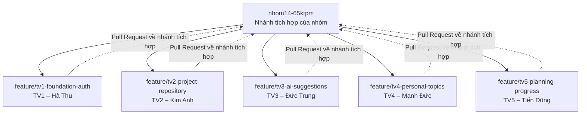

# QUY TRÌNH GIT/GITHUB, ISSUE, PROJECT BOARD VÀ DATABASE
## Nhóm 14 – 65KTPM

Tài liệu này quy định cách làm việc chung của 5 thành viên trên repository nhóm. Thành viên cần đọc và tuân thủ trước khi tạo branch, commit, Pull Request hoặc thay đổi database.

## 1. Repository và mô hình branch

| Thành phần | Giá trị | Vai trò |
|---|---|---|
| Repository nhóm | `Maya0612/project-ptuddd` | Nơi nhóm phát triển và tích hợp |
| Nhánh tích hợp | `nhom14-65ktpm` | Nhánh nhận các Pull Request nội bộ |
| Nhánh gốc `main` của fork | `main` | Không dùng cho phát triển nội bộ; giữ theo quy định nộp bài của giảng viên |
| Repository giảng viên | `oanhcuongdo/project-ptuddd` | Kho upstream để nhận mã nguồn gốc và nộp bài |

### 1.1. Sơ đồ branch



Sơ đồ thể hiện quan hệ làm việc: branch cá nhân được tạo từ nhánh tích hợp; PR nội bộ đi từ branch cá nhân về nhánh tích hợp. Không phát triển trực tiếp trên `main` hoặc `nhom14-65ktpm`.

## 2. Branch cá nhân cố định và trách nhiệm

Mỗi thành viên dùng đúng một branch cá nhân cố định:

| Mã TV | Thành viên | Branch cá nhân | Phạm vi |
|---|---|---|---|
| TV1 | Đào Hà Thu – Trưởng nhóm | `feature/tv1-foundation-auth` | Kiến trúc, cấu trúc Flutter, Supabase, Auth, `profiles`, RLS nền tảng, tổng hợp schema và tích hợp |
| TV2 | Phạm Kim Anh | `feature/tv2-project-repository` | `projects`, `fields`, `favorites`, kho đồ án, tìm kiếm/lọc, đề xuất và duyệt đồ án |
| TV3 | Trần Đức Trung | `feature/tv3-ai-suggestions` | AI gợi ý, đối chiếu dữ liệu đồ án đã duyệt, thiết kế I/O và tích hợp AI API qua backend/Edge Function |
| TV4 | Trịnh Mạnh Đức | `feature/tv4-personal-topics` | `personal_topics`, CRUD đề tài cá nhân và phân quyền dữ liệu |
| TV5 | Vương Tiến Dũng | `feature/tv5-planning-progress` | `plans`, `tasks`, kế hoạch, thời hạn, trạng thái và tiến độ |

### Quy định branch

- Chỉ làm việc trên branch được phân công.
- Không commit trực tiếp lên `main` hoặc `nhom14-65ktpm`.
- Không tự ý đổi tên branch, dùng chung branch hoặc xóa branch cá nhân cố định sau khi merge.
- Mỗi người commit/push bằng tài khoản GitHub cá nhân.
- Mọi PR nội bộ phải có base repository `Maya0612/project-ptuddd` và base branch `nhom14-65ktpm`.
- Branch cá nhân là branch dài hạn. Sau mỗi lần PR được merge, phải đồng bộ lại branch cá nhân từ nhánh tích hợp trước khi tiếp tục công việc.

## 3. Chuẩn bị Git lần đầu

Thực hiện một lần trên máy cá nhân. Thay thông tin mẫu bằng tên và email gắn với tài khoản GitHub của chính bạn.

```bash
git config --global user.name "Ho Va Ten"
git config --global user.email "email-github@example.com"

git clone https://github.com/Maya0612/project-ptuddd.git
cd project-ptuddd
```

Kiểm tra remote:

```bash
git remote -v
```

`origin` phải trỏ tới `https://github.com/Maya0612/project-ptuddd.git`.

Nếu chưa có nhánh tích hợp trên máy, lấy branch từ GitHub:

```bash
git fetch origin
git switch --track origin/nhom14-65ktpm
```

Nếu Git báo branch đã tồn tại ở local thì không chạy lại lệnh tạo tracking; chỉ chuyển branch:

```bash
git switch nhom14-65ktpm
```

Sau đó lấy cập nhật mới nhất:

```bash
git pull --ff-only origin nhom14-65ktpm
```

## 4. Quy trình làm việc hằng ngày

### Bước 1 – Cập nhật nhánh tích hợp

Trước khi bắt đầu một phiên làm việc:

```bash
git fetch origin
git switch nhom14-65ktpm
git pull --ff-only origin nhom14-65ktpm
```

### Bước 2 – Chuyển sang branch cá nhân

Ví dụ TV2:

```bash
git switch feature/tv2-project-repository
```

Nếu branch cá nhân đã có trên GitHub nhưng chưa có ở máy:

```bash
git fetch origin
git switch --track origin/feature/tv2-project-repository
```

Nếu branch cá nhân chưa tồn tại ở cả local và GitHub, tạo từ nhánh tích hợp mới nhất. Ví dụ TV2:

```bash
git switch nhom14-65ktpm
git pull --ff-only origin nhom14-65ktpm
git switch -c feature/tv2-project-repository
git push -u origin feature/tv2-project-repository
```

Mỗi thành viên thay tên branch trong ví dụ bằng branch đã được chỉ định ở Mục 2.

### Bước 3 – Code, kiểm tra và commit

Trước khi commit:

```bash
git status
```

Kiểm tra:
- Đang đứng trên đúng branch cá nhân.
- Chỉ có file liên quan đến Issue/module được giao.
- Không có `.env`, khóa bí mật, file build hoặc file cá nhân.
- Không vô tình sửa tài liệu gốc do giảng viên quản lý.

Từ thư mục gốc repository, stage đúng phạm vi. Ví dụ nếu làm trong thư mục nhóm:

```bash
git add nhom14-65ktpm/
git status
git commit -m "feat: add project search and filter"
git push origin feature/tv2-project-repository
```

Không dùng `git add .` một cách máy móc khi chưa kiểm tra `git status`. Nếu repository có thay đổi ngoài thư mục nhóm, chỉ stage các file thực sự thuộc nhiệm vụ.

#### Quy ước commit message

Dùng tiền tố và nội dung cụ thể:

| Prefix | Dùng khi | Ví dụ |
|---|---|---|
| `feat:` | Thêm chức năng | `feat: add project search and filter` |
| `fix:` | Sửa lỗi | `fix: handle empty AI response` |
| `docs:` | Cập nhật tài liệu | `docs: update database workflow` |
| `refactor:` | Tái cấu trúc không đổi hành vi | `refactor: extract project card widget` |
| `test:` | Thêm/sửa kiểm thử | `test: add profile repository tests` |
| `chore:` | Cấu hình/công việc phụ trợ | `chore: configure supabase cli` |

Không dùng message chung chung như `update`, `done`, `fix bug`, `test` hoặc `abc`.

### Bước 4 – Tạo Pull Request

Khi hoàn thành một phần việc đủ rõ ràng để review:

1. Mở repository `Maya0612/project-ptuddd` → **Pull requests** → **New pull request**.
2. Chọn đúng:
   - **Base repository:** `Maya0612/project-ptuddd`
   - **Base branch:** `nhom14-65ktpm`
   - **Compare branch:** branch cá nhân của người tạo PR.
3. Không chọn `main` làm base branch cho PR nội bộ.
4. Gắn reviewer là một thành viên khác.
5. Gắn Issue liên quan bằng `Refs #<issue_number>`.
6. Tạo PR và chuyển Issue tương ứng sang `In Review`.

Mẫu mô tả PR:

```markdown
## 1. Nội dung thay đổi
- Mô tả chức năng hoặc phần sửa đổi.

## 2. Phạm vi file
- Liệt kê các file chính đã thay đổi.

## 3. Cách kiểm thử
1. Các bước kiểm thử.
2. Kết quả mong đợi.
3. Kết quả thực tế.

## 4. Issue liên quan
Refs #<issue_number>

## 5. Lưu ý cho reviewer
- Các điểm cần chú ý, phụ thuộc hoặc phần chưa hoàn thiện (nếu có).
```

### Bước 5 – Review Pull Request

- Người tạo PR không tự approve PR của chính mình.
- Tối thiểu một thành viên khác phải review. Nếu repository có branch protection/ruleset yêu cầu approval, phải đáp ứng đúng điều kiện đó; reviewer cần có quyền phù hợp trên repository.
- Reviewer kiểm tra nghiệp vụ, chất lượng code, khả năng chạy, xử lý lỗi, phạm vi thay đổi, bảo mật và tương thích với module/schema khác.
- Nếu có yêu cầu chỉnh sửa, tác giả sửa ngay trên branch cá nhân đang mở PR, sau đó commit và push lại. PR tự cập nhật.
- Chỉ approve khi thay đổi đã được kiểm tra. Không approve hình thức.

### Bước 6 – Merge và cập nhật Issue/Project Board

Chỉ merge khi:
- Đã có approval theo yêu cầu repository.
- Không còn conflict chưa xử lý.
- Các kiểm tra cần thiết đã đạt.
- Nội dung PR đúng Issue và phạm vi được giao.

Sau khi merge vào `nhom14-65ktpm`:
- Không xóa branch cá nhân cố định.
- Cập nhật Issue và Project Board sang `Done` sau khi xác nhận công việc thực sự hoàn tất.
- Không chuyển sang `Done` chỉ vì đã push code hoặc mới mở PR.

Dùng `Refs #<issue_number>` trong PR để liên kết Issue. Không mặc định dùng `Closes #...` vì PR merge vào branch không phải default branch có thể không tự đóng Issue theo cấu hình GitHub. Nếu Issue chưa tự đóng, người phụ trách đóng thủ công sau khi xác nhận.

### Bước 7 – Đồng bộ branch cá nhân sau khi có merge mới

Sau khi nhánh tích hợp có thay đổi mới, mỗi thành viên cập nhật branch của mình:

```bash
git fetch origin
git switch feature/tv2-project-repository
git merge origin/nhom14-65ktpm
git push origin feature/tv2-project-repository
```

Thay branch TV2 bằng branch của bản thân. Nếu có conflict, xử lý theo Mục 8.

## 5. Issue và Project Board

### 5.1. Quy tắc tạo Issue

Mỗi công việc cần theo dõi phải có Issue. Issue nên đủ nhỏ để có thể giao cho một người chịu trách nhiệm chính và review được.

Mỗi Issue cần có:
- **Title:** ngắn gọn, nêu loại công việc và kết quả cần đạt.
- **Description:** bối cảnh, mục tiêu, phạm vi và tiêu chí hoàn thành.
- **Checklist:** các đầu việc có thể kiểm tra.
- **Labels:** phân loại công việc.
- **Assignee:** người chịu trách nhiệm chính.
- **Project:** thêm Issue vào Project Board của nhóm.

Ví dụ tiêu đề:
- `[SETUP] Xây dựng kiến trúc và nền tảng hệ thống`
- `[FEATURE] Xây dựng chức năng quản lý và tra cứu kho đồ án`
- `[AI] Xây dựng chức năng AI gợi ý và đối chiếu đề tài`

Labels nên dùng nhất quán. Ví dụ: `feature`, `bug`, `setup`, `database`, `ui`, `ai`, `docs`. Không cần tạo quá nhiều label trùng nghĩa.

### 5.2. Trạng thái Project Board

Nhóm sử dụng 4 trạng thái:

| Trạng thái | Ý nghĩa |
|---|---|
| `Todo` | Đã lên kế hoạch, chưa bắt đầu |
| `In Progress` | Đang thực hiện |
| `In Review` | Đã mở PR và đang chờ review |
| `Done` | PR đã merge vào `nhom14-65ktpm` và công việc được xác nhận hoàn thành |

Người được giao Issue chịu trách nhiệm cập nhật trạng thái. Nếu Project Board chưa được cấu hình tự động, cần chuyển thẻ thủ công.

## 6. Quy ước thiết kế cơ sở dữ liệu Supabase

### 6.1. Phân công thiết kế

| Thành viên | Bảng/phần dữ liệu |
|---|---|
| TV1 – Hà Thu | `profiles`; tổng hợp schema toàn hệ thống và rà soát RLS nền tảng |
| TV2 – Kim Anh | `projects`, `fields`, `favorites` |
| TV3 – Đức Trung | Thiết kế cấu trúc I/O cho AI/Edge Function; đọc và đối chiếu dữ liệu `projects` đã được duyệt. Chỉ đề xuất `ai_suggestions` nếu thực sự cần lưu lịch sử |
| TV4 – Mạnh Đức | `personal_topics` |
| TV5 – Tiến Dũng | `plans`, `tasks` |

`auth.users` do Supabase Auth quản lý; nhóm không tự tạo bảng thay thế cho bảng này. `profiles` là bảng hồ sơ bổ sung, thường có `id` tham chiếu `auth.users.id`.

### 6.2. Nội dung bắt buộc trong đề xuất schema

Trước khi tạo mới hoặc chỉnh sửa bất kỳ bảng nào trên Supabase dùng chung, thành viên phải gửi đề xuất và thống nhất với TV1 cùng các thành viên có module liên quan. Đề xuất phải có:

1. Tên bảng và mục đích.
2. Tên từng cột, kiểu dữ liệu và ý nghĩa.
3. Primary Key (PK), Foreign Key (FK).
4. Quan hệ giữa các bảng: 1–1, 1–N hoặc N–N.
5. Ràng buộc: `NOT NULL`, `UNIQUE`, `CHECK`, giá trị mặc định và `ON DELETE`.
6. Quyền truy cập và chính sách RLS theo vai trò/người sở hữu dữ liệu.
7. Các thao tác CRUD mà ứng dụng cần hỗ trợ.

### 6.3. Quy ước đặt tên và thiết kế

- Tên bảng và cột dùng `snake_case`; tên bảng thống nhất dạng số nhiều.
- Khóa chính ưu tiên `id UUID`; khóa ngoại đặt theo dạng `<entity>_id`.
- Các bảng nghiệp vụ có thời gian tạo/cập nhật phù hợp, thường là `created_at` và `updated_at` kiểu `timestamptz`.
- Quy định rõ `NOT NULL`, `UNIQUE`, `CHECK`, default và hành vi xóa liên đới.
- Xác định rõ dữ liệu thuộc người dùng nào và vai trò nào được phép đọc/ghi.
- Không lưu mật khẩu trong `profiles`; Supabase Auth quản lý thông tin xác thực.
- Không cho phép người dùng tự nâng role lên `admin` hoặc `lecturer` từ client.
- RLS phải được thiết kế theo từng bảng và từng thao tác; bật RLS nhưng không có policy phù hợp có thể khiến ứng dụng không đọc/ghi được dữ liệu.
- Không dùng policy rộng kiểu cho phép mọi người đọc/ghi toàn bộ dữ liệu trong môi trường dùng chung.

### 6.4. Quy trình duyệt và triển khai database

1. Thành viên thiết kế schema module và gửi TV1.
2. TV1 rà soát PK/FK, quan hệ, tên gọi, ràng buộc, RLS và ảnh hưởng đến module khác.
3. Các thành viên liên quan xác nhận những quan hệ phụ thuộc.
4. Sau khi thống nhất, thành viên chuẩn bị file SQL migration cho thay đổi của module.
5. Đưa migration lên branch cá nhân và tạo PR về `nhom14-65ktpm` để review.
6. TV1 phối hợp kiểm tra thứ tự migration và thời điểm áp dụng lên Supabase dùng chung.
7. Sau khi triển khai, kiểm tra lại bảng, constraint, index và RLS trên Supabase.

**Không tự ý tạo/sửa bảng hoặc policy trực tiếp trên Supabase dùng chung bằng Table Editor/SQL Editor mà không thống nhất và không lưu lại thay đổi tương ứng trong repository.** Nếu có thao tác khẩn cấp trực tiếp trên Dashboard, phải tạo migration phản ánh chính xác thay đổi đó ngay sau đó.

### 6.5. Quản lý SQL Migration bằng Git

Repository là nơi lưu lịch sử thay đổi database; Supabase là môi trường PostgreSQL thực tế.

Cấu trúc dự kiến:

```text
nhom14-65ktpm/
└── supabase/
    ├── config.toml
    └── migrations/
        ├── <timestamp>_create_profiles.sql
        ├── <timestamp>_create_projects.sql
        └── <timestamp>_create_personal_topics.sql
```

Quy tắc:
- Mỗi thay đổi schema có migration riêng, tên gồm timestamp và mô tả ngắn.
- Migration phải được review trong PR như code thông thường.
- Migration có FK phụ thuộc bảng khác phải được triển khai sau migration tạo bảng được tham chiếu.
- Không sửa/xóa migration đã áp dụng trên môi trường dùng chung; tạo migration mới để điều chỉnh.
- Không để hai thành viên tạo migration xung đột cùng thay đổi một đối tượng database mà chưa trao đổi.
- Chỉ triển khai migration lên project Supabase dùng chung sau khi đã được duyệt.
- Không commit mật khẩu database, `service_role` key, AI API secret hoặc file `.env`.
- Khi nhóm chưa thiết lập Supabase CLI, có thể soạn SQL và review trước; cần thống nhất cách áp dụng và ghi nhận migration trước khi chạy trên project dùng chung.

### 6.6. Cấu trúc bảng dự kiến

| Bảng | Mục đích | Phụ trách |
|---|---|---|
| `profiles` | Hồ sơ và vai trò người dùng | TV1 |
| `fields` | Danh mục lĩnh vực | TV2 |
| `projects` | Kho đồ án | TV2 |
| `favorites` | Đồ án yêu thích | TV2 |
| `personal_topics` | Đề tài cá nhân | TV4 |
| `plans` | Kế hoạch theo đề tài | TV5 |
| `tasks` | Công việc trong kế hoạch | TV5 |
| `ai_suggestions` | Lịch sử gợi ý nếu cần lưu | TV3 phối hợp TV1 |

Đây là danh sách sơ bộ, không thay thế ERD/schema đã được duyệt.

## 7. Bảo mật và phạm vi file được phép commit

### 7.1. Không commit

- `.env` chứa secret, Database Password, Supabase `service_role` key, AI API key.
- Tệp chứa token, mật khẩu hoặc thông tin cá nhân nhạy cảm.
- Build artifacts và thư mục sinh tự động như `.dart_tool/`, `build/`, `.gradle/`, `Pods/`, `*.apk`, `*.aab`, `*.ipa`.
- File IDE/cấu hình cá nhân không cần thiết như `.idea/`, `.vscode/`, `*.iml` (trừ khi nhóm thống nhất chia sẻ cấu hình).

Có thể commit `.env.example` nếu chỉ chứa tên biến và giá trị giả/hướng dẫn, tuyệt đối không chứa secret thật.

### 7.2. Bảo mật Supabase

- Flutter client chỉ sử dụng publishable key/anon key theo cấu hình phù hợp; mọi bảng có dữ liệu cần bảo vệ phải có RLS và policy đúng.
- Không nhúng `service_role` key hoặc AI API secret vào Flutter.
- Các thao tác cần secret phải thực hiện qua Edge Function/backend.
- Không coi việc ẩn nút trên UI là cơ chế bảo mật.
- Cấp quyền Supabase theo nguyên tắc tối thiểu cần thiết.

### 7.3. Phạm vi thư mục và tài liệu giảng viên

- Mã nguồn và tài liệu nhóm đặt trong thư mục `nhom14-65ktpm/` theo cấu trúc repository đã thống nhất.
- Không tự ý sửa README, `.gitignore` hoặc các tệp hướng dẫn gốc do giảng viên cung cấp ở ngoài thư mục nhóm.
- Khi commit từ thư mục gốc repository, kiểm tra `git status` và chỉ stage file thuộc phạm vi nhóm/nhiệm vụ được giao.

## 8. Xử lý conflict

1. Chạy `git status` để xem trạng thái.
2. Xác định file conflict và trao đổi với thành viên sở hữu phần code liên quan.
3. Mở file, xử lý các dấu phân cách `<<<<<<<`, `=======`, `>>>>>>>`; giữ lại nội dung đúng và xóa dấu conflict.
4. Chạy kiểm thử phù hợp, ví dụ `flutter analyze`, test liên quan và chạy ứng dụng nếu cần.
5. Stage file đã xử lý, commit và push lên branch cá nhân để cập nhật PR.

Ví dụ:

```bash
git status
git add nhom14-65ktpm/
git commit -m "fix: resolve merge conflict in project module"
git push origin feature/tv2-project-repository
```

**Không tự ý dùng `git push --force`, `git reset --hard` hoặc xóa lịch sử commit để xử lý conflict.** Nếu không chắc chắn, dừng lại và nhờ TV1 hỗ trợ.

## 9. Đồng bộ với repository giảng viên và nộp bài

- Trong quá trình phát triển, PR nội bộ chỉ đi từ branch cá nhân vào `Maya0612/project-ptuddd:nhom14-65ktpm`.
- Không tạo PR nội bộ từ branch cá nhân thẳng vào `main`.
- Việc đồng bộ thay đổi mới từ repository giảng viên (`oanhcuongdo/project-ptuddd`) và nộp bài về upstream do TV1 điều phối.
- Chỉ đồng bộ upstream khi đã kiểm tra hướng dẫn nộp bài ở README gốc và xác định rõ cách giữ nguyên cấu trúc yêu cầu của giảng viên.
- PR nộp bài cuối cùng được tạo từ nhánh tích hợp của nhóm sang repository giảng viên, đúng base branch và quy định mà giảng viên yêu cầu. Đây là PR nộp bài, khác với PR nội bộ.

---

## 10. Checklist trước mỗi Pull Request

- [ ] Đang làm trên branch cá nhân đúng tên.
- [ ] Đã cập nhật branch cá nhân từ `origin/nhom14-65ktpm` trước khi làm.
- [ ] Đã kiểm tra `git status` và chỉ stage file cần thiết.
- [ ] Không có secret, `.env` hoặc build artifacts.
- [ ] Code đã được kiểm tra/chạy thử phù hợp.
- [ ] Database migration (nếu có) đã được rà soát và không xung đột.
- [ ] PR có base branch `nhom14-65ktpm`.
- [ ] PR có mô tả, cách kiểm thử, reviewer và `Refs #<issue_number>`.
- [ ] Issue được chuyển sang `In Review`.

**Nguyên tắc cuối cùng:** Branch cá nhân dùng để phát triển; `nhom14-65ktpm` dùng để tích hợp; `main` và repository giảng viên được giữ theo quy định nộp bài. Mọi thay đổi quan trọng cần có Issue/PR, review và lịch sử commit rõ ràng.
