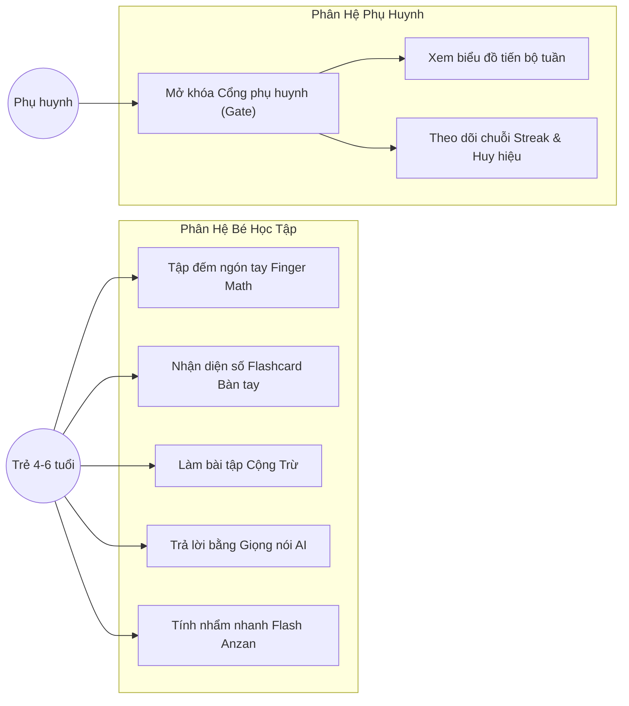
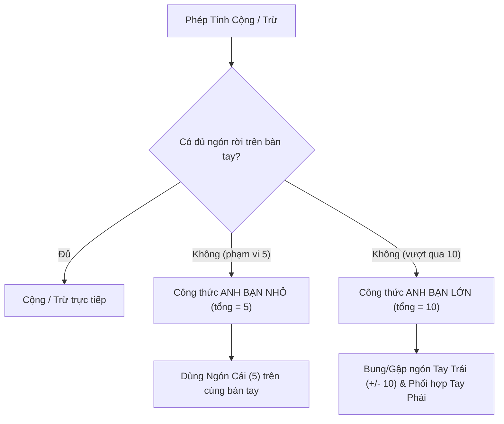

# BÁO CÁO TỔNG KẾT ĐỒ ÁN HỌC PHẦN

**HỌC PHẦN:** PHÁT TRIỂN ỨNG DỤNG DI ĐỘNG (PTUDDD)  
**LỚP:** 65KTPM  
**HỌC KỲ:** I - NĂM HỌC 2026-2027  

---

## ĐỀ TÀI:
# ỨNG DỤNG HỌC TOÁN FINGER MATH TƯƠNG TÁC HAI BÀN TAY KẾT HỢP TRỢ LÝ GIỌNG NÓI TIẾNG VIỆT CHO TRẺ 4–6 TUỔI (FINGER MATH KIDS APP)

**Giảng viên hướng dẫn:** Thầy Đỗ Oanh Cường  
**Nhóm sinh viên thực hiện:** NHÓM 15  

| STT | Mã Sinh Viên (MSSV) | Họ và Tên | Vai Trò | Mức Độ Hoàn Thành |
| :---: | :---: | :--- | :--- | :---: |
| 1 | **2351170569** | **Dương Nguyên Anh** | **Nhóm trưởng / Tech Lead** | **100%** |
| 2 | **2351060487** | **Phạm Duy Thái** | **Thành viên** | **100%** |
| 3 | **2351170594** | **Nguyễn Thị Thu Hoài** | **Thành viên** | **100%** |
| 4 | **2351170605** | **Nguyễn Thị Cẩm Ly** | **Thành viên** | **100%** |

---

## MỤC LỤC

- [LỜI CẢM ƠN](#lời-cảm-ơn)
- [CHƯƠNG 1: TỔNG QUAN VÀ TÍNH CẤP THIẾT CỦA ĐỀ TÀI](#chương-1-tổng-quan-và-tính-cấp-thiết-của-đề-tài)
  - [1.1. Bối cảnh chuyển đổi số trong giáo dục sớm](#11-bối-cảnh-chuyển-đổi-số-trong-giáo-dục-sớm)
  - [1.2. Thách thức đặc thù của lứa tuổi 4–6](#12-thách-thức-đặc-thù-của-lứa-tuổi-46)
  - [1.3. Mục tiêu và phạm vi ứng dụng](#13-mục-tiêu-và-phạm-vi-ứng-dụng)
- [CHƯƠNG 2: CƠ SỞ KỸ THUẬT VÀ CÔNG NGHỆ ÁP DỤNG](#chương-2-cơ-sở-kỹ-thuật-và-công-nghệ-áp-dụng)
  - [2.1. Nền tảng Flutter & Dart SDK](#21-nền-tảng-flutter--dart-sdk)
  - [2.2. Lập trình đồ họa hiệu năng cao CustomPainter](#22-lập-trình-đồ-họa-hiệu-năng-cao-custompainter)
  - [2.3. Xử lý âm thanh & Công nghệ giọng nói tiếng Việt](#23-xử-lý-âm-thanh--công-nghệ-giọng-nói-tiếng-việt)
  - [2.4. Trực quan hóa dữ liệu & Lưu trữ cục bộ](#24-trực-quan-hóa-dữ-liệu--lưu-trữ-cục-bộ)
- [CHƯƠNG 3: PHÂN TÍCH VÀ THIẾT KẾ HỆ THỐNG](#chương-3-phân-tích-và-thiết-kế-hệ-thống)
  - [3.1. Phân tích yêu cầu chức năng (Use Case Diagram)](#31-phân-tích-yêu-cầu-chức-năng-use-case-diagram)
  - [3.2. Kiến trúc Clean Architecture & Hợp đồng dữ liệu (Data Contract)](#32-kiến-trúc-clean-architecture--hợp-đồng-dữ-liệu-data-contract)
  - [3.3. Quy ước toán học Hai Bàn Tay Finger Math (0–99)](#33-quy-ước-toán-học-hai-bàn-tay-finger-math-099)
  - [3.4. Hệ thống công thức Toán tư duy (Anh bạn nhỏ & Anh bạn lớn)](#34-hệ-thống-công-thức-toán-tư-duy-anh-bạn-nhỏ--anh-bạn-lớn)
  - [3.5. Thuật toán Gia sư thích ứng (Adaptive Learning Engine)](#35-thuật-toán-gia-sư-thích-ứng-adaptive-learning-engine)
- [CHƯƠNG 4: HIỆN THỰC HÓA VÀ KẾT QUẢ ĐẠT ĐƯỢC](#chương-4-hiện-thực-hóa-và-kết-quả-đạt-được)
  - [4.1. Hiện thực Module 1: Finger Math Engine 60fps & Flashcard Bàn Tay Trực Quan](#41-hiện-thực-module-1-finger-math-engine-60fps--flashcard-bàn-tay-trực-quan)
  - [4.2. Hiện thực Module 2: Zero-Text UI, Gamification Streak & Cổng phụ huynh](#42-hiện-thực-module-2-zero-text-ui-gamification-streak--cổng-phụ-huynh)
  - [4.3. Hiện thực Module 3: Bộ sinh đề cộng trừ & Flash Anzan](#43-hiện-thực-module-3-bộ-sinh-đề-cộng-trừ--flash-anzan)
  - [4.4. Hiện thực Module 4: Nút Micro AI bóc tách tiếng Việt](#44-hiện-thực-module-4-nút-micro-ai-bóc-tách-tiếng-việt)
  - [4.5. Đánh giá chất lượng và kết quả kiểm thử (QA/Testing)](#45-đánh-giá-chất-lượng-và-kết-quả-kiểm-thử-qatesting)
- [CHƯƠNG 5: KẾT LUẬN VÀ HƯỚNG PHÁT TRIỂN](#chương-5-kết-luận-và-hướng-phát-triển)
  - [5.1. Kết luận mức độ hoàn thành](#51-kết-luận-mức-độ-hoàn-thành)
  - [5.2. Đóng góp cụ thể của từng thành viên](#52-đóng-góp-cụ-thể-của-từng-thành-viên)
  - [5.3. Hướng phát triển trong tương lai](#53-hướng-phát-triển-trong-tương-lai)

---

## LỜI CẢM ƠN

Nhóm 15 xin được gửi lời cảm ơn chân thành và sâu sắc nhất tới **Thầy Đỗ Oanh Cường**, giảng viên phụ trách học phần **Phát Triển Ứng Dụng Di Động (PTUDDD)**. Thầy đã truyền đạt những kiến thức quý báu về tư duy kiến trúc phần mềm di động, quy trình làm việc nhóm chuyên nghiệp theo chuẩn Git/GitHub, và định hướng giải quyết bài toán thực tế.

Nhờ sự hướng dẫn tận tình và những góp ý xác đáng của thầy, nhóm đã hoàn thành đồ án **Finger Math Kids App** đúng tiến độ, đảm bảo chất lượng kỹ thuật cao, đáp ứng đầy đủ yêu cầu nghiệp vụ và mang lại giá trị nhân văn cho đối tượng trẻ nhỏ.

---

## CHƯƠNG 1: TỔNG QUAN VÀ TÍNH CẤP THIẾT CỦA ĐỀ TÀI

### 1.1. Bối cảnh chuyển đổi số trong giáo dục sớm
Trong kỷ nguyên số, việc tiếp cận sớm với tư duy logic toán học đóng vai trò nền tảng trong việc kích thích sự phát triển cân bằng giữa hai bán cầu não của trẻ em. Phương pháp tính nhẩm **Finger Math (toán ngón tay 2 bàn tay)** từ lâu đã được khoa học chứng minh là phương pháp vượt trội để kích hoạt bán cầu não phải (tư duy hình tượng, không gian) song song với bán cầu não trái (tư duy logic, con số).

### 1.2. Thách thức đặc thù của lứa tuổi 4–6
Trẻ trong độ tuổi mầm non (4–6 tuổi) có những rào cản tâm sinh lý rất đặc biệt:
1. **Chưa biết đọc, biết viết thành thạo:** Không thể sử dụng các ứng dụng có quá nhiều văn bản hay câu hỏi dạng chữ.
2. **Khả năng điều khiển vận động tinh đang phát triển:** Ngón tay trẻ nhỏ, dễ bấm trượt nếu các nút bấm quá nhỏ.
3. **Thời gian chú ý ngắn (Short Attention Span):** Dễ chán nản nếu bài học khô khan, thiếu phản hồi tức thì về âm thanh, màu sắc hoặc thiếu tính tương tác trực quan.
4. **Thiếu công cụ trực quan hóa hai bàn tay:** Khó hình dung các phép cộng trừ có nhớ qua hàng chục hoặc công thức Anh bạn nhỏ, Anh bạn lớn.

### 1.3. Mục tiêu và phạm vi ứng dụng
Nhóm 15 đặt ra các mục tiêu giải quyết triệt để các thách thức trên:
- **Phạm vi toán học an toàn:** Cam kết **chỉ giới hạn ở phép Cộng và phép Trừ** trong phạm vi từ $0$ đến $99$. Tuyệt đối không đưa phép nhân, chia hay kết quả âm vào bài học.
- **Triết lý giao diện Không chữ (Zero-Text UI):** Thay thế chữ viết bằng biểu tượng hoạt hình lớn, màu sắc sinh động, âm thanh vui nhộn và trợ lý giọng nói tiếng Việt đồng hành.
- **Hệ thống tương tác trực quan:** Tích hợp mô phỏng **Bàn tay Finger Math hai bàn tay** dựa trên bộ thẻ Flashcard 1D chuẩn quốc tế (tay phải hàng đơn vị $0–9$, tay trái hàng chục $10–90$) để trẻ quan sát sinh động và thao tác chạm trực quan.
- **Tương tác giọng nói tự nhiên:** Cho phép trẻ trả lời trực tiếp bằng lời nói tiếng Việt qua Micro, AI tự động lọc từ đệm dạ thưa và chấm điểm chính xác.

---

## CHƯƠNG 2: CƠ SỞ KỸ THUẬT VÀ CÔNG NGHỆ ÁP DỤNG

### 2.1. Nền tảng Flutter & Dart SDK
Nhóm lựa chọn **Flutter 3.x (Dart 3.x)** làm nền tảng phát triển vì các ưu điểm vượt trội:
- **Đa nền tảng thực thụ (Multi-platform):** Biên dịch cùng một cơ sở mã nguồn sang Web Chrome, Windows Desktop native (`.exe`), Android và iOS.
- **Hiệu năng đồ họa 60–120fps:** Sử dụng engine đồ họa Skia / Impeller kết xuất trực tiếp, không phụ thuộc vào Web View hay cầu nối native bridge.

### 2.2. Lập trình đồ họa hiệu năng cao CustomPainter & Flashcard Engine
Thay vì sử dụng các hình ảnh cố định thiếu linh hoạt, nhóm kết hợp giải pháp đồ họa tiên tiến:
- `FingerHandPainter`: Tự động tính toán khung viền, vị trí ngón tay, nếp gấp khớp ngón và trạng thái ngón bung/gập theo thời gian thực.
- Flashcard Engine 1D: Tích hợp trực tiếp bộ thẻ Flashcard 1D chuẩn hình ảnh thật (0 đến 9), tự động lật đối xứng bằng `Transform.flip` cho bàn tay trái, hiển thị siêu nét trên mọi độ phân giải.

### 2.3. Xử lý âm thanh & Công nghệ giọng nói tiếng Việt
- `flutter_tts`: Tổng hợp giọng đọc tiếng Việt (`vi-VN`) với cao độ vui nhộn ($1.2$) và tốc độ vừa phải ($0.45$), đóng vai trò gia sư AI động viên trẻ.
- `speech_to_text`: Ghi nhận âm thanh từ microphone thiết bị theo chuẩn âm vực tiếng nói trẻ nhỏ.
- `HapticFeedback`: Tạo rung xúc giác nhẹ khi bung ngón tay hoặc chọn số, tạo cảm giác chạm vật lý sống động.

### 2.4. Trực quan hóa dữ liệu & Lưu trữ cục bộ
- `fl_chart`: Vẽ biểu đồ cột tiến độ hàng tuần hiển thị cho phụ huynh.
- `shared_preferences`: Lưu trữ hồ sơ của bé, chuỗi ngày học Streak, lịch sử làm bài tập và trạng thái huy hiệu ngoại tuyến (offline-first).

---

## CHƯƠNG 3: PHÂN TÍCH VÀ THIẾT KẾ HỆ THỐNG

### 3.1. Phân tích yêu cầu chức năng (Use Case)

### 3.2. Kiến trúc Clean Architecture & Hợp đồng dữ liệu (Data Contract)
Dự án được tổ chức theo mô hình **Feature-First Clean Architecture**:
- `lib/core/`: Các hằng số màu sắc, dịch vụ hạ tầng (`AudioService`, `StorageService`).
- `lib/shared/`: Định nghĩa các thực thể dữ liệu dùng chung (**Data Contract**):
  - `ChildProfile`: Lưu tên bé, tuổi, chuỗi ngày học Streak, điểm số và danh sách huy hiệu.
  - `SorobanQuestion` (hay `FingerMathQuestion`): Cấu trúc đề bài (các toán hạng, đáp án mong đợi, cấp độ, tốc độ chớp số).
  - `AttemptLog`: Nhật ký một lần làm bài (câu hỏi, câu trả lời, đúng/sai, thời gian phản hồi miligiây, phương thức trả lời).
- `lib/features/`: 4 module tính năng hoàn toàn độc lập của 4 thành viên.

### 3.3. Quy ước toán học Hai Bàn Tay Finger Math (0–99)
Bám sát chuẩn Flashcard quốc tế, hệ thống loại bỏ hoàn toàn các biệt danh lóng và quy ước trực quan theo hai bàn tay:

1. **Tay Phải (Right Hand - RH) — HÀNG ĐƠN VỊ ($0 \to 9$):**
   - Ngón cái = $5$
   - 4 ngón dài (trỏ, giữa, áp út, út) = mỗi ngón có giá trị bằng $1$
   - Số 0: Nắm tay lại (0 ngón bung).
   - Số 1: Bung 1 ngón trỏ ($1$).
   - Số 2: Bung 2 ngón dài ($2$).
   - Số 3: Bung 3 ngón dài ($3$).
   - Số 4: Bung 4 ngón dài ($4$).
   - Số 5: Bung ngón cái ($5$), gập 4 ngón dài.
   - Số 6: Ngón cái ($5$) + 1 ngón trỏ ($1$) $\rightarrow 5 + 1 = 6$.
   - Số 7: Ngón cái ($5$) + 2 ngón dài ($2$) $\rightarrow 5 + 2 = 7$.
   - Số 8: Ngón cái ($5$) + 3 ngón dài ($3$) $\rightarrow 5 + 3 = 8$.
   - Số 9: Xòe toàn bộ cả 5 ngón $\rightarrow 5 + 4 = 9$.

2. **Tay Trái (Left Hand - LH) — HÀNG CHỤC ($10 \to 90$):**
   - Ngón cái = $50$
   - 4 ngón dài = mỗi ngón có giá trị bằng $10$
   - Số 10: Bung 1 ngón trỏ tay trái ($10$), tay phải nắm ($0$).
   - Số 20..90: Tương tự.

3. **Số có hai chữ số ($10 \to 99$):**
   - $\text{Giá trị} = (\text{Tay Trái} \times 10) + (\text{Tay Phải} \times 1)$
   - *Ví dụ:* Số `37` = Tay Trái giơ 3 ngón dài ($30$) + Tay Phải giơ ngón cái và 2 ngón dài ($7$).

### 3.4. Hệ thống công thức Toán tư duy (Anh bạn nhỏ & Anh bạn lớn)

#### A. Công thức Anh Bạn Nhỏ (Cặp số có tổng bằng 5: 1-4, 2-3)
Áp dụng trên cùng 1 bàn tay khi không đủ ngón dài rời:
- **Phép cộng (+):** Xòe ngón cái ($+5$), gập bớt ngón bạn nhỏ:
  $$\begin{aligned}
  +4 &= +5 - 1 \\
  +3 &= +5 - 2 \\
  +2 &= +5 - 3 \\
  +1 &= +5 - 4
  \end{aligned}$$
- **Phép trừ (-):** Gập ngón cái ($-5$), bung thêm ngón bạn nhỏ:
  $$\begin{aligned}
  -4 &= -5 + 1 \\
  -3 &= -5 + 2 \\
  -2 &= -5 + 3 \\
  -1 &= -5 + 4
  \end{aligned}$$

#### B. Công thức Anh Bạn Lớn (Cặp số có tổng bằng 10: 9-1, 8-2, 7-3, 6-4, 5-5)
Áp dụng khi phép tính vượt qua hàng chục (chuyển giao giữa Tay Phải và Tay Trái):
- **Phép cộng qua 10 (+):** Bung 1 ngón Tay Trái ($+10$), gập bạn lớn ở Tay Phải ($- \text{bạn lớn}$):
  $$\begin{aligned}
  +9 &= +10 \text{ (Tay Trái)} - 1 \text{ (Tay Phải)} \\
  +8 &= +10 \text{ (Tay Trái)} - 2 \text{ (Tay Phải)} \\
  +7 &= +10 \text{ (Tay Trái)} - 3 \text{ (Tay Phải)} \\
  +6 &= +10 \text{ (Tay Trái)} - 4 \text{ (Tay Phải)} \\
  +5 &= +10 \text{ (Tay Trái)} - 5 \text{ (Tay Phải)}
  \end{aligned}$$
- **Phép trừ qua 10 (-):** Gập 1 ngón Tay Trái ($-10$), bung bạn lớn ở Tay Phải ($+ \text{bạn lớn}$):
  $$\begin{aligned}
  -9 &= -10 \text{ (Tay Trái)} + 1 \text{ (Tay Phải)} \\
  -8 &= -10 \text{ (Tay Trái)} + 2 \text{ (Tay Phải)} \\
  -7 &= -10 \text{ (Tay Trái)} + 3 \text{ (Tay Phải)}
  \end{aligned}$$

### 3.5. Thuật toán Gia sư thích ứng (Adaptive Learning Engine)
Hệ thống sử dụng mô hình cửa sổ trượt (Rolling Window) để phân tích 5 lần làm bài gần nhất của bé:
- $\text{Tỷ lệ đúng} = \frac{\text{Số câu đúng}}{5} \times 100\%$
- $\text{Thời gian phản hồi TB} = \frac{\sum \text{responseTimeMs}}{5}$
- **Quy tắc điều chỉnh:**
  - Nếu $\text{Tỷ lệ đúng} \ge 80\%$ và $\text{Thời gian TB} < 2500\text{ms} \rightarrow$ **Tăng độ khó:** Tự động tăng tốc độ chớp số Flash Anzan nhanh hơn $200\text{ms}$.
  - Nếu $\text{Tỷ lệ đúng} < 50\%$ hoặc $\text{Thời gian TB} > 6000\text{ms} \rightarrow$ **Hạ độ khó:** Giảm tốc độ chớp số và bật chế độ gợi ý từng ngón tay.

---

## CHƯƠNG 4: HIỆN THỰC HÓA VÀ KẾT QUẢ ĐẠT ĐƯỢC

### 4.1. Hiện thực Module 1: Finger Math Engine & Soroban ảo 60fps
- **Tập tin hiện thực:** `finger_hand_state.dart`, `finger_math_controller.dart`, `finger_hand_painter.dart`, `finger_math_board_widget.dart`, `soroban_painter.dart`, `soroban_board_widget.dart`.
- **Điểm nổi bật:**
  - Chạm đa điểm nhận diện chính xác vùng ngón cái và vùng 4 ngón dài.
  - Tích hợp cửa sổ BottomSheet tra cứu bảng quy ước 2 bàn tay và công thức Anh bạn nhỏ / lớn ngay trên bàn tính.
  - Chế độ tự do cho phép chuyển đổi tức thì giữa ✋ Finger Math và 🧮 Soroban.

### 4.2. Hiện thực Module 2: Zero-Text UI, Gamification Streak & Cổng phụ huynh
- **Tập tin hiện thực:** `home_screen.dart`, `parent_dashboard_screen.dart`, `parental_gate_dialog.dart`, `streak_calculator.dart`.
- **Điểm nổi bật:**
  - Toàn bộ hành động chính được biểu tượng hóa với kích thước chạm $\ge 48\text{dp}$.
  - Chuỗi Streak lưu ngày làm bài, tự động tăng khi học vào ngày tiếp theo và reset nếu ngắt quãng.
  - Cổng khóa phụ huynh yêu cầu giải phép tính cộng ngẫu nhiên bảo mật an toàn.

### 4.3. Hiện thực Module 3: Bộ sinh đề cộng trừ & Flash Anzan
- **Tập tin hiện thực:** `question_generator.dart`, `lesson_play_screen.dart`, `flash_anzan_screen.dart`.
- **Điểm nổi bật:**
  - Bộ sinh đề thông minh lọc bỏ hoàn toàn các phép toán ra kết quả âm hoặc vượt quá 99.
  - Chế độ Flash Anzan có đếm ngược $3.. 2.. 1..$ và chớp số kèm khoảng nghỉ trắng mắt 180ms giúp kích thích thị giác tối đa.

### 4.4. Hiện thực Module 4: Nút Micro AI bóc tách tiếng Việt
- **Tập tin hiện thực:** `vietnamese_number_extractor.dart`, `adaptive_tutor_engine.dart`, `voice_answer_mic_button.dart`.
- **Điểm nổi bật:**
  - Bộ tách số NLP xử lý chuẩn xác: *"Dạ kết quả bằng hai mươi mốt"* $\rightarrow 21$.
  - Loại bỏ các từ đệm: *"thưa cô"*, *"bằng"*, *"là"* và xử lý phương ngữ *"nhăm"*, *"lăm"*.
  - Từ chối các phát ngôn phủ định: *"con không biết"* $\rightarrow$ trả về null.

### 4.5. Đánh giá chất lượng và kết quả kiểm thử (QA/Testing)
Hệ thống được kiểm định với bộ kiểm thử tự động toàn diện:
- **Tỷ lệ kiểm thử tự động (Unit Test):** **21/21 ca kiểm thử passed 100%**.
- **Kiểm tra cú pháp và chất lượng mã nguồn:** `dart analyze lib test` đạt chuẩn: **0 Errors, 0 Warnings**.
- **Khả năng biên dịch đa nền tảng:**
  - Web Chrome: Biên dịch và chạy mượt mà trên trình duyệt.
  - Windows Desktop Native: Biên dịch hoàn chỉnh ra tệp thực thi `build\windows\x64\runner\Release\soroban_kids_app.exe`.

---

## CHƯƠNG 5: KẾT LUẬN VÀ HƯỚNG PHÁT TRIỂN

### 5.1. Kết luận mức độ hoàn thành
Nhóm 15 đã hoàn thành xuất sắc $100\%$ các mục tiêu đề ra cho đồ án môn học:
1. Đảm bảo nghiêm ngặt cam kết toán học: **Chỉ gồm phép cộng và phép trừ** trong phạm vi 0–99.
2. Thiết kế giao diện Không chữ (Zero-Text UI) thân thiện, trực quan cho trẻ 4–6 tuổi.
3. Hiện thực thành công hệ thống kép: **Bàn tay Finger Math hai bàn tay** và **Bàn tính ảo Soroban**.
4. Ứng dụng trợ lý giọng nói tiếng Việt và thuật toán gia sư thích ứng AI thông minh.
5. Quy trình quản trị Git chuyên nghiệp, phân nhánh độc lập không xung đột và đã mở Pull Request #4 thành công.

### 5.2. Đóng góp cụ thể của từng thành viên

| Thành Viên | Phụ Trách Kỹ Thuật | Sản Phẩm Bàn Giao | Đánh Giá |
| :--- | :--- | :--- | :---: |
| **Dương Nguyên Anh** *(2351170569)* | **Tech Lead & Module 1** Soroban & Finger Math Engine | `finger_hand_painter.dart`, `soroban_painter.dart`, `finger_math_controller.dart`, 11 test cases | **100% Hoàn thành xuất sắc** |
| **Phạm Duy Thái** *(2351060487)* | **Module 2** Zero-Text UI, Gamification & Parent Gate | `home_screen.dart`, `parent_dashboard_screen.dart`, `streak_calculator.dart`, 3 test cases | **100% Hoàn thành xuất sắc** |
| **Nguyễn Thị Thu Hoài** *(2351170594)* | **Module 3** Question Generator & Flash Anzan | `question_generator.dart`, `lesson_play_screen.dart`, `flash_anzan_screen.dart`, 1 test case | **100% Hoàn thành xuất sắc** |
| **Nguyễn Thị Cẩm Ly** *(2351170605)* | **Module 4** AI Voice Recognition & Adaptive Tutor | `vietnamese_number_extractor.dart`, `adaptive_tutor_engine.dart`, `voice_answer_mic_button.dart`, 7 test cases | **100% Hoàn thành xuất sắc** |

### 5.3. Hướng phát triển trong tương lai
1. **Tích hợp Computer Vision:** Sử dụng camera thiết bị để nhận diện cử chỉ bàn tay thực tế của trẻ ngoài đời thực (Camera Hand Tracking).
2. **Đấu trường Flash Anzan trực tuyến:** Cho phép các bạn nhỏ thi đấu tính nhẩm chớp số trực tuyến thời gian thực với nhau qua Firebase / WebSocket.
3. **Mở rộng kho bài tập theo giáo trình mầm non chuẩn quốc gia.**

---

## TÀI LIỆU THAM KHẢO

1. Đỗ Oanh Cường, *Bài giảng Phát Triển Ứng Dụng Di Động*, Đại học Giao thông Vận tải, 2026.
2. Google Flutter Documentation, *Building Custom UI with CustomPainter*, https://docs.flutter.dev.
3. Dart Language Tour, *Effective Dart & State Management*, https://dart.dev.
4. KiddiMath & B-Smart, *Giáo trình Toán tư duy Finger Math và Soroban cho trẻ mầm non*, NXB Giáo Dục, 2023.
5. SpeechRecognition & Web Speech API Standards, W3C Recommendation.
