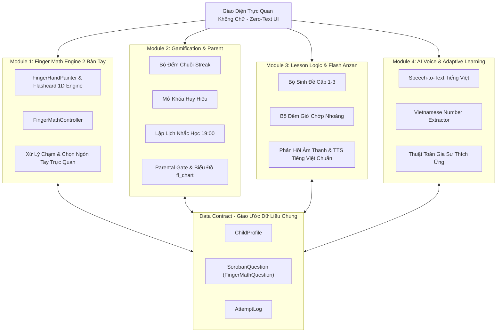

# Đặc Tả Kiến Trúc Hệ Thống (System Architecture Specification)

Dự án: **Finger Math Kids App**  
Nhóm: **Nhóm 15 - Lớp 65KTPM**

---

## 1. Sơ Đồ Kiến Trúc Tổng Thể (System Architecture)

---

## 2. Giao Ước Dữ Liệu Cốt Lõi (Data Contract)

> **Lưu ý nghiệp vụ:** Toàn bộ hệ thống được thiết kế **chỉ giới hạn ở phép Cộng và phép Trừ** (phù hợp với lứa tuổi 4–6 tuổi). Tuyệt đối không sinh phép nhân hay chia. Mọi phép toán đều đảm bảo kết quả không âm ($0 \le \text{kết quả} \le 99$) để bé thao tác chính xác trên 2 bàn tay Finger Math.

Để 4 thành viên phát triển độc lập không bị xung đột, các lớp dữ liệu cốt lõi được định nghĩa sẵn trong `lib/shared/entities/`:

### 2.1. `ChildProfile`
- `id`: Mã định danh bé.
- `name`: Tên bé.
- `age`: Độ tuổi (4 - 6).
- `streakCount`: Số ngày duy trì chuỗi học tập liên tiếp.
- `lastActiveDate`: Ngày hoạt động gần nhất để tính streak.
- `unlockedBadgeIds`: Danh sách ID các huy hiệu bé đã đạt được.
- `currentLevel`: Cấp độ hiện tại (1: Nhận diện, 2: Anh bạn nhỏ/lớn, 3: Flash Anzan).

### 2.2. `SorobanQuestion`
- `id`: Mã câu hỏi.
- `level`: Cấp độ bài toán (1, 2, 3).
- `operands`: Danh sách các số hạng trong phép tính (ví dụ: `[2, 3, -1]`).
- `expectedAnswer`: Kết quả chính xác.
- `displayType`: Dạng câu hỏi (`recognition`, `formula`, `flashAnzan`).
- `flashSpeedMs`: Tốc độ hiển thị mỗi số trong chế độ Flash Anzan (500ms - 2000ms).

### 2.3. `AttemptLog`
- `questionId`: Mã câu hỏi tương ứng.
- `userAnswer`: Kết quả bé trả lời (nhập qua bàn tính hoặc qua giọng nói).
- `isCorrect`: Đúng hay sai.
- `responseTimeMs`: Thời gian phản hồi (mili-giây).
- `answeredVia`: Phương thức trả lời (`voice` hoặc `abacus_touch`).
- `timestamp`: Thời điểm thực hiện.

---

## 3. Kiến Trúc Đồ Họa Tương Tác Finger Math (Finger Math Engine)

Hệ thống mô phỏng trực quan theo quy ước **Hai Bàn Tay (Tay Phải - Hàng đơn vị & Tay Trái - Hàng chục)**, không dùng các tên lóng/biệt danh tùy tiện, giúp trẻ 4–6 tuổi nắm vững bản chất toán học:

### 3.1. Quy ước Bàn Tay Phải (Hàng đơn vị: 0 đến 9)
- **Số 0:** Tay phải nắm lại (0 ngón bung).
- **Số 1:** Tay phải bung 1 ngón trỏ (giá trị = 1).
- **Số 2:** Tay phải bung 2 ngón (trỏ + giữa) (giá trị = 2).
- **Số 3:** Tay phải bung 3 ngón (trỏ + giữa + áp út) (giá trị = 3).
- **Số 4:** Tay phải bung 4 ngón dài (trỏ, giữa, áp út, út), ngón cái gập (giá trị = 4).
- **Số 5:** Tay phải bung **ngón cái (giá trị = 5)**, 4 ngón dài gập lại.
- **Số 6:** Tay phải bung **ngón cái (5) + 1 ngón trỏ (1)** $\rightarrow 5 + 1 = 6$.
- **Số 7:** Tay phải bung **ngón cái (5) + 2 ngón (trỏ + giữa)** $\rightarrow 5 + 2 = 7$.
- **Số 8:** Tay phải bung **ngón cái (5) + 3 ngón dài** $\rightarrow 5 + 3 = 8$.
- **Số 9:** Tay phải bung toàn bộ **5 ngón** $\rightarrow 5 + 4 = 9$.

### 3.2. Quy ước Bàn Tay Trái (Hàng chục: 10 đến 90)
- **Số 0 (tròn chục):** Tay trái nắm lại.
- **Số 10:** Tay trái bung 1 ngón trỏ (giá trị = 10).
- **Số 20:** Tay trái bung 2 ngón dài (giá trị = 20).
- **Số 30:** Tay trái bung 3 ngón dài (giá trị = 30).
- **Số 40:** Tay trái bung 4 ngón dài (giá trị = 40).
- **Số 50:** Tay trái bung **ngón cái (giá trị = 50)**, 4 ngón dài gập.
- **Số 60:** Tay trái bung **ngón cái (50) + 1 ngón trỏ (10)** $\rightarrow 50 + 10 = 60$.
- **Số 70:** Tay trái bung **ngón cái (50) + 2 ngón dài (20)** $\rightarrow 50 + 20 = 70$.
- **Số 80:** Tay trái bung **ngón cái (50) + 3 ngón dài (30)** $\rightarrow 50 + 30 = 80$.
- **Số 90:** Tay trái bung toàn bộ **5 ngón** $\rightarrow 50 + 40 = 90$.

### 3.3. Phối hợp 2 bàn tay biểu diễn số 2 chữ số (10 đến 99)
- **Nguyên tắc:** `Giá trị = (Tay Trái × 10) + (Tay Phải × 1)`
- **Ví dụ:**
  - Số `37` = Tay Trái giơ 3 ngón dài (30) + Tay Phải giơ ngón cái và 2 ngón dài (7).
  - Số `68` = Tay Trái giơ ngón cái và 1 ngón dài (60) + Tay Phải giơ ngón cái và 3 ngón dài (8).
  - Số `99` = Toàn bộ 10 ngón tay của cả 2 bàn tay đều xòe.

### 3.4. Áp dụng các công thức Toán tư duy Finger Math
#### a. Công thức Anh Bạn Nhỏ (Cặp số có tổng bằng 5: 1-4, 2-3, 3-2, 4-1)
Áp dụng khi cộng/trừ trong phạm vi 5 trên cùng một bàn tay (hàng đơn vị ở Tay Phải hoặc hàng chục ở Tay Trái) khi không đủ ngón dài rời rạc:
- **Phép cộng (+): Thêm ngón cái (5), gập bớt ngón bạn nhỏ:**
  - $+4 = +5 - 1$ (Xòe ngón cái 5, gập 1 ngón dài)
  - $+3 = +5 - 2$ (Xòe ngón cái 5, gập 2 ngón dài)
  - $+2 = +5 - 3$ (Xòe ngón cái 5, gập 3 ngón dài)
  - $+1 = +5 - 4$ (Xòe ngón cái 5, gập 4 ngón dài)
- **Phép trừ (-): Gập bớt ngón cái (5), bung thêm ngón bạn nhỏ:**
  - $-4 = -5 + 1$ (Gập ngón cái 5, bung 1 ngón dài)
  - $-3 = -5 + 2$ (Gập ngón cái 5, bung 2 ngón dài)
  - $-2 = -5 + 3$ (Gập ngón cái 5, bung 3 ngón dài)
  - $-1 = -5 + 4$ (Gập ngón cái 5, bung 4 ngón dài)

#### b. Công thức Anh Bạn Lớn (Cặp số có tổng bằng 10: 9-1, 8-2, 7-3, 6-4, 5-5)
Áp dụng khi cộng/trừ chuyển giao giữa Tay Phải (hàng đơn vị) và Tay Trái (hàng chục):
- **Phép cộng qua 10 (+): Bung 1 ngón ở Tay Trái (+10), gập bớt ngón bạn lớn ở Tay Phải (- bạn lớn):**
  - $+9 = +10 \text{ (Tay Trái)} - 1 \text{ (Tay Phải)}$
  - $+8 = +10 \text{ (Tay Trái)} - 2 \text{ (Tay Phải)}$
  - $+7 = +10 \text{ (Tay Trái)} - 3 \text{ (Tay Phải)}$
  - $+6 = +10 \text{ (Tay Trái)} - 4 \text{ (Tay Phải)}$
  - $+5 = +10 \text{ (Tay Trái)} - 5 \text{ (Tay Phải)}$
- **Phép trừ qua 10 (-): Gập 1 ngón ở Tay Trái (-10), bung thêm ngón bạn lớn ở Tay Phải (+ bạn lớn):**
  - $-9 = -10 \text{ (Tay Trái)} + 1 \text{ (Tay Phải)}$
  - $-8 = -10 \text{ (Tay Trái)} + 2 \text{ (Tay Phải)}$
  - $-7 = -10 \text{ (Tay Trái)} + 3 \text{ (Tay Phải)}$
  - $-6 = -10 \text{ (Tay Trái)} + 4 \text{ (Tay Phải)}$
  - $-5 = -10 \text{ (Tay Trái)} + 5 \text{ (Tay Phải)}$

---

## 4. Xử Lý Giọng Nói & Thuật Toán AI Tiếng Việt

### 4.1. Bộ bóc tách số tiếng Việt (Vietnamese Number Extractor)
Trẻ 4-6 tuổi thường trả lời kèm đại từ xưng hô hoặc từ dạ thưa:
- Câu nói: *"Dạ thưa cô kết quả bằng mười lăm ạ"* $\rightarrow$ lọc bỏ từ đệm $\rightarrow$ trích xuất: `15`.
- Câu nói: *"Bằng hai mươi mốt"* $\rightarrow$ trích xuất: `21`.
- Câu nói: *"Số năm"* $\rightarrow$ trích xuất: `5`.

### 4.2. Thuật toán Gia sư thích ứng (Adaptive Learning)
Hệ thống tính điểm trượt (Rolling Evaluation) trên 5 câu hỏi gần nhất:
- **Tăng độ khó:** Nếu tỷ lệ đúng $\ge 80\%$ và thời gian phản hồi trung bình $< 2.5$ giây:
  - Tự động tăng số lượng phép tính hoặc giảm tốc độ chớp số Flash Anzan thêm 200ms.
- **Hạ độ khó / Trợ giúp:** Nếu tỷ lệ đúng $< 50\%$ hoặc thời gian phản hồi liên tục $> 6$ giây:
  - Tự động chuyển về bài tập hướng dẫn trực quan (Highlight từng hạt cần gảy) và động viên bé bằng lời nói.
