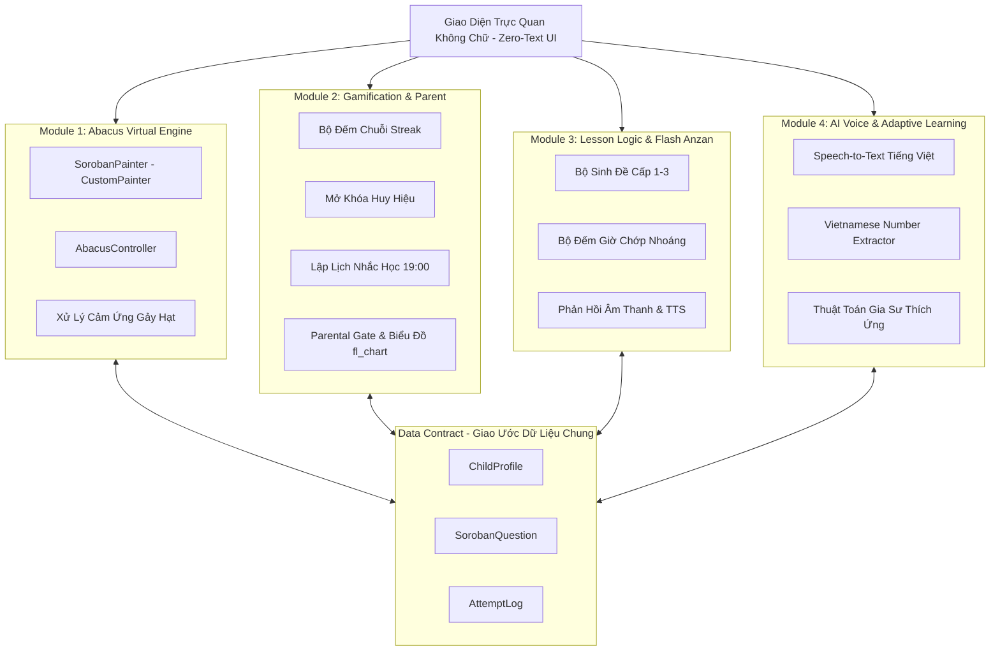

# Đặc Tả Kiến Trúc Hệ Thống (System Architecture Specification)

Dự án: **Soroban Kids App**  
Nhóm: **Nhóm 15 - Lớp 65KTPM**

---

## 1. Sơ Đồ Kiến Trúc Tổng Thể (System Architecture)

---

## 2. Giao Ước Dữ Liệu Cốt Lõi (Data Contract)

> **Lưu ý nghiệp vụ:** Toàn bộ hệ thống được thiết kế **chỉ giới hạn ở phép Cộng và phép Trừ** (phù hợp với lứa tuổi 4–6 tuổi). Tuyệt đối không sinh phép nhân hay chia. Mọi phép toán đều đảm bảo kết quả không âm ($0 \le \text{kết quả} \le 99$) để bé thao tác chính xác trên bàn tính ảo.

Để 4 thành viên phát triển độc lập không bị xung đột, các lớp dữ liệu cốt lõi được định nghĩa sẵn trong `lib/shared/entities/`:

### 2.1. `ChildProfile`
- `id`: Mã định danh bé.
- `name`: Tên bé.
- `age`: Độ tuổi (4 - 6).
- `streakCount`: Số ngày duy trì chuỗi học tập liên tiếp.
- `lastActiveDate`: Ngày hoạt động gần nhất để tính streak.
- `unlockedBadgeIds`: Danh sách ID các huy hiệu bé đã đạt được.
- `currentLevel`: Cấp độ hiện tại (1: Nhận diện, 2: Anh bạn nhỏ/lớn, 3: Flash Anzan).

### 2.2. `SorobanQuestion`
- `id`: Mã câu hỏi.
- `level`: Cấp độ bài toán (1, 2, 3).
- `operands`: Danh sách các số hạng trong phép tính (ví dụ: `[2, 3, -1]`).
- `expectedAnswer`: Kết quả chính xác.
- `displayType`: Dạng câu hỏi (`recognition`, `formula`, `flashAnzan`).
- `flashSpeedMs`: Tốc độ hiển thị mỗi số trong chế độ Flash Anzan (500ms - 2000ms).

### 2.3. `AttemptLog`
- `questionId`: Mã câu hỏi tương ứng.
- `userAnswer`: Kết quả bé trả lời (nhập qua bàn tính hoặc qua giọng nói).
- `isCorrect`: Đúng hay sai.
- `responseTimeMs`: Thời gian phản hồi (mili-giây).
- `answeredVia`: Phương thức trả lời (`voice` hoặc `abacus_touch`).
- `timestamp`: Thời điểm thực hiện.

---

## 3. Kiến Trúc Bàn Tính Ảo Soroban (Abacus Engine)

- **Cấu trúc 1 cột Soroban chuẩn:**
  - **Thanh xà ngang (Beam):** Phân chia hạt trên và hạt dưới.
  - **Hạt trên (Upper Deck):** 1 hạt (giá trị = 5). Khi kéo xuống sát thanh xà ngang $\rightarrow$ hạt kích hoạt (+5).
  - **Hạt dưới (Lower Deck):** 4 hạt (mỗi hạt giá trị = 1). Khi đẩy lên sát thanh xà ngang $\rightarrow$ hạt kích hoạt (+1 mỗi hạt).
- **Cơ chế CustomPainter & HitTest:**
  - Tối ưu hóa render 60fps bằng `CustomPainter`.
  - Phân vùng cảm ứng theo trục tung ($Y$) và trục hoành ($X$) tương ứng từng cột hạt.
  - Tích hợp hiệu ứng âm thanh gảy hạt "tách" và rung phản hồi (Haptic Feedback) khi hạt chạm xà ngang.

---

## 4. Xử Lý Giọng Nói & Thuật Toán AI Tiếng Việt

### 4.1. Bộ bóc tách số tiếng Việt (Vietnamese Number Extractor)
Trẻ 4-6 tuổi thường trả lời kèm đại từ xưng hô hoặc từ dạ thưa:
- Câu nói: *"Dạ thưa cô kết quả bằng mười lăm ạ"* $\rightarrow$ lọc bỏ từ đệm $\rightarrow$ trích xuất: `15`.
- Câu nói: *"Bằng hai mươi mốt"* $\rightarrow$ trích xuất: `21`.
- Câu nói: *"Số năm"* $\rightarrow$ trích xuất: `5`.

### 4.2. Thuật toán Gia sư thích ứng (Adaptive Learning)
Hệ thống tính điểm trượt (Rolling Evaluation) trên 5 câu hỏi gần nhất:
- **Tăng độ khó:** Nếu tỷ lệ đúng $\ge 80\%$ và thời gian phản hồi trung bình $< 2.5$ giây:
  - Tự động tăng số lượng phép tính hoặc giảm tốc độ chớp số Flash Anzan thêm 200ms.
- **Hạ độ khó / Trợ giúp:** Nếu tỷ lệ đúng $< 50\%$ hoặc thời gian phản hồi liên tục $> 6$ giây:
  - Tự động chuyển về bài tập hướng dẫn trực quan (Highlight từng hạt cần gảy) và động viên bé bằng lời nói.
