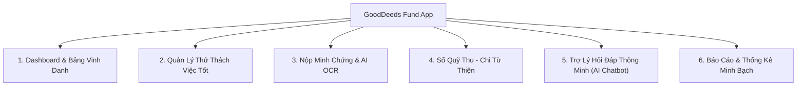
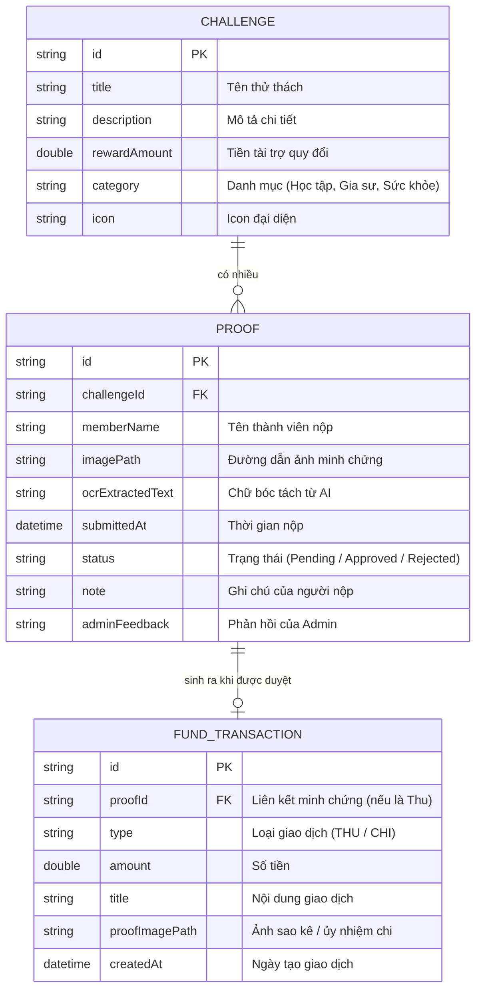

# BÁO CÁO THỰC HÀNH 4 (TH4): XÂY DỰNG ĐỀ CƯƠNG PROJECT CUỐI KỲ
## HỌC PHẦN: PHÁT TRIỂN ỨNG DỤNG DI ĐỘNG (PTUDDD)

---

* **Học viện / Trường:** Khoa Công Nghệ Thông Tin  
* **Lớp học phần / Lớp sinh hoạt:** 65KTPM  
* **Nhóm thực hiện:** Nhóm 16  
* **Giảng viên hướng dẫn:** TS. Đỗ Oanh Cường  
* **Tên đề tài Project:** **GoodDeeds Fund - Ứng Dụng Quản Lý Thử Thách Việc Tốt & Quỹ Từ Thiện**  
* **Nền tảng công nghệ:** Flutter & Dart Framework (Cross-platform)  

---

## 👥 THÔNG TIN NHÓM THỰC HIỆN

| STT | Họ và Tên | Mã Sinh Viên | Lớp Sinh Hoạt | Vai Trò | Nhiệm Vụ Đảm Nhiệm Chính |
|:---:|:---|:---:|:---:|:---:|:---|
| 1 | **Nguyễn Văn Huỳnh** | **2351170599** | 65KTPM | **Trưởng nhóm** | Kiến trúc tổng thể, Dashboard tổng quan quỹ, Module Thử thách & Trợ lý Hỏi đáp AI Chatbot |
| 2 | **Lê Anh Tuấn** | **2151060296** | 65KTPM | **Thành viên** | Thiết kế Cơ sở dữ liệu SQLite/Hive & Module Sổ Quỹ Thu - Chi Từ Thiện (Phiếu chi, chứng từ) |
| 3 | **NGUYỄN TRUNG KIÊN** | **2251172394** | 65KTPM | **Thành viên** | Module Nộp minh chứng (Camera) & Tích hợp AI OCR (Google ML Kit đọc thời gian/chữ trên ảnh) |
| 4 | **Trần Anh Tuấn** | **2351170629** | 65KTPM | **Thành viên** | Module Báo cáo & Thống kê minh bạch tài chính (`fl_chart`), Màn hình Duyệt minh chứng Admin |

---

# PHẦN 1: TỔNG HỢP CÁC ỨNG DỤNG ĐÃ PHÂN TÍCH, THIẾT KẾ TRONG HỌC KỲ

Trong quá trình học tập và thực hành các bài tập tuần môn Phát triển ứng dụng di động, nhóm đã nghiên cứu và phân tích thiết kế 3 ý tưởng ứng dụng:

### 1. Ứng dụng Quản lý Chi tiêu Cá nhân (Personal Expense Tracker)
* **Mô tả:** Ứng dụng ghi chép thu - chi hằng ngày, phân loại danh mục (ăn uống, mua sắm...), biểu đồ chi tiêu và quản lý hạn mức ngân sách.
* **Ưu điểm:** Nghiệp vụ CRUD cơ bản quen thuộc, dễ tiếp cận với sinh viên mới học Flutter.
* **Nhược điểm & Hạn chế:** Bài toán quá phổ biến, dễ gây nhàm chán; nghiệp vụ mở rộng quá rộng (nhiều ví, đa tiền tệ, đồng bộ tài khoản ngân hàng phức tạp); thiếu tính tương tác xã hội và điểm nhấn sáng tạo.

### 2. Ứng dụng Quản lý Công việc & Tập trung (Task & Focus Tracker - Pomodoro)
* **Mô tả:** Kết hợp Todo list chia theo thẻ Kanban và đồng hồ đếm ngược Pomodoro hỗ trợ học tập, làm việc tập trung.
* **Ưu điểm:** Giao diện trực quan, dễ xây dựng hiệu ứng Animation và Timer trong Flutter.
* **Nhược điểm:** Tính năng mang tính cá nhân cục bộ, cơ sở dữ liệu đơn giản, ít đất diễn cho các tính năng nâng cao như AI hay xử lý hình ảnh thực tế.

### 3. Ứng dụng Quản lý Thử thách Việc tốt & Quỹ Từ thiện (GoodDeeds Fund)
* **Mô tả:** Kết hợp giữa việc rèn luyện thói quen tốt cá nhân (dậy sớm, dạy học gia sư trẻ em, rèn luyện tư duy toán học) với việc gây quỹ từ thiện dựa trên nguồn tài trợ từ các nhà hảo tâm. Mỗi hành động có minh chứng được duyệt sẽ kích hoạt một khoản tiền đóng góp vào quỹ chung và giải ngân minh bạch có sao kê.
* **Ưu điểm vượt trội:**
  * Tính nhân văn và ý nghĩa thực tiễn cao, gắn liền với đời sống sinh viên.
  * Tích hợp công nghệ hiện đại: **AI OCR (Google ML Kit)** đọc chữ/giờ trên ảnh check-in và **AI Chatbot** trợ lý hỏi đáp thể lệ.
  * Giới hạn phạm vi chuẩn xác cho đồ án môn học (Mini Project 3-4 tuần): không vướng mắc thủ tục pháp lý cổng thanh toán ngân hàng thật mà tập trung trọn vẹn vào trải nghiệm người dùng, xác thực minh chứng và minh bạch tài chính.

---

# PHẦN 2: LỰA CHỌN ỨNG DỤNG CHO PROJECT CUỐI KỲ

Nhóm 16 quyết định lựa chọn đề tài: **GoodDeeds Fund - Ứng Dụng Quản Lý Thử Thách Việc Tốt & Quỹ Từ Thiện**.

### Lý do lựa chọn:
1. **Tính độc đáo & Tính xã hội:** Khác biệt hoàn toàn so với các ứng dụng Todo hay Thu-chi thông thường. Dự án tạo ra động lực thực sự: "Hành động tốt của bạn hôm nay mang lại kinh phí giúp đỡ người khó khăn ngày mai".
2. **Khả năng áp dụng kiến thức toàn diện:** Đề tài bao quát trọn vẹn các chuẩn đầu ra của học phần:
   * Thiết kế giao diện hiện đại Material 3, Navigation, Form validation.
   * Quản lý trạng thái (State Management) đa màn hình.
   * Quản trị dữ liệu cục bộ bền vững (Local Database: SQLite / Hive).
   * Tương tác phần cứng di động: Camera, Thư viện ảnh, File System.
   * Ứng dụng Trí tuệ nhân tạo (AI): OCR Text Recognition và AI Assistant.
   * Trực quan hóa dữ liệu tài chính với biểu đồ tương tác (`fl_chart`).
3. **Tính khả thi và phù hợp thời lượng:** Được tinh gọn tối ưu cho quy mô Mini Project, đảm bảo nhóm hoàn thiện đúng hạn với chất lượng sản phẩm cao nhất.

---

# PHẦN 3: ĐỀ CƯƠNG CHI TIẾT PROJECT CUỐI KỲ

## 1. MỤC TIÊU DỰ ÁN (PROJECT OBJECTIVES)

* **Mục tiêu học thuật:**
  * Nắm vững kiến trúc phát triển ứng dụng di động chuẩn công nghiệp (**Feature-First / Clean Architecture**).
  * Thành thạo quy trình cộng tác mã nguồn chuyên nghiệp bằng Git/GitHub (Branching strategy, Pull Request review).
  * Làm chủ việc tích hợp các thư viện AI On-Device và xử lý biểu đồ trên Flutter.
* **Mục tiêu sản phẩm:**
  * Xây dựng ứng dụng di động hoàn chỉnh, chạy mượt mà trên nền tảng Android (và mở rộng trên iOS / Windows).
  * Cung cấp giải pháp minh bạch, tự động hóa quy trình ghi nhận thử thách và điều phối quỹ từ thiện cho các câu lạc bộ, nhóm sinh viên hoặc tổ chức thiện nguyện.

---

## 2. PHẠM VI DỰ ÁN (PROJECT SCOPE)

### 2.1. Phạm vi thực hiện (In-Scope)
* **Nền tảng:** Ứng dụng di động phát triển bằng Flutter SDK 3.x+.
* **Đối tượng sử dụng:**
  * *Thành viên (User):* Tham gia thử thách việc tốt, chụp ảnh nộp minh chứng, xem tiến độ quỹ, tra cứu thông tin với Trợ lý AI.
  * *Quản trị viên / Trưởng nhóm (Admin):* Tạo thử thách, duyệt/từ chối minh chứng, lập phiếu giải ngân từ thiện kèm chứng từ chuyển khoản.
* **Cơ chế lưu trữ:** Cơ sở dữ liệu Offline (SQLite / Hive), đảm bảo ứng dụng hoạt động ổn định không phụ thuộc mạng.
* **Xác thực AI:** Tích hợp mô hình OCR trên máy (On-Device ML Kit) không tốn chi phí server.

### 2.2. Giới hạn phạm vi (Out-of-Scope)
* Không tích hợp cổng thanh toán trực tuyến tiền thật (VNPay, MoMo SDK) để tránh phức tạp về pháp lý và bảo mật thanh toán ngân hàng trong phạm vi bài tập lớn.
* Số dư quỹ được vận hành dựa trên cơ chế ghi nhận cam kết tài trợ và phiếu giải ngân có bằng chứng hình ảnh (ủy nhiệm chi, sao kê chuyển khoản thực tế đính kèm).

---

## 3. DANH SÁCH CÁC PHÂN HỆ VÀ CHỨC NĂNG CHÍNH



### 🔹 Phân hệ 1: Dashboard Tổng quan & Bảng vinh danh (Huỳnh phụ trách)
* **Tổng quan quỹ:** Hiển thị số dư quỹ hiện tại, tổng tiền đã gây quỹ được, tổng tiền đã giải ngân.
* **Thanh tiến độ chiến dịch:** Thể hiện % mục tiêu gây quỹ đạt được (vd: 5.000.000đ / 10.000.000đ).
* **Bảng vinh danh (Leaderboard):** Xếp hạng các thành viên tích cực nhất dựa trên số lượng thử thách hoàn thành.
* **Danh sách thử thách nổi bật:** Hiển thị thẻ thử thách đang diễn ra kèm định mức tiền tài trợ.

### 🔹 Phân hệ 2: Quản lý Thử thách Việc tốt (Huỳnh phụ trách)
* **Danh mục thử thách:** Xem danh sách việc tốt (Dậy sớm học bài trước 6h, Gia sư dạy học trẻ em, Rèn luyện tư duy toán học, Chạy bộ thể thao...).
* **Chi tiết thử thách:** Xem mô tả chi tiết, tiêu chuẩn ảnh minh chứng hợp lệ, số tiền tài trợ quy đổi (10.000đ, 20.000đ...).
* **Thêm mới / Cập nhật thử thách:** Dành cho Trưởng nhóm tạo các thử thách mới cho chiến dịch.

### 🔹 Phân hệ 3: Nộp & Xác thực Minh chứng có AI OCR (Kiên phụ trách)
* **Chụp & Tải ảnh minh chứng:** Tích hợp Camera trực tiếp và Thư viện ảnh (`image_picker`).
* **Trí tuệ nhân tạo (AI OCR):** Sử dụng `google_mlkit_text_recognition` tự động đọc chữ và thời gian hiển thị trên ảnh check-in (ví dụ: giờ chụp trên đồng hồ bàn học, chữ trên bài tập toán, giáo án).
* **Kiểm tra sơ bộ:** Hỗ trợ người dùng tự động điền mốc thời gian và cảnh báo nếu ảnh chụp quá mờ hoặc thiếu chi tiết.
* **Gửi duyệt:** Đính kèm ghi chú, gửi yêu cầu xác nhận về hàng đợi của Quản trị viên.

### 🔹 Phân hệ 4: Sổ Quỹ Thu - Chi Từ Thiện (Lê Anh Tuấn phụ trách)
* **Ghi nhận Thu tự động:** Khi Admin duyệt minh chứng thành công, hệ thống tự động sinh giao dịch Thu tương ứng vào quỹ.
* **Lập phiếu Chi (Giải ngân từ thiện):**
  * Nhập thông tin: Số tiền chi, Mục đích giúp đỡ, Người/Đơn vị thụ hưởng, Ngày chi.
  * **Chứng từ đính kèm:** Bắt buộc chụp/tải ảnh ủy nhiệm chi hoặc sao kê chuyển khoản từ thiện.
* **Lịch sử giao dịch quỹ:** Hiển thị toàn bộ dòng tiền vào - ra kèm bộ lọc (Lọc theo Thu/Chi, lọc theo mốc thời gian).

### 🔹 Phân hệ 5: Trợ lý Hỏi Đáp Thông Minh (AI Chatbot) (Huỳnh phụ trách)
* **Giao diện trò chuyện dạng Message:** Chat trực quan, hỗ trợ gợi ý các câu hỏi nhanh.
* **Hỏi đáp thể lệ:** Hướng dẫn quy tắc tham gia từng thử thách, tiêu chí ảnh chụp thế nào được duyệt.
* **Tra cứu số liệu:** Hỏi đáp nhanh thông tin quỹ: *"Quỹ hiện có bao nhiêu tiền?"*, *"Các đợt từ thiện gần nhất đã chi cho ai?"*.
* **Cơ chế xử lý:** Kết hợp bộ dữ liệu tri thức nội bộ (Knowledge Base FAQ) và cơ chế phản hồi thông minh.

### 🔹 Phân hệ 6: Báo cáo Thống kê & Kiểm duyệt Admin (Trần Anh Tuấn phụ trách)
* **Màn hình Kiểm duyệt Admin (Review Flow):**
  * Danh sách minh chứng chờ duyệt.
  * Xem phóng to ảnh minh chứng, thời gian nộp, gợi ý từ AI OCR.
  * Thao tác 1 chạm: **Duyệt (Kích hoạt cộng tiền vào quỹ)** hoặc **Từ chối (kèm lý do)**.
* **Trực quan hóa tài chính (`fl_chart`):**
  * Biểu đồ tròn: Tỷ trọng nguồn tiền gây quỹ theo từng loại thử thách.
  * Biểu đồ cột / đường: Biến động số dư quỹ và dòng tiền thu - chi theo tuần / tháng.
* **Tiện ích:** Cài đặt thông tin tài khoản, chuyển chế độ sáng/tối (Dark Mode).

---

## 4. THIẾT KẾ KIẾN TRÚC & DỮ LIỆU

### 4.1. Kiến trúc ứng dụng (Feature-First Architecture)
```text
nhom16-65ktpm/src/lib/
├── core/                   # Cấu hình chung, Themes, Utils, Base Widgets
├── data/                   # SQLite/Hive Database Helper, Local Storage
├── features/
│   ├── dashboard/          # Giao diện chính, Leaderboard
│   ├── challenges/         # Nghiệp vụ Thử thách
│   ├── proof_submission/   # Chụp ảnh, AI OCR Scanner
│   ├── fund_ledger/        # Sổ quỹ Thu - Chi, Phiếu giải ngân
│   ├── chatbot/            # Trợ lý hỏi đáp AI
│   ├── admin_review/       # Màn hình duyệt minh chứng
│   └── analytics/          # Biểu đồ báo cáo fl_chart
└── main.dart               # Điểm khởi chạy ứng dụng
```

### 4.2. Thiết kế Mô hình Dữ liệu (Entity Relationship)



---

## 5. KẾ HOẠCH THỰC HIỆN & LỘ TRÌNH SPRINT (4 TUẦN)

| Tuần (Sprint) | Mục tiêu chính | Đầu việc các thành viên | Kết quả bàn giao (Deliverables) |
|:---:|:---|:---|:---|
| **Sprint 1**<br>*(Tuần 1)* | **Khởi tạo kiến trúc & Cơ sở dữ liệu** | • **Huỳnh:** Dựng khung ứng dụng Feature-First, Theme, Navigation.<br>• **L.A.Tuấn:** Thiết kế Database SQLite/Hive, viết Helper & Models.<br>• **Kiên:** Cấu hình Camera/Gallery, tích hợp mẫu `google_mlkit`.<br>• **T.A.Tuấn:** Dựng layout mockup biểu đồ và Admin review. | Khung ứng dụng chạy được trên máy; Database cục bộ sẵn sàng CRUD. |
| **Sprint 2**<br>*(Tuần 2)* | **Phát triển Thử thách & Sổ Quỹ Thu Chi** | • **Huỳnh:** Hoàn thiện `DashboardScreen`, `ChallengeListScreen`, dựng UI `ChatbotScreen`.<br>• **L.A.Tuấn:** Hoàn thiện CRUD Sổ Quỹ Thu - Chi, tạo phiếu giải ngân.<br>• **Kiên:** Hoàn thiện màn hình chụp ảnh & lưu trữ minh chứng cục bộ.<br>• **T.A.Tuấn:** Hoàn thiện danh sách minh chứng cần duyệt của Admin. | Xem được danh sách thử thách; Nhập được phiếu chi kèm ảnh sao kê. |
| **Sprint 3**<br>*(Tuần 3)* | **Tích hợp AI OCR, Tự động hóa duyệt & Chatbot** | • **Kiên:** Tích hợp AI OCR tự động trích xuất chữ/giờ từ ảnh check-in.<br>• **T.A.Tuấn:** Hoàn thiện cơ chế 1 chạm Duyệt / Từ chối minh chứng.<br>• **L.A.Tuấn:** Xử lý tự động sinh phiếu Thu vào Quỹ khi minh chứng được duyệt.<br>• **Huỳnh:** Hoàn thiện logic Trợ lý AI trả lời câu hỏi tự động. | Luồng nghiệp vụ cốt lõi thông suốt: Nộp ảnh ➔ AI đọc ➔ Duyệt ➔ Tăng quỹ. |
| **Sprint 4**<br>*(Tuần 4)* | **Biểu đồ tài chính, Tối ưu hóa & Đóng gói** | • **T.A.Tuấn:** Kết nối số liệu quỹ vào biểu đồ `fl_chart`; soạn báo cáo.<br>• **Huỳnh:** Kiểm thử tích hợp tổng thể, tối ưu UI/UX, rà soát chuẩn Git.<br>• **L.A.Tuấn:** Kiểm thử toàn vẹn dữ liệu quỹ (Thu - Chi = Số dư).<br>• **Kiên:** Tối ưu hóa xử lý ảnh, nén ảnh chống tràn bộ nhớ. | Ứng dụng hoàn thiện 100%, sẵn sàng báo cáo và nghiệm thu đồ án. |

---

## 6. QUẢN TRỊ RỦI RO VÀ GIẢI PHÁP KỸ THUẬT

1. **Rủi ro ảnh chụp dung lượng lớn làm chậm ứng dụng:**
   * *Giải pháp:* Sử dụng cơ chế nén ảnh (resize & compress image) trước khi lưu vào bộ nhớ máy.
2. **Rủi ro AI OCR nhận diện sai khi ảnh chụp thiếu sáng hoặc mờ:**
   * *Giải pháp:* AI đóng vai trò **hỗ trợ trích xuất sơ bộ**; giao diện luôn cho phép người dùng kiểm tra lại thông tin và quyền quyết định phê duyệt cuối cùng thuộc về Admin.
3. **Rủi ro xung đột mã nguồn khi nhiều thành viên cùng làm việc:**
   * *Giải pháp:* Tuân thủ nghiêm ngặt quy tắc phân nhánh của nhóm (`feature/nhom16/...`), chỉ làm việc trong thư mục `nhom16-65ktpm/src/` và luôn chạy `git pull` trước khi code.

---

## 7. TIÊU CHÍ ĐÁNH GIÁ VÀ NGHIỆM THU PROJECT (ACCEPTANCE CRITERIA)

* [x] Đầy đủ cấu trúc thư mục quy chuẩn: `danhsachnhom.md`, `README.md`, `PHAN_CHIA_CONG_VIEC.md`, `DE_CUONG_PROJECT_CUOI_KY.md`, `src/`.
* [x] Ứng dụng chạy mượt mà, không gặp lỗi crash (Zero-error runtime).
* [x] Hoàn thiện 100% các phân hệ: Dashboard, Thử thách, Nộp minh chứng AI OCR, Sổ quỹ Thu - Chi, Trợ lý hỏi đáp AI Chatbot, Biểu đồ thống kê.
* [x] Giao diện người dùng chuẩn Material 3, hỗ trợ cả Light Mode và Dark Mode.
* [x] Báo cáo đồ án đầy đủ, trình bày mạch lạc, logic và đúng tiến độ.
