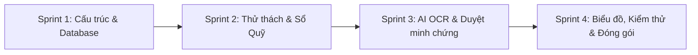

# 📋 Kế Hoạch Phân Chia Công Việc & Lộ Trình Triển Khai Dự Án

> **Môn học:** Lập trình Thiết bị Di động (Mobile Application Development)  
> **Dự án:** Ứng Dụng Quản Lý Thử Thách Việc Tốt & Quỹ Từ Thiện (GoodDeeds Fund)  
> **Nhóm thực hiện:** Nhóm 16 - Lớp 65KTPM  
> **Nền tảng:** Flutter (Cross-platform Android / iOS / Desktop)  

---

## 👥 1. Bảng phân công nhiệm vụ chi tiết theo thành viên

| STT | MSSV | Họ và tên | Vai trò | Nhiệm vụ chính phụ trách | Module & Deliverables (Sản phẩm bàn giao) | Nhánh Git đề xuất |
|:---:|:---:|:---|:---:|:---|:---|:---|
| **1** | **2351170599** | **Nguyễn Văn Huỳnh** | **Nhóm trưởng** (Team Lead / Core Architecture) | • Khởi tạo bộ khung dự án Flutter (Feature-First Architecture) tại thư mục `src/`. • Cấu hình State Management (`Provider`/`Bloc`), Theme chung (Light/Dark Mode). • Xây dựng màn hình **Dashboard / Home Screen**: Tổng tiền quỹ hiện có, tiến độ mục tiêu chiến dịch, thống kê thử thách hoàn thành, bảng vinh danh (Leaderboard). • Xây dựng module **Quản lý Thử thách (Challenge Management)**: Danh sách thử thách, chi tiết thử thách, quy tắc định mức tiền tài trợ. • Xây dựng module **Trợ lý Hỏi Đáp Thông Minh (AI Q&A Chatbot Screen & Assistant Service)**: Giải đáp quy chế thử thách, hướng dẫn nộp minh chứng và tra cứu số dư quỹ. • Quản trị dự án: Điều phối tiến độ, code review, kiểm thử tích hợp. | • Khung ứng dụng & Navigation Flow. • `DashboardScreen`, `ChallengeListScreen`, `ChallengeDetailScreen`. • `ChatbotScreen` & `QaAssistantService`. • Core Theme, Base Widgets. • Điều phối chung và nộp bài. | `feature/nhom16/core-setup` `feature/nhom16/dashboard` `feature/nhom16/challenge-module` `feature/nhom16/ai-chatbot` |
| **2** | **2151060296** | **Lê Anh Tuấn** | **Thành viên** (Database & Fund Ledger) | • Thiết kế cấu trúc cơ sở dữ liệu ngoại tuyến (**SQLite / Hive**) cho toàn bộ hệ thống. • Định nghĩa Data Models: `ChallengeModel`, `ProofModel`, `FundTransactionModel`. • Xây dựng nghiệp vụ **Sổ Quỹ Thu - Chi Từ Thiện (Charity Fund Ledger)**: &emsp;+ Ghi nhận Thu: Tự động cộng tiền tài trợ khi minh chứng được duyệt. &emsp;+ Ghi nhận Chi: Form lập phiếu giải ngân từ thiện kèm đính kèm ảnh chứng từ/sao kê. • Xây dựng màn hình **Lịch sử giao dịch quỹ** và bộ lọc (theo loại Thu/Chi, theo khoảng thời gian). | • `DatabaseHelper` & Models. • `FundRepository`, `FundTransactionModel`. • `FundLedgerScreen`, `DisbursementFormScreen` (Phiếu chi). • Bộ lọc lịch sử quỹ. | `feature/nhom16/local-database` `feature/nhom16/fund-ledger` `feature/nhom16/disbursement` |
| **3** | **2251172394** | **NGUYỄN TRUNG KIÊN** | **Thành viên** (AI OCR & Proof Submission) | • Tích hợp `image_picker` và `camera` để chụp ảnh hoặc chọn ảnh minh chứng thực tế. • Tích hợp thư viện AI **`google_mlkit_text_recognition`** (Text Recognition OCR). • Xây dựng module **Nộp minh chứng (Proof Submission)**: Form chụp ảnh, nhập ghi chú, tự động gắn mốc thời gian và vị trí. • Thuật toán AI: Tự động đọc chữ/giờ trên ảnh check-in để hỗ trợ xác thực sơ bộ tính trung thực của minh chứng. • Xử lý nén ảnh và lưu trữ file ảnh minh chứng cục bộ an toàn. | • `ProofSubmissionScreen`. • `MlKitOcrService` (Nhận diện văn bản trên ảnh). • Logic kiểm tra giờ dậy sớm/thời gian check-in từ ảnh. | `feature/nhom16/proof-submission` `feature/nhom16/ai-ocr` |
| **4** | **2351170629** | **Trần Anh Tuấn** | **Thành viên** (Analytics & Admin Review) | • Tích hợp thư viện **`fl_chart`** xây dựng màn hình **Báo cáo & Thống kê minh bạch quỹ**: &emsp;+ Biểu đồ đường/cột: Biến động số dư quỹ và dòng tiền thu/chi. &emsp;+ Biểu đồ tròn: Tỷ trọng đóng góp quỹ theo từng loại thử thách (Dậy sớm, Dạy học, v.v.). • Xây dựng màn hình **Duyệt minh chứng (Admin Review Screen)**: Xem danh sách minh chứng chờ duyệt, xem ảnh chi tiết, kết quả AI gợi ý, nút Duyệt (cộng quỹ) hoặc Từ chối kèm lý do. • Màn hình Cài đặt, Thông tin nhóm và xuất báo cáo dữ liệu. | • `AnalyticsScreen` & các widget biểu đồ `fl_chart`. • `AdminReviewScreen` (Duyệt/Từ chối minh chứng). • `SettingsScreen` & Export data module. | `feature/nhom16/analytics-charts` `feature/nhom16/admin-review` `feature/nhom16/settings` |

---

## 📅 2. Lộ trình triển khai dự án (Sprint Milestones)

### 🔹 Sprint 1: Khởi tạo kiến trúc & Thiết kế cơ sở dữ liệu (Tuần 1)
* **Mục tiêu:** Thống nhất mô hình dữ liệu, dựng khung ứng dụng Flutter trong `nhom16-65ktpm/src/`.
* **Phân công cụ thể:**
  * **Nguyễn Văn Huỳnh:** Khởi tạo cấu trúc thư mục Feature-First, cấu hình Navigation/BottomBar, thiết lập theme ứng dụng.
  * **Lê Anh Tuấn:** Thiết kế cấu trúc các bảng/box trong SQLite/Hive (`challenges`, `proofs`, `fund_transactions`).
  * **Nguyễn Trung Kiên:** Cấu hình quyền Camera/Storage trên Android & iOS, tích hợp mẫu `google_mlkit_text_recognition`.
  * **Trần Anh Tuấn:** Cài đặt `fl_chart`, dựng khung màn hình Thống kê và duyệt minh chứng với mock data.

### 🔹 Sprint 2: Phát triển nghiệp vụ Thử thách & Sổ Quỹ Thu Chi (Tuần 2)
* **Mục tiêu:** Hoàn thiện luồng hiển thị thử thách, ghi nhận thu chi quỹ thủ công và giao diện Trợ lý hỏi đáp.
* **Phân công cụ thể:**
  * **Nguyễn Văn Huỳnh:** Hoàn thiện giao diện `DashboardScreen` (hiển thị số dư quỹ, tiến độ, thử thách nổi bật), `ChallengeListScreen`, và dựng khung giao diện `ChatbotScreen`.
  * **Lê Anh Tuấn:** Hoàn thiện logic CRUD cho Sổ Quỹ Thu - Chi (`FundLedgerScreen`), tạo phiếu chi giải ngân từ thiện kèm ảnh chứng từ.
  * **Nguyễn Trung Kiên:** Xây dựng màn hình chụp và xem trước ảnh minh chứng (`ProofSubmissionScreen`), lưu trữ ảnh vào bộ nhớ máy.
  * **Trần Anh Tuấn:** Thiết kế chi tiết giao diện danh sách minh chứng cần duyệt dành cho Admin.

### 🔹 Sprint 3: Tích hợp AI OCR, Quy trình Phê duyệt & Trợ lý Hỏi Đáp (Tuần 3)
* **Mục tiêu:** Kết nối hoàn chỉnh luồng: Thành viên nộp minh chứng ➔ AI đọc thông tin ➔ Admin duyệt ➔ Tự động cộng tiền vào Quỹ, đồng thời hoàn thiện tính năng hỏi đáp thông minh.
* **Phân công cụ thể:**
  * **Nguyễn Văn Huỳnh:** Tích hợp bộ tri thức và logic phản hồi tự động cho `ChatbotScreen` (giải đáp thể lệ, hướng dẫn nộp minh chứng, kiểm tra trạng thái quỹ).
  * **Lê Anh Tuấn:** Viết hàm tự động tạo giao dịch Thu trong Sổ Quỹ khi một minh chứng chuyển sang trạng thái `Approved`.
  * **Nguyễn Trung Kiên:** Hoàn thiện thuật toán AI OCR đọc văn bản trên ảnh check-in (nhận diện giờ đồng hồ, chữ trên bài làm).
  * **Trần Anh Tuấn:** Hoàn thiện màn hình `AdminReviewScreen` với thao tác 1 chạm Duyệt / Từ chối minh chứng.

### 🔹 Sprint 4: Báo cáo biểu đồ, Kiểm thử tích hợp & Hoàn thiện báo cáo (Tuần 4)
* **Mục tiêu:** Vẽ biểu đồ tài chính thực tế, dọn dẹp mã nguồn, đóng gói báo cáo PDF và chuẩn bị nộp bài.
* **Phân công cụ thể:**
  * **Nguyễn Văn Huỳnh:** Kiểm thử toàn bộ ứng dụng, rà soát mã nguồn, đảm bảo tuân thủ 100% .gitignore và cấu trúc thư mục của thầy.
  * **Lê Anh Tuấn:** Kiểm thử tính nhất quán của số dư quỹ (tổng thu - tổng chi), kiểm tra bộ lọc lịch sử.
  * **Nguyễn Trung Kiên:** Tối ưu hóa tốc độ nhận diện ảnh của AI, xử lý các trường hợp ảnh chụp mờ hoặc không có chữ.
  * **Trần Anh Tuấn:** Nối dữ liệu thực tế từ Sổ Quỹ vào biểu đồ `fl_chart` (biểu đồ tròn phân bổ và biểu đồ cột biến động); soạn thảo báo cáo đồ án `docs/baocao_doan.pdf`.

---

## 🔒 3. Quy tắc làm việc trên Git của nhóm
1. **Nhánh làm việc chính của nhóm:** `nhom16-65ktpm` (tuyệt đối không commit lên `main`).
2. **Quy tắc tạo nhánh tính năng cá nhân:** `feature/nhom16/<tinh-nang>`.
3. **Quy tắc thông điệp commit:** `<loại>(nhom16-65ktpm): <mô tả>` (ví dụ: `feat(nhom16-65ktpm): bo sung tinh nang ocr nhan dien anh`).
4. **Phạm vi tác động:** Chỉ thao tác 100% bên trong thư mục `nhom16-65ktpm/`.
