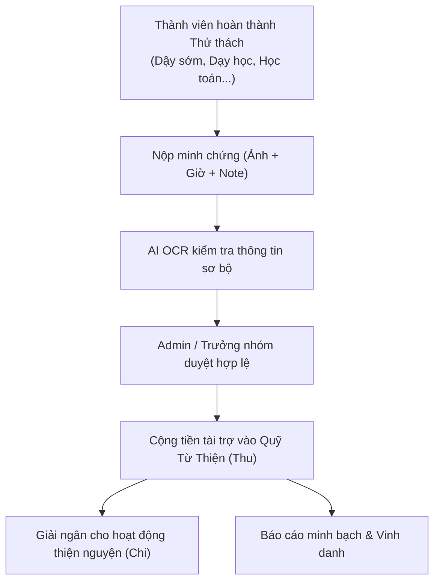

# 🌟 GoodDeeds Fund - Ứng Dụng Quản Lý Thử Thách Việc Tốt & Quỹ Từ Thiện

> **Học phần:** Phát Triển Ứng Dụng Di Động (PTUDDD)  
> **Lớp học phần / Lớp sinh hoạt:** 65KTPM  
> **Nhóm thực hiện:** Nhóm 16  
> **Giảng viên hướng dẫn:** TS. Đỗ Oanh Cường  
> **Nền tảng phát triển:** Flutter (Cross-platform Android / iOS / Desktop)  

---

## 📖 1. Giới thiệu đề tài & Ý tưởng cốt lõi

### 🎯 Ý tưởng đề tài
Trong đời sống sinh viên và cộng đồng, có rất nhiều hành động tích cực mang lại giá trị lớn:
- Dậy sớm trước 6h00 – 7h00 sáng để học tập, rèn luyện tính kỷ luật.
- Dạy học / gia sư miễn phí cho trẻ em có hoàn cảnh khó khăn.
- Rèn luyện tư duy toán học, giải bài tập lập trình hằng ngày.
- Hoạt động tình nguyện, bảo vệ môi trường, rèn luyện thể thao.

**GoodDeeds Fund** ra đời nhằm **kết nối những hành động tích cực đó với nguồn lực tài trợ từ thiện**. Nhà tài trợ / Bên bảo trợ cam kết trích một khoản kinh phí (ví dụ: 10.000đ – 50.000đ cho mỗi lượt hoàn thành hợp lệ) chuyển trực tiếp vào **Quỹ từ thiện chung** của nhóm/tổ chức.

Dựa trên dữ liệu minh chứng xác thực từ ứng dụng, quỹ từ thiện sẽ được tích lũy minh bạch và giải ngân đến các đối tượng cần giúp đỡ (trẻ em vùng cao, bệnh nhi, người già neo đơn...).

---

## 🚀 2. Các phân hệ chức năng chính (Core Features)



### 🏆 1. Phân hệ Thử thách việc tốt (Challenge Module)
- Danh mục thử thách phong phú: *Dậy sớm học bài*, *Gia sư trẻ em*, *Giải toán tư duy*, *Chạy bộ 3km*...
- Mỗi thử thách quy định rõ: Mô tả công việc, định mức tiền tài trợ tương ứng, yêu cầu về ảnh minh chứng.
- Đăng ký tham gia thử thách và theo dõi tiến độ cá nhân.

### 📸 2. Phân hệ Nộp & Xác thực minh chứng (AI-Assisted Proof Module)
- Thành viên chụp ảnh từ Camera hoặc tải ảnh minh chứng thực tế (ảnh chụp bàn học kèm đồng hồ, ảnh lớp dạy học, ảnh bài tập toán...).
- **Tích hợp AI OCR (Google ML Kit Text Recognition):**
  - Tự động trích xuất mốc thời gian và nội dung chữ hiển thị trên ảnh check-in.
  - Hỗ trợ điền nhanh thông tin và kiểm tra sơ bộ tính hợp lệ trước khi gửi phê duyệt.
- Giao diện dành cho Admin/Trưởng nhóm kiểm duyệt (Duyệt hợp lệ ➔ kích hoạt cộng tiền vào quỹ; hoặc Từ chối kèm lý do).

### 💰 3. Phân hệ Sổ Quỹ Thu - Chi Từ Thiện (Charity Fund Ledger)
- **Khoản Thu:**
  - Tự động cộng dồn tiền tài trợ khi một minh chứng được duyệt thành công.
  - Ghi nhận khoản tài trợ trực tiếp từ các nhà hảo tâm.
- **Khoản Chi:**
  - Lập phiếu giải ngân từ thiện (Số tiền, Mục đích giúp đỡ, Người nhận, Ngày chuyển).
  - Bắt buộc đính kèm **ảnh hóa đơn / ủy nhiệm chi / sao kê chuyển khoản** để bảo đảm tính minh bạch 100%.
- Lịch sử biến động quỹ đầy đủ, có bộ lọc theo khoảng thời gian và loại giao dịch.

### 📊 4. Phân hệ Thống kê & Báo cáo minh bạch (Analytics & Transparency)
- Biểu đồ biến động số dư quỹ theo thời gian (sử dụng thư viện `fl_chart`).
- Biểu đồ phân bổ nguồn tiền theo loại thử thách đã hoàn thành.
- Bảng vinh danh thành viên tích cực nhất (Leaderboard).
- Thước đo tiến độ đạt mục tiêu gây quỹ của chiến dịch.

### 🤖 5. Phân hệ Trợ lý Hỏi Đáp Thông Minh (AI Q&A Assistant / Chatbot)
- Giải đáp thắc mắc tự động cho thành viên về: Thể lệ tham gia từng thử thách, quy định chụp ảnh minh chứng hợp lệ, thời gian xét duyệt.
- Hướng dẫn tra cứu thông tin: Số dư quỹ hiện tại, tổng kinh phí đã quyên góp, các đợt giải ngân gần nhất.
- Hỗ trợ trả lời thông minh dựa trên bộ tri thức (Knowledge Base) của dự án và tích hợp API mô hình ngôn ngữ (Gemini API / Rule-based Assistant).

---

## 👥 3. Thành viên nhóm & Phân công vai trò

| STT | Mã Sinh Viên | Họ và Tên | Vai Trò | Nhiệm Vụ Phân Công Chính |
|:---:|:---:|:---|:---:|:---|
| 1 | **2351170599** | **Nguyễn Văn Huỳnh** | **Trưởng nhóm** | • Kiến trúc tổng thể ứng dụng (Feature-First / Clean Architecture).<br>• Xây dựng màn hình **Dashboard tổng quan** (Tổng quỹ, tiến độ chiến dịch, bảng vinh danh).<br>• Module **Quản lý danh mục Thử thách** (Tạo, sửa, hiển thị chi tiết thử thách).<br>• Xây dựng phân hệ **Trợ lý Hỏi Đáp Thông Minh (AI Q&A Chatbot Screen & Assistant Service)**.<br>• Điều phối tiến độ, chuẩn hóa Git, review và tích hợp mã nguồn. |
| 2 | **2151060296** | **Lê Anh Tuấn** | **Thành viên** | • Thiết kế và hiện thực Cơ sở dữ liệu Offline (**SQLite / Hive**).<br>• Module **Sổ Quỹ Thu - Chi Từ Thiện** (Ghi nhận thu từ thử thách thành công, tạo phiếu chi giải ngân từ thiện kèm ảnh chứng từ).<br>• Màn hình **Lịch sử giao dịch quỹ** và bộ lọc tìm kiếm nâng cao. |
| 3 | **2251172394** | **NGUYỄN TRUNG KIÊN** | **Thành viên** | • Xây dựng module **Nộp minh chứng** (Tích hợp Camera, chọn ảnh, gắn mốc thời gian và ghi chú).<br>• Tích hợp thư viện AI **`google_mlkit_text_recognition`** để đọc chữ/thời gian trên ảnh minh chứng check-in.<br>• Thuật toán kiểm tra và tự động điền dữ liệu bóc tách từ ảnh. |
| 4 | **2351170629** | **Trần Anh Tuấn** | **Thành viên** | • Tích hợp thư viện biểu đồ **`fl_chart`** xây dựng màn hình **Báo cáo & Thống kê minh bạch tài chính quỹ**.<br>• Xây dựng giao diện **Kiểm duyệt minh chứng dành cho Admin** (Review & Duyệt/Từ chối minh chứng).<br>• Trang Cài đặt / Hồ sơ cá nhân và xuất báo cáo dữ liệu. |

> 📌 **Chi tiết lộ trình từng tuần (Sprint):** Xem tại [PHAN_CHIA_CONG_VIEC.md](PHAN_CHIA_CONG_VIEC.md).

---

## 🛠️ 4. Công nghệ & Thư viện sử dụng

* **Ngôn ngữ & Framework:** [Flutter](https://flutter.dev/) (SDK 3.x+), [Dart](https://dart.dev/)
* **Kiến trúc:** Feature-First Architecture
* **Cơ sở dữ liệu cục bộ:** [Hive](https://pub.dev/packages/hive) / [sqflite](https://pub.dev/packages/sqflite)
* **Quản lý trạng thái:** Provider / Bloc
* **Trí tuệ nhân tạo (AI):** [google_mlkit_text_recognition](https://pub.dev/packages/google_mlkit_text_recognition) (AI OCR trên thiết bị, hoạt động offline nhanh chóng)
* **Biểu đồ & Thống kê:** [fl_chart](https://pub.dev/packages/fl_chart)
* **Hình ảnh & Media:** `image_picker`, `camera`

---

## 📂 5. Cấu trúc thư mục dự án chuẩn theo yêu cầu giảng viên

```text
nhom16-65ktpm/
├── danhsachnhom.md                 # Tệp bắt buộc: Bảng thành viên & Hướng dẫn chạy
├── README.md                       # Tài liệu tổng quan đề tài & Kiến trúc
├── PHAN_CHIA_CONG_VIEC.md          # Kế hoạch phân công & Lộ trình Sprint
├── docs/                           # Thư mục chứa báo cáo đồ án (PDF/DOCX)
└── src/                            # Toàn bộ mã nguồn ứng dụng Flutter
    ├── lib/
    │   ├── core/                   # Common widgets, theme Material 3, constants
    │   ├── data/                   # Models, SQLite DatabaseHelper, Repositories
    │   ├── features/
    │   │   ├── dashboard/          # Tổng quan quỹ, tiến độ mục tiêu, podium vinh danh
    │   │   ├── challenges/         # Danh mục & chi tiết thử thách việc tốt
    │   │   ├── proof_submission/   # Nộp minh chứng Camera & AI OCR Google ML Kit
    │   │   ├── fund_ledger/        # Sổ quỹ thu chi từ thiện minh bạch
    │   │   ├── analytics/          # Biểu đồ báo cáo minh bạch (fl_chart)
    │   │   ├── admin_review/       # Màn hình duyệt minh chứng kèm badge thông báo
    │   │   └── chatbot/            # Trợ lý Hỏi Đáp AI Chatbot & QaAssistantService
    │   └── main.dart
    ├── pubspec.yaml
    └── ...
```

---

## 🎨 6. Hệ thống thiết kế chuẩn Material 3 (Design System)

* **Phong cách:** Hiện đại, ấm áp, truyền cảm hứng và minh bạch 100%.
* **Bảng màu chủ đạo:**
  * **Primary (Xanh ngọc / Teal - `#0F9D8A`):** Tượng trưng cho sự tin cậy, chính trực và phát triển bền vững.
  * **Accent (Cam ấm - `#FF8A3D`):** Tượng trưng cho lòng nhân ái, dùng cho các nút kêu gọi hành động (CTA) và nút FAB Camera nổi ở giữa.
  * **Màu trạng thái:** Thành công (`#22C55E`), Cảnh báo (`#F59E0B`), Lỗi (`#EF4444`).
  * **Hỗ trợ giao diện:** Light Mode (`#F7FAF9`) và Dark Mode (`#0F172A`).
* **Trải nghiệm điều hướng trung tâm:**
  * **Bottom Navigation Bar 5 tabs:** Trang chủ | Thử thách | **Nút FAB tròn Cam ấm ở giữa (Nộp ảnh)** | Sổ Quỹ | Báo cáo.
  * **Kiểm duyệt Admin:** Nút quản trị trên AppBar kèm **Badge số lượng minh chứng chờ duyệt** lấy dữ liệu thời gian thực từ SQLite.
  * **Trợ lý AI Chatbot:** Tích hợp trực tiếp trên thanh AppBar, hỗ trợ hỏi đáp thể lệ, tra cứu quỹ và hướng dẫn chụp ảnh 24/7.

